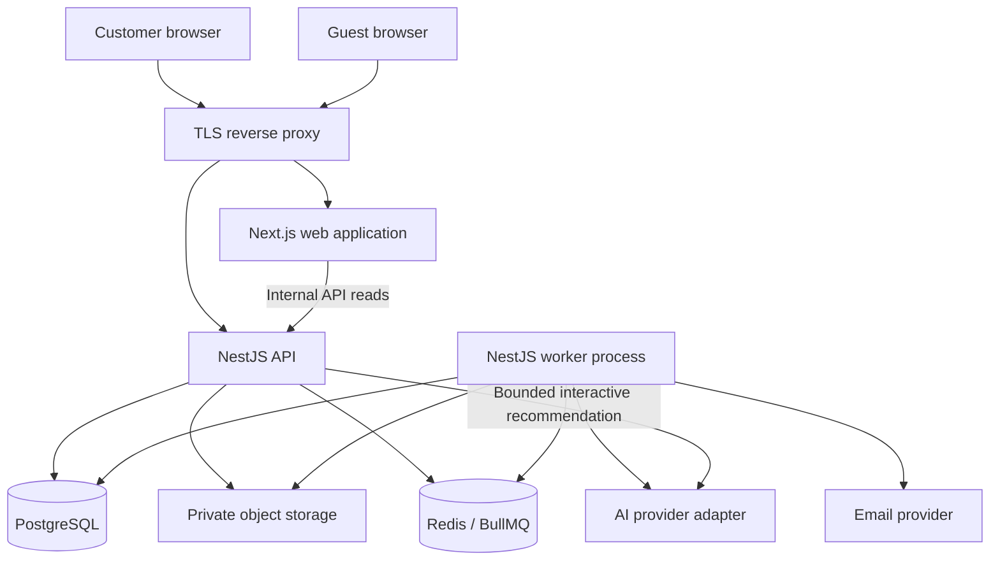
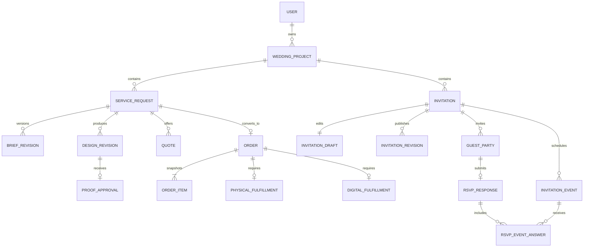
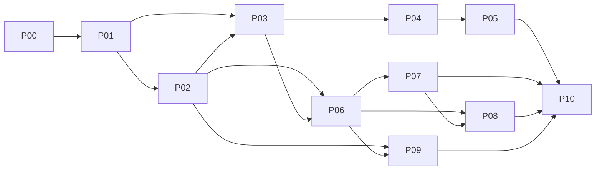

# MORI Wedding Studio - Implementation Plan and Product Specification

> **Status:** Proposed implementation baseline, ready to turn into engineering tickets.  
> **Specification version:** 1.0  
> **Prepared:** 2026-10-31  
> **Language:** English. Product UI is Vietnamese-first, with translation-ready English resources.  
> **Required stack:** Next.js, NestJS, Prisma, PostgreSQL, Docker.  
> **Explicit exclusion:** No payment integration, payment collection, payment status, deposits, refunds, subscriptions, or payment-gated publishing in this release.  
> **Canonical location:** `docs/MORI_PROJECT_PLAN.md` in the application repository.

This is a build specification, not a claim that the application has been implemented, security-audited, load-tested, or approved by a printer. All limits, service objectives, capacity assumptions, and commercial rules marked **proposed** are engineering/product decisions for this project, not facts extracted from the original brief. Code and configuration fragments describe implementation contracts; they are not a complete runnable application.

## Navigation

- [1. Executive decision](#1-executive-decision)
- [2. Source alignment and requirements traceability](#2-source-alignment-and-requirements-traceability)
- [3. Scope, roles, and product rules](#3-scope-roles-and-product-rules)
- [4. Non-negotiable invariants](#4-non-negotiable-invariants)
- [5. End-to-end happy paths](#5-end-to-end-happy-paths)
- [6. State machines and transition guards](#6-state-machines-and-transition-guards)
- [7. Online invitation, sharing, and RSVP specification](#7-online-invitation-sharing-and-rsvp-specification)
- [8. UI and UX specification](#8-ui-and-ux-specification)
- [9. Architecture and repository boundaries](#9-architecture-and-repository-boundaries)
- [10. Data model and persistence specification](#10-data-model-and-persistence-specification)
- [11. API contracts and application security](#11-api-contracts-and-application-security)
- [12. AI consultation and staff assistance](#12-ai-consultation-and-staff-assistance)
- [13. 2D, 3D, proofs, and print production](#13-2d-3d-proofs-and-print-production)
- [14. Media, notifications, and durable background work](#14-media-notifications-and-durable-background-work)
- [15. Privacy, threat model, and moderation](#15-privacy-threat-model-and-moderation)
- [16. Performance, accessibility, SEO, and observability](#16-performance-accessibility-seo-and-observability)
- [17. Docker deployment, CI/CD, and operational runbooks](#17-docker-deployment-cicd-and-operational-runbooks)
- [18. Acceptance test catalogue: happy paths, edge cases, and failures](#18-acceptance-test-catalogue-happy-paths-edge-cases-and-failures)
- [19. Implementation sequence and engineering backlog](#19-implementation-sequence-and-engineering-backlog)
- [20. Complete-release definition and source coverage](#20-complete-release-definition-and-source-coverage)
- [21. Risk register and decisions needed before production](#21-risk-register-and-decisions-needed-before-production)
- [22. Architecture decision records to create](#22-architecture-decision-records-to-create)
- [23. Repository implementation rules](#23-repository-implementation-rules)
- [24. Sources, evidence, and verification notes](#24-sources-evidence-and-verification-notes)

## 1. Executive decision

Build MORI as a **studio-led wedding stationery platform with a self-service digital invitation workspace**, not as a generic shopping cart and not as an AI-first website builder.

The experience has three distinct surfaces:

| Surface | Main purpose | Visual character |
| --- | --- | --- |
| Storefront | Discover physical and digital designs; understand materials; request a design | Editorial, tactile, restrained, premium |
| Customer and studio workspace | Personalize, exchange feedback, approve proofs, place and track orders, manage invitations | Calm, precise, task-focused |
| Guest invitation | Read an invitation, view event details, open directions, respond to RSVP | Personal, immersive, mobile-first, lightweight |

Use one monorepo, one Next.js application, one NestJS modular backend, one PostgreSQL database, and a separate worker process from the same backend codebase. Docker Compose is the initial deployment model. Add Redis/BullMQ for bounded background work, not as the source of business truth. Use S3-compatible object storage for media, not database blobs or container-local uploads.

### 1.1 What a successful first complete release does

A visitor can browse approximately 30 approved designs, use a grounded recommendation assistant or browse without AI, customize a structured brief, work with the studio, inspect 2D and supported 3D previews, approve a specific proof, accept a specific quote while placing an order, and track fulfillment. A verified customer can also create and publish a digital invitation, share its link or QR code with friends and relatives, and manage private RSVP responses. Staff can run the complete workflow without editing the database manually. [B1]

A failed AI provider, email provider, 3D viewer, or background worker must not erase a design, approve a proof, duplicate an order, or expose a private invitation.

### 1.2 Decisions that keep the system practical

- **Modular monolith, not microservices.** Domain boundaries remain explicit without distributed transaction overhead.
- **Structured editors, not a Canva clone.** Customers edit approved fields and sections; staff upload final artwork. Arbitrary positioning, HTML, CSS, and JavaScript are not allowed.
- **Versioned public content and proofs.** A draft is never the public page. An approved proof is never overwritten.
- **One wedding workspace owner in v1.** A partner can view the public invitation, but shared editing and account ownership transfer are deferred.
- **No payment-shaped workflow.** Quotes, order acceptance, and delivery work without a `paid` flag.
- **Two supported paper geometries.** Flat and bi-fold are production scope. Tri-fold is unavailable until a printer-backed manufacturing gate is passed.
- **AI is optional assistance.** The deterministic catalogue, price engine, and staff workflow remain authoritative.

## 2. Source alignment and requirements traceability

### 2.1 Source hierarchy

1. The latest user instruction takes precedence: the named stack, Docker deployment, English documentation, public/shareable online invitations, detailed UI, happy paths and edge cases, and **no payments now**.
2. The original four-page MORI brief supplies the brand, product mix, approximately 30 starting designs, AI assistance, physical-card 3D preview, studio involvement, ordering, and fulfillment requirements.
3. This specification supplies missing operational decisions. These additions must not be misrepresented as text already present in the brief.

The source's page 1 establishes a mid-to-premium, personalized sugarcane-bagasse stationery brand. Page 2 supplies the visual palette and approximately 30-design catalogue objective. Page 3 defines consultation, indicative pricing, customization, proof approval, orders, nationwide shipping from Da Nang, and digital delivery. Page 4 defines flat, bi-fold, conditional tri-fold, and six design-style families. [B1]

### 2.2 Requirement map

| ID | Source requirement | Implementation commitment | Release gate |
| --- | --- | --- | --- |
| BR-01 | MORI brand and premium positioning, p.1 | Brand tokens, editorial storefront, actual material photography | UX review against Section 8 |
| BR-02 | Sugarcane-bagasse physical invitations, pp.1,3 | Material/specification catalogue, print workflow, shipping | Physical end-to-end acceptance |
| BR-03 | Approximately 30 initial designs, p.2 | 30 content-reviewed active catalogue records; no fake live inventory | Catalogue import and content sign-off |
| BR-04 | Classification by shape/style/colour/type, pp.2,4 | Faceted browsing and structured recommendation attributes | Search/filter tests |
| BR-05 | AI preference/budget consultation, pp.2,3 | Grounded recommendations with deterministic fallback | Evaluation suite and outage test |
| BR-06 | Indicative and official pricing, p.3 | Server-side estimate and immutable staff-issued quote | Price/quote consistency tests |
| BR-07 | Template personalization and custom design, p.3 | Structured brief, custom-request intake, assigned staff | Both request paths work |
| BR-08 | AI support for staff, p.3 | Brief summarization, copy suggestions, design-direction suggestions | Staff review required for all outputs |
| BR-09 | 3D paper preview, p.2 | Flat/bi-fold geometries, actual revision textures, 2D fallback | Geometry and visual mapping tests |
| BR-10 | Feedback and final approval, p.3 | Revision-specific comments and explicit approval record | Stale approval and race tests |
| BR-11 | Standalone/bundled digital products, p.3 | PAPER, DIGITAL, BUNDLE assisted requests/orders | Digital-only and bundle tests |
| BR-12 | Public website invitation, maps/photos/music/RSVP, p.3 | Published invitation snapshots, privacy settings, share flow, RSVP | Guest journey and revocation tests |
| BR-13 | Order placement and tracking, p.3 | Quote acceptance + order creation; separate fulfillment tracks | No-payment order completion |
| BR-14 | Payment in original brief, p.3 | **Explicitly excluded by latest user instruction** | No collection UI, provider SDK, or payment states |
| BR-15 | Production in Da Nang; nationwide delivery, p.3 | Configurable fulfillment origin and manual shipment tracking | Operational policy sign-off |
| BR-16 | Flat/bi-fold and conditional tri-fold, p.4 | Flat/bi-fold launch; tri-fold unavailable and clearly labelled | No unsupported configuration can be ordered |
| BR-17 | Six style families, p.4 | Vintage, Modern, Minimalist, Luxury, Rustic/Botanical, Romantic/Floral | Seed taxonomy and visual variation |
| UR-01 | Next.js/NestJS/Prisma/PostgreSQL/Docker | Required architecture and deployment | Clean-clone container test |
| UR-02 | Modern UI without generic AI-generated appearance | Specific screen layouts, tokens, states, anti-pattern checklist | Human visual acceptance |
| UR-03 | Detailed plan with happy/edge cases | Explicit workflows, API rules, tests, dependency-ordered backlog | Traceability audit |

### 2.3 Explicit additions beyond the brief

This plan adds account verification, staff assignment, autosave conflict handling, publication history, public-link privacy controls, RSVP abuse protection, audit logs, upload quarantine, durable jobs, backups, observability, and operational runbooks. These are proposed safeguards needed to make the original experience dependable.

**Pilot publishing policy:** a verified customer may publish one active self-service invitation without an order or payment. The owner may have three invitation drafts. Staff may grant a documented quota increase. This is a temporary no-payment pilot policy, not a promise of permanent free commercial hosting. Assisted digital design remains a quotable service; the quote is accepted through the same no-payment order flow as other services.

## 3. Scope, roles, and product rules

### 3.1 Release boundaries

| Classification | Included capabilities |
| --- | --- |
| Full v1 - required | Accounts, catalogue, structured customization, studio requests, versioned proofs, estimates/quotes, orders, physical tracking, digital builder/publishing/sharing, RSVP, grounded customer AI, staff AI assistance, flat/bi-fold 3D, administration, backups, security/accessibility testing |
| Pilot milestone - deliberately smaller | Catalogue, accounts, digital editor, public invitation, privacy controls, open/guest-list RSVP and moderation; not advertised as full brief completion |
| Later, not silently included | Payments, partner collaboration, custom domains, arbitrary canvas editing, tri-fold manufacturing, carrier integrations, bulk guest messaging, guest CSV import, seating plans, wishlists, subscriptions, multi-store tenancy, advanced analytics |
| Not required | Native mobile apps, Kubernetes, Kafka, Elasticsearch, vector database, custom AI training, blockchain, multi-region deployment |

A later phase is not an excuse to call the original scope complete early. The complete-release checklist includes AI consultation, staff assistance, supported 3D, and physical fulfillment.

### 3.2 Actors and authority

| Action | Visitor/guest | Verified customer | Assigned studio staff | Administrator |
| --- | --- | --- | --- | --- |
| Browse public catalogue | Yes | Yes | Yes | Yes |
| Use bounded recommendation assistant | Anonymous limited session | Account quota | Yes | Yes |
| Create workspace/brief | No | Own only | On behalf of assigned customer, audited | Audited |
| View private drafts and assets | No | Own only | Assigned projects only | Operational access, audited |
| Issue quote/upload proof | No | No | Assigned requests | Yes |
| Approve final customer proof | No | Owner only | No impersonation | No impersonation |
| Place order/accept quote | No | Owner only | Cannot consent for customer | Cannot consent for customer |
| Edit invitation | No | Own only | Assigned and explicitly authorized | Audited operational access |
| Publish invitation | No | Owner only | Prepare for owner; no public release | Suspend/restore safety status, not publish as customer |
| Respond to RSVP | Valid public/granted access | As guest, not automatically privileged | No guest impersonation | No guest impersonation |
| Read guest responses | No | Own invitation only | Only assignment with RSVP permission | Audited, reason required |
| Record fulfillment | No | No | Assigned operations | Yes |
| Change global catalogue/policy | No | No | Draft content only | Yes |
| Moderate public content | Report only | Report/own unpublish | Escalate | Suspend, review, restore |

`CUSTOMER`, `STUDIO`, and `ADMIN` are account roles. `GUEST` is an access context, not a customer account role. Use object-level ownership/assignment checks in addition to roles. A role string alone never grants access to every record.

### 3.3 Commercial rules without payments

An **estimate** is an indicative calculation; a **quote** is a time-bounded, immutable offer for a precise scope; an **order** is the customer's accepted scope awaiting or receiving studio fulfillment. None implies money has been collected.

Use the calls to action **Request a design**, **Review your quote**, **Approve this proof**, and **Place order request**. Do not use **Pay now**, **Payment successful**, **Outstanding balance**, **Deposit required**, or **Subscription active**. The order confirmation states: "Your order request has been received. The studio will confirm production and delivery details. No payment is collected on this website."

Prices use VND in v1. Store money as integer VND using PostgreSQL `bigint`/Prisma `BigInt`; serialize amounts as decimal strings in JSON. Use integer or decimal-safe arithmetic server-side, never floating-point money. A proposed maximum order value of 1,000,000,000 VND and maximum quantity of 10,000 keep inputs bounded; administrators may change these through reviewed configuration.

Every displayed estimate includes quantity, specification, price basis, and whether shipping and tax are included, excluded, or pending. An unknown component is `null` with a visible explanation, not zero. A final quote cannot be accepted while any required charge remains unresolved. Taxes, shipping rates, unit prices, production times, and minimum quantities require actual studio data before commercial launch; test fixtures are not real offers.

### 3.4 Proposed operational defaults

| Setting | Proposed default | Enforcement |
| --- | --- | --- |
| Application locale | `vi-VN`; English resources prepared | Locale dictionary; no hardcoded UI prose |
| Default event time zone | `Asia/Ho_Chi_Minh` | Explicit IANA zone retained per event |
| Quote lifetime | 7 days | `expiresAt`, checked in placement transaction |
| Active self-service invitations | 1 per verified account | Transactionally checked under user lock |
| Invitation drafts | 3 per account | Server-side quota |
| Events per invitation | 5 | Draft and publish validation |
| Album photos | 30 | Per-file and total quota validation |
| Guest parties | 500 per invitation | Includes open RSVP-created parties |
| Party attendance maximum | 10 per event by default | Roster-specific limits can be smaller |
| RSVP deadline | 7 days before earliest RSVP-enabled event | Owner can change, but not beyond that event's start |
| Published invitation expiry | 180 days after latest event | Visible before publishing; renewable by explicit policy |
| RSVP response retention | 90 days after latest event, then delete/anonymize | Proposed privacy policy; communicate and export in advance |
| Invitation draft inactivity cleanup | 180 days with 14-day warning | Never delete without disclosed policy and notification |
| Anonymous AI allowance | 5 messages per browser session/day plus IP limit | Combined anti-abuse controls; not a hard identity guarantee |
| Verified AI allowance | 30 messages/account/day | Atomic quota reservation |

Production defaults are documented versioned configuration, not arbitrary UI constants. Expiry and retention notices are part of the product; unlimited hosting is never implied.

## 4. Non-negotiable invariants

| ID | Invariant | Required enforcement |
| --- | --- | --- |
| INV-01 | Every private read/write belongs to an authorized principal | API policy + scoped query; negative integration tests |
| INV-02 | A published invitation points to exactly one immutable publication revision | Atomic publication pointer; never render mutable draft JSON |
| INV-03 | An approved proof and its approved files cannot be overwritten | Immutable revisions/assets and approval hash |
| INV-04 | A print job uses the revision/specification accepted with the order | Order snapshot references; no lookup of "latest proof" |
| INV-05 | A quote's amount and scope do not change after issue | New quote version for any change |
| INV-06 | Retrying the same order command cannot create another order | Idempotency record + unique service-request/order constraint |
| INV-07 | An RSVP cannot exceed its party allowance or event capacity | Transactional validation and event row locks |
| INV-08 | RSVP responses and guest lists are never public page data | Dedicated allowlisted public DTO; no ORM object serialization |
| INV-09 | Unpublished/suspended/expired content is denied on every fresh page and media request | Dynamic policy check; no shared cache for invitation content |
| INV-10 | An AI model cannot set prices, approve proofs, publish pages, or modify orders | Read-only tool allowlist and application permissions |
| INV-11 | A failed queue or provider does not roll back a completed customer action | Database commit + durable task/outbox records |
| INV-12 | Cross-account media cannot be attached by guessing an ID | Asset ownership/use permission checked at attach and publish |
| INV-13 | No workflow depends on payment state | No payment entities, guards, SDKs, or payment vocabulary |
| INV-14 | A stale editor cannot silently overwrite a newer edit | Compare-and-swap `version`; conflict UI |
| INV-15 | Private credentials/tokens never appear in logs, public metadata, or analytics | Redaction, fragment-based guest links, public DTO tests |
| INV-16 | One accepted service request creates at most one v1 order | Database uniqueness, not only a disabled button |

## 5. End-to-end happy paths

### 5.1 HP-01 - Physical invitation, template-based

1. A visitor filters the catalogue by shape, style, colour, and quantity/budget. AI is optional.
2. The product page shows actual specifications, supported customization, material details, indicative price assumptions, and a flat/bi-fold preview.
3. The visitor chooses **Personalize this design**. A temporary non-sensitive selection survives sign-in; guest names and addresses do not enter local storage.
4. The customer verifies their email, creates a wedding workspace, fills the structured brief, chooses quantity/specification, and submits a design request.
5. Assigned staff review the brief, ask questions in the request thread, and prepare immutable design revision 1.
6. Staff submit the revision for review. The customer sees 2D proof pages, a revision-labelled 3D viewer, an exact text summary, and anchored comments.
7. The customer requests changes. Staff create revision 2 rather than replacing revision 1.
8. The customer approves revision 2 with explicit acknowledgement of names, dates, venues, quantity/specification, and the approved artifact hash.
9. Staff issue a quote for the same brief/specification fingerprint. The customer reviews scope, total, shipping details, expiry, and delivery estimate.
10. **Place order request** atomically accepts that quote and creates one order from the approved revision and quote snapshot. No payment screen appears.
11. Staff confirm operational feasibility, start production, record quality check, create a shipment, and record delivery.
12. The order becomes complete only after all required fulfillment tracks are complete. The customer retains the accepted proof and order history.

### 5.2 HP-02 - Bespoke physical design

The customer chooses **Request a custom design**, supplies text, preferred styles, quantity, deadline, and optional reference images. No catalogue price is invented. The UI states **Studio quote required**. Staff use AI to summarize the brief or draft alternatives, manually prepare artwork, and follow the same proof/quote/order flow. A custom brief must resolve material, size, folding, finishes, and production feasibility before quote issuance.

### 5.3 HP-03 - Self-service online invitation

1. A verified customer creates an invitation in their own wedding workspace and selects a versioned template.
2. The editor collects display names, event schedule, venues, greeting, optional story, gallery, selected music, and RSVP settings. Autosave shows the last server acknowledgement.
3. The owner previews phone and desktop views using the same renderer as production. Missing sections are identified with field-level guidance.
4. The owner chooses **Anyone with the link** or **Passcode protected**, reviews what will become visible, and explicitly consents to publishing the selected names/photos/venue details.
5. Publish validates content, assets, ownership, quotas, time settings, and template compatibility. It creates immutable revision 1 and activates the public pointer atomically.
6. The owner receives a stable public URL, copy action, native share action where supported, and downloadable QR image. There is no promise that a messaging app delivered the invitation.
7. A guest opens the URL without creating a MORI account. They read event details, deliberately start optional music, open directions, add an event to their calendar, and respond to RSVP.
8. The owner sees private per-event RSVP counts and can export responses. Public guests never see the response list.
9. Subsequent edits remain draft changes until the owner publishes revision 2. The link stays stable; the public page switches atomically to revision 2.

### 5.4 HP-04 - Assisted digital-only order

A customer requests studio-designed digital content, reviews a versioned digital proof, and places a DIGITAL order against the issued quote. Staff hand over the approved invitation draft into the customer's workspace. Digital fulfillment is complete when the approved deliverable is owner-accessible and the handover is recorded; **public release still requires the owner's publish action**. The order does not require a shipping address or shipment. It contains no payment state.

### 5.5 HP-05 - Paper and digital bundle

A BUNDLE order contains one physical and one digital fulfillment track. The paper proof and digital deliverable may share event data, but each has its own approved artifact/version. A digital handover can finish before paper shipping. The dashboard displays both timelines; the order does not appear fully complete until both are complete. Editing the online page later never changes an already approved print file.

### 5.6 HP-06 - Named guest invitation and RSVP update

The owner creates a guest party, sets its event eligibility and allowed attendance, and generates a private guest link. The guest opens a fragment-token URL, exchanges the token for a scoped guest session, and receives a clean URL. The page addresses the party by name only after authorization. The guest responds for permitted events, receives confirmation, and can edit through the same granted session or private manage link until the deadline. Repeated submissions update the same response rather than increasing the count.

## 6. State machines and transition guards

States below are domain contracts. Controllers cannot accept arbitrary status strings and write them directly. Each transition has a command, authorization policy, validation, audit event, and notification rule.

### 6.1 Service request

| From | Command / actor | To | Required guard / effect |
| --- | --- | --- | --- |
| DRAFT | Submit / owner | SUBMITTED | Verified owner; valid brief; supported product configuration |
| SUBMITTED | Assign / admin or authorized operations | IN_REVIEW | Active staff assignment |
| IN_REVIEW | Start design / assigned staff | DESIGNING | Missing brief questions resolved or recorded |
| DESIGNING | Submit proof / assigned staff | AWAITING_APPROVAL | New immutable revision, validated proof assets |
| AWAITING_APPROVAL | Request changes / owner | DESIGNING | Feedback anchored to current review revision |
| AWAITING_APPROVAL | Approve / owner | APPROVED | Current revision and specification match; approval recorded |
| APPROVED | Edit scoped brief or replace proof / owner or staff | DESIGNING | Previous approval retained historically but no longer eligible for a new order |
| APPROVED | Place order / owner | CONVERTED | Active matching quote; current approval; idempotent transaction |
| Any non-converted active state | Cancel / owner or authorized staff | CANCELLED | Reason recorded; pending work cancelled |

`READY_TO_ORDER` is a derived UI condition: request is APPROVED and has an unexpired, matching ISSUED quote. It is not a separately mutable status that can drift from its dependencies.

### 6.2 Design revision and proof approval

A revision is created as `WORKING`, becomes `IN_REVIEW` after staff submission, then `APPROVED`, `CHANGES_REQUESTED`, or `SUPERSEDED`. Its content/files are immutable once `IN_REVIEW`. Staff corrections create a new revision. Customers can comment on older revisions but cannot approve a superseded one.

Approval records contain `actorUserId`, `revisionId`, `artifactManifestHash`, `briefFingerprint`, `acknowledgementVersion`, and `approvedAt`. They are append-only. Store a minimized security audit context, not an unnecessary permanent raw IP address. Approvals cannot be forged by an admin acting as the customer.

### 6.3 Quote

`DRAFT -> ISSUED -> ACCEPTED` is the normal path. An ISSUED quote may instead become `WITHDRAWN`, `SUPERSEDED`, or `EXPIRED`. Expiry is always checked against the database clock even before a cleanup job marks the state. A new issue operation supersedes the previous active quote for that request transactionally. ACCEPTED quotes are immutable historical records.

Accepting a quote and creating the order are one operation; there is no standalone accepted-quote state without an order in v1. An already accepted quote is returned as the existing order for the same idempotent command, not accepted again.

### 6.4 Order and fulfillment

| Order state | Meaning | Allowed next states |
| --- | --- | --- |
| SUBMITTED | Customer accepted exact quote/proof; awaiting studio confirmation | CONFIRMED, CANCELLED |
| CONFIRMED | Studio accepted delivery/production responsibility | IN_FULFILLMENT, CANCELLED if no irreversible work |
| IN_FULFILLMENT | At least one track has started | COMPLETED; cancellation only through reviewed decision |
| COMPLETED | All required tracks completed | No rewind; correction/support case is separate |
| CANCELLED | Accepted cancellation; no further normal work | No reopen; create a new request/order |

Physical track: `PENDING -> IN_PRODUCTION -> QUALITY_CHECK -> READY_TO_SHIP -> SHIPPED -> DELIVERED`. A quality failure records an issue and returns to `IN_PRODUCTION` with a rework reason. Delivery exceptions are separate shipment events; they never fabricate delivery. A physical track is complete only at DELIVERED.

Digital track: `PENDING -> IN_PROGRESS -> READY_FOR_HANDOVER -> HANDED_OVER`. It is complete at HANDED_OVER. Publishing, unpublishing, or expiring the customer's invitation afterward does not reopen the historical order.

`ON_HOLD` is an issue flag with a reason and responsible staff member, not a replacement for the last completed fulfillment stage. The UI displays both stage and hold reason.

Cancellation after production has started creates a `CancellationRequest`. Staff record approval/denial and affected tracks. A delivered or handed-over track stays historical; partial cancellation is displayed as an exception outcome, not falsely reported as an untouched cancelled order. No refund logic exists.

### 6.5 Invitation lifecycle

`DRAFT -> PUBLISHED -> UNPUBLISHED` is owner-controlled. PUBLISHED can become EXPIRED according to `expiresAt`. Admin moderation sets `moderationState=SUSPENDED` independently and takes precedence over all publication states. A publication attempt cannot clear a suspension.

A published invitation can have a newer draft simultaneously. Do not change its status to DRAFT merely because the owner is editing. Store `draftVersion`, `publishedRevisionId`, and publication status separately.

Unpublish immediately denies fresh HTML, JSON, calendar, OG-personalized content, and invitation media requests. It does not delete drafts, publications, or RSVPs. Restore requires a fresh validation and an explicit owner action. No automated worker is allowed to republish a page.

## 7. Online invitation, sharing, and RSVP specification

### 7.1 Information model and editor

The invitation editor is a structured form with a live preview, not a free-position canvas. It supports:

| Section | Fields and constraints | Public exposure |
| --- | --- | --- |
| Identity | Two display names, optional family greeting, locale | Names are public only after explicit publishing consent |
| Cover | Approved image, focal point, title, optional short subtitle | Publication-approved derivative only |
| Events | Stable event ID, title, local date/time, IANA zone, venue, address, optional coordinates, display order | Owner-selected fields only |
| Story | Optional heading and plain text, maximum 2,000 characters | Included only when enabled |
| Gallery | Up to 30 ready images; ordered; optional captions | Only attached publication images |
| Music | One studio-curated, rights-cleared audio track or none | User-triggered playback; no automatic sound |
| RSVP | OFF, OPEN, or GUEST_LIST; deadline; eligible events; optional event capacity | Configuration is public; responses are not |
| Contact | Optional contact explicitly chosen for public display | Never infer from the account email/phone |
| Closing | Optional short message | Plain text only |
| Sharing | Title and cover preview consent; privacy mode; expiry | Public metadata uses separate allowlisted fields |

Names allow meaningful Unicode, diacritics, apostrophes, and hyphens. Proposed limits: display name 80 grapheme clusters, event title 120, venue name 160, address 300, message 1,000. Trim redundant whitespace; preserve intentional internal spaces. Do not use ASCII-only name validation. Validate server-side and display actionable errors.

Event timestamps are resolved from local date/time plus an explicit IANA zone and stored as `timestamptz`; retain the time zone and original local input for editing. Never silently assume the guest's browser zone is the venue zone. For zones with daylight-saving gaps or ambiguous times, ask for an explicit valid resolution. Show the event's zone beside the time and optionally a labelled guest-local equivalent.

### 7.2 Draft save contract

Autosave after 800 ms of inactivity, on a deliberate **Save** action, and before preview/publish. The client displays `Unsaved changes`, `Saving`, `Saved at ...`, `Offline - changes not saved`, or `Conflict - review required` based on server acknowledgement, not optimistic text alone.

Every patch includes the last known `version`. A successful patch increments it. A stale patch returns `409 VERSION_CONFLICT` and the latest version metadata. Preserve the local edits in memory, show field differences, and let the user explicitly reload or reapply changes. Do not automatically merge event times, media deletions, or privacy changes. In v1, sensitive draft contents are not persisted to browser local storage; leaving the page with unsaved edits triggers an appropriate warning.

### 7.3 Publication algorithm

1. Check account verification, ownership, moderation status, quota, and expected draft version.
2. Read a consistent draft snapshot. Validate required fields, time rules, supported template/schema version, event eligibility, asset readiness/ownership, and disclosure consent.
3. For an existing invitation, preserve stable event IDs. Events with responses cannot be silently deleted or reassigned; retire them visibly and preserve their historical responses. Material time/venue changes require an owner warning and mark affected answers `needsReconfirmation`; previously reserved attendance remains counted until an authorized response/correction changes it. Publication updates the event projection and flags in the same transaction. A changed earliest event must still satisfy the RSVP deadline rule; otherwise adjust the deadline or disable RSVP before publishing.
4. Prepare all required media derivatives before publication. Missing processing output blocks publication with a field-specific message; it does not produce a half-rendered public page.
5. In a short transaction, lock the owner quota row and invitation row in a consistent order, recheck the draft version and publication prerequisites, insert immutable `InvitationRevision`, insert its media references, and atomically update `publishedRevisionId`, `publishedAt`, and publication state.
6. Append audit and durable background-task/outbox records in the same transaction. Optional OG image generation may finish later; the page initially uses a safe default image.
7. Return the stable URL and publication revision. Never return an editor URL as the share URL.
8. An interrupted/retried publish command returns its existing result using the idempotency key. Two concurrent first publications cannot consume two quotas or create two active public handles.

Rollback to an older visual design creates a **new** publication revision from that content after validation. It does not restore obsolete security settings or erase newer RSVP history. Access mode, security epoch, expiry, and moderation status are live policy, not part of the content rollback.

### 7.4 Public link and privacy modes

Proposed public host: `https://invite.mori.example`. Production domains must be supplied by the owner; this is an example, not an existing MORI domain.

General public URL: `https://invite.mori.example/i/mai-an-k7m2p9qx`.

The slug combines an optional human-readable label with a cryptographically generated suffix. Slug uniqueness is enforced in the database. A slug is not an authorization secret. There is no public invitation directory, sitemap, search endpoint, or predictable numeric invitation route.

| Mode | Guest experience | Search/social policy |
| --- | --- | --- |
| Anyone with the link | No account required; view published allowlisted content | `noindex, nofollow`; no sitemap; safe social preview only after owner consent |
| Passcode protected | Generic gate before private names, images, dates, or venue are returned | Generic MORI metadata; no personal OG image; `noindex, nofollow` |
| Draft/unpublished/expired | Generic unavailable response | No personal metadata or assets |
| Suspended | Generic unavailable response; owner sees moderation reason privately | All public routes and assets denied |

The public-link setting is **unlisted, not confidential**. Anyone receiving it can forward it, copy text, save images, or take screenshots. `noindex` is a crawler instruction, not access control. Display this distinction before publication.

Passcodes are hashed with the selected password-hashing library, never stored or emailed as plaintext by the server. A guest submits the passcode to exchange it for a time-limited scoped guest grant. Do not put the passcode in a URL. Proposed grant lifetime is 12 hours, capped by invitation expiry. Use generic failure messages and per-invitation/IP rate limits.

### 7.5 Guest-specific links and revocation

A named guest link uses a cryptographically random 256-bit secret in the URL fragment, for example `https://invite.mori.example/i/mai-an-k7m2p9qx#guest=<secret>`. Store only its digest and current access epoch. The browser sends it once in a protected POST body to exchange for an HttpOnly guest session, then removes it from the visible URL using `history.replaceState`. The server, reverse proxy, analytics, and social crawler must not receive that fragment in request URLs.

A guest link grants access to one invitation and one guest party, including its permitted RSVP events. It is an alternative credential that can bypass that invitation's passcode; the owner is told this before generating it. It is a bearer credential, not proof of real-world identity. Its holder can forward it. It does not grant access to the owner dashboard or other guests.

`GuestSession` has narrowly scoped `GuestGrant` records. A single browser may hold grants for multiple weddings without mixing party identities. Each grant carries invitation ID, optional party ID, access epoch, allowed actions, grant kind, and expiry. Public generic viewing does not create a customer account session. Keep one selected party per invitation per guest session: opening a different party link for the same wedding requires an explicit identity-switch confirmation and never merges responses. Different weddings keep separate grants. Named-link secrets expire at the earlier of invitation expiry or 180 days after issue; the token expiry is checked at exchange.

Owner controls: revoke one party link, revoke all guest access, rotate the public handle for a leaked unlisted invitation, unpublish, and change passcode. **Proposed conservative policy:** changing a passcode or choosing **Revoke all guest access** increments the invitation access epoch and invalidates existing grants and named links; the confirmation explains that personalized links/QRs must be reissued. Revoking one party link increments only that party's link version. Rotating a public handle returns generic 404 for the old handle; do not redirect a revoked URL to the new one.

Unpublish/suspension/expiry is checked on every fresh page/API/media request even for a valid old guest grant. Revocation cannot recall files already downloaded or screenshots, and cannot guarantee deletion from third-party messaging previews.

### 7.6 Rendering, media, and cache contract

Use server-rendered Next.js invitation pages with an explicit uncached NestJS public read. Every HTML, public-data JSON, guest-specific data response, RSVP response, invitation calendar file, and invitation media response uses `Cache-Control: private, no-store` in v1. Route-level configuration and fetch behavior must both prevent full-route/data caching. Do not assume framework defaults remain unchanged. [S1]

The NestJS public read returns a dedicated `PublicInvitationView`, never a raw Prisma record. It includes only the active publication revision and authorized optional party greeting. It excludes owner/account IDs, emails, internal notes, request/order IDs, upload originals, guest lists, responses, audit records, and token digests.

Invitation images and audio are served through a policy-checking media gateway backed by private object storage. Every request verifies that the media belongs to the currently published revision and that the current visitor is authorized. Do not redirect passcode-protected media to a reusable public object URL. Do not pass protected media through an image-optimization endpoint that caches it publicly. Pre-generated responsive derivatives are displayed with normal `img`/`srcset`; immutable template CSS/JS and public catalogue media can be cached separately.

Checking access before serving an internally cached immutable blob is permitted; bypassing the policy check because bytes are cached is not. This intentionally trades some CDN efficiency for simple, predictable revocation at pilot scale. A later cache architecture needs an explicit security ADR and revocation SLA.

### 7.7 Sharing and QR behavior

The owner sharing panel shows the live state, privacy badge, canonical URL, safe preview, expiry, and **Open as a guest** action. Support native `navigator.share` only after feature detection and a user gesture; otherwise provide **Copy link** and selectable URL fallback. Native sharing support is not universal. [S12]

Generate QR codes from the canonical public URL or explicitly chosen named guest link. QR codes contain no owner email, internal IDs, or passcodes. A named-guest QR contains a bearer credential and receives the same warning as the link. Test scanning a printed sample on multiple phones; maintain the QR library's required quiet zone and adequate contrast. QR regeneration after handle/token rotation is required.

Do not label a native-share completion as **Guest invited**, **Delivered**, or **Read**. The website cannot establish those facts. Sharing is manual in v1; it does not access a user's contact book or send bulk messages.

### 7.8 RSVP modes and data rules

| Mode | Who may respond | Duplicate/update rule |
| --- | --- | --- |
| OFF | Nobody | The form is absent; old responses remain private history |
| OPEN | Anyone authorized to view this invitation | One open party per guest session/invitation; repeat submissions update it |
| GUEST_LIST | Holders of valid named guest grants | One response per registered party; only eligible events |

Each response contains one stable party identity and per-event answers. `ATTENDING` requires an integer attendance count from 1 to the party's event allowance. `DECLINED` requires count 0. An unanswered event remains `UNANSWERED`; it is not treated as declined. Optional contact details are collected only when enabled and explained; they are never required for a basic RSVP. Optional dietary preference is structured and minimal; do not solicit unnecessary medical histories.

In OPEN mode, an authorized guest can explicitly create a private manage link for their own response. Its high-entropy secret is shown once and stored only as a digest on that open party; the existing guest-exchange endpoint consumes it under the same invitation/epoch/expiry rules. Named guests reuse their owner-issued link rather than silently rotating it. A lost one-time secret can be explicitly regenerated only from an authorized current session or through owner assistance; possession of a name or email alone does not recover it.

An open RSVP does not establish a unique human identity. Clearing cookies or using another device can create a second party. Show that limitation in the owner interface. Suspected duplicates can be flagged using minimized signals, but do not auto-merge people with the same name or expose a searchable guest directory. A switch from OPEN to GUEST_LIST preserves response history/counts but removes open parties' guest write permission; the owner must confirm that consequence. The owner can mark a duplicate response excluded with a reason; original history remains auditable until retention expiry.

Named-party limits can differ by event. A guest invited only to the reception cannot RSVP to the ceremony by changing an event ID. Responses are counted **per event**; do not sum attendance across multiple events and label that sum "unique guests". Unique party count and per-event attendance are different metrics.

### 7.9 RSVP transaction and capacity algorithm

1. Authenticate the guest grant or establish an open guest session. Validate invitation state, current access epoch, RSVP mode, body schema, and request idempotency key.
2. Begin a transaction. Lock the invitation policy row, then all affected event rows in ascending ID order, then the party/response row. All RSVP, capacity-edit, mode-change, and event-retirement operations use the same lock order.
3. Recheck current publication, eligibility, database time against the deadline, party allowance, and whether the response version is current.
4. Calculate per-event attendance deltas against the previous accepted response. With event rows locked, compute capacity used by non-excluded ATTENDING responses; verify the new delta fits. Every mutation that changes counts must acquire these locks.
5. Upsert one response per party and one answer per party/event, append an audit/change record, and create any notification task. Commit.
6. Return the accepted values, response version, and a scoped manage capability/session. Never return other people's responses.

A capacity conflict returns `409 EVENT_CAPACITY_EXCEEDED` with the affected event and safe current availability. Preserve the guest's input; do not silently reduce party size. There is no automatic waitlist in v1. Lowering capacity below already accepted attendance is rejected unless the owner removes the cap or uses a separate reviewed resolution; the application does not silently revoke accepted guests.

After the deadline, guest mutations return `409 RSVP_CLOSED`; viewing an existing response remains available while access is valid. Owner corrections after closure require a reason and are recorded as an owner edit, not as a guest submission. Reopening RSVP requires a new valid deadline and an audit event.

### 7.10 Calendar, maps, music, and post-event behavior

Generate `.ics` from the active published event with a stable event UID and incrementing sequence when the published schedule changes. Escape text, fold content lines correctly, and emit UTC times or a standards-compliant time-zone representation. Verify files in actual calendar clients. These format requirements follow iCalendar rather than custom string concatenation. [S21] Downloaded calendar files are snapshots; the product must not promise automatic updates without a subscribed calendar feed.

Construct directions links from validated coordinates or encoded venue text on the client. No backend fetch of arbitrary map URLs is necessary. An optional map embed loads only after guest action and must have a text-address fallback. External links use safe schemes and `rel="noopener noreferrer"` where appropriate.

Music starts paused, with explicit play/pause and volume controls. Handle rejected play promises and unsupported formats. Failure to play audio does not obstruct the invitation or RSVP. [S13]

After an event, replace the countdown with a calm past-event message; do not show negative time. An invitation may remain published until its disclosed expiry, with RSVP closed. Remind the owner before expiry and before RSVP-data deletion. Archiving a page does not extend personal-data retention automatically.

## 8. UI and UX specification

### 8.1 Visual thesis

**Quiet editorial wedding stationery, translated into a precise digital product.** The brand should feel like a considered paper studio: generous typography, photographed material, deliberate alignment, and restrained botanical detail. It should not resemble a generic AI dashboard, a fintech landing page, or a collage of interchangeable rounded cards.

Use the existing logo as an approved brand asset once a production-quality source file is supplied. Do not reconstruct the logo from an arbitrary font or assume an image extracted from the PDF is sufficiently sharp for every use. The source palette on page 2 is authoritative; additional interface colours below are proposed functional extensions. [B1]

### 8.2 Colour tokens

```css
:root {
  /* Brand palette from source brief, page 2. */
  --mori-olive: #55634F;
  --mori-sage: #8A987D;
  --mori-pale-green: #D5DBC9;
  --mori-ivory: #F5F4EC;
  --mori-natural-beige: #D0C8B7;
  --mori-earth: #9C836F;

  /* Proposed interface extensions. */
  --surface-page: #F5F4EC;
  --surface-raised: #FFFFFF;
  --surface-subtle: #ECEDE4;
  --text-primary: #252A24;
  --text-secondary: #5F675C;
  --border-subtle: #D8D7CE;
  --action-primary: #55634F;
  --action-hover: #45523F;
  --focus-ring: #32462F;
  --status-error: #9D2F37;
  --status-warning: #815D22;
  --radius-control: 8px;
  --radius-panel: 12px;
}
```

Olive is the principal action colour. Sage, pale green, beige, and earth are surfaces or accents, not automatically approved colours for small text. Verify actual foreground/background pairs at all states. Do not reduce error/focus contrast to preserve a soft aesthetic. Status meaning always includes an icon or text, not colour alone.

### 8.3 Typography and layout

Proposed font pairing: **Lora** for editorial headings and invitation display names; **Be Vietnam Pro** for interface text. Confirm current licensing, webfont availability, Vietnamese glyph coverage, and file weight before shipping. Self-host approved font assets; do not ship unrestricted font files with project documentation. Use at most two families and the minimum necessary weights. The logo remains independent of this font pairing.

| Token | Desktop | Mobile | Use |
| --- | --- | --- | --- |
| Editorial hero | 64/68 px | 40/44 px | One primary storefront statement |
| Invitation names | 64/70 px, responsive | 40/46 px, wrap allowed | Never truncate a person's name |
| Page heading | 36/44 px | 28/36 px | Workspace and product pages |
| Section heading | 28/36 px | 24/32 px | Content sections |
| Body | 16/26 px | 16/26 px | Descriptions and forms |
| Interface label | 14/20 px | 14/20 px | Labels, navigation, table controls |
| Supporting caption | 12/18 px | 12/18 px | Nonessential metadata only |

Use a 4 px spacing base with the sequence `4, 8, 12, 16, 24, 32, 48, 64, 96`. Marketing content max width is 1280 px; long-form reading width is 720 px. Desktop storefront uses a 12-column grid with 24 px gutters. Workspace content can reach 1440 px for useful tables and editor previews. Page gutters: 20 px on small phones, 32 px on tablet, 48-64 px on desktop. Do not use arbitrary margins for individual sections.

Breakpoints: 640, 768, 1024, and 1280 px. Test 360, 390, 768, 1024, and 1440 px widths. Support 320 px reflow for accessibility without horizontal page scrolling. Long Vietnamese names, dates, and labels must fit without ellipsis in important content.

### 8.4 Image and material direction

Use real, rights-cleared stationery photography: visible paper grain, flat and folded views, envelope scale, print detail, restrained fabric/wood props, and accurate colour. Crop intentionally, usually 4:5 for catalogue cards and 3:2 or 4:5 for editorial placements. Do not add meaningless AI-generated foliage, floating paper mockups that misrepresent the actual product, or repetitive stock wedding imagery.

Public invitation photos belong to customers and require publication consent. Use focal-point controls so faces are not accidentally cropped. Decorative botanical vectors are curated template assets, not arbitrary uploaded SVG. Avoid unsupported claims such as "100% sustainable" or numerical environmental savings without substantiation.

### 8.5 Navigation and screen inventory

| Screen ID | Route | Essential content/actions | Required states |
| --- | --- | --- | --- |
| UI-01 | `/` | Editorial hero, selected designs, material story, process, studio CTA | Normal; image fallback |
| UI-02 | `/collections` | Product grid, filter controls, sort, result count | Loading, results, empty, error |
| UI-03 | `/products/[slug]` | Gallery, specs, estimate inputs, preview, personalize | Active, unavailable, custom-quote-only |
| UI-04 | `/digital-invitations` | Actual guest-page demos, template selection, privacy explanation | Demo, create CTA, quota reached |
| UI-05 | `/studio` | Process, materials, custom-design request | Standard; accessible contact alternative |
| UI-06 | `/auth/*` | Sign in, sign up, verification, recovery | Pending, invalid, expired, rate-limited |
| UI-07 | `/dashboard` | Current next action, workspaces, active requests/orders/invitations | First-use empty, active, error |
| UI-08 | `/dashboard/projects/[id]` | Wedding workspace, event basics, linked work | Loading, own, forbidden-as-not-found |
| UI-09 | `/dashboard/requests/[id]` | Brief, proof history, messages, quote | Every request state |
| UI-10 | `/dashboard/requests/[id]/proofs/[revision]` | Large proof, revision label, text checklist, comments, approve | Current, superseded, rendering failed |
| UI-11 | `/dashboard/orders/[id]` | Accepted snapshot, physical/digital tracks, shipment | Submitted, active, hold, completed, cancellation |
| UI-12 | `/dashboard/invitations/[id]/edit` | Structured editor, preview, save state, publish | Draft, saved, conflict, offline, validation failure |
| UI-13 | `/dashboard/invitations/[id]/share` | Live URL, privacy, QR, guest links, expiry | Draft, published, revoked, suspended |
| UI-14 | `/dashboard/invitations/[id]/guests` | Parties, allowances, RSVP counts, export | Empty, filtered, duplicate flagged, closed |
| UI-15 | `/dashboard/settings` | Profile, sessions, password, privacy export/delete | Standard, pending verification |
| UI-16 | `/admin/requests` | Assignment queue, filters, SLA indicators, next action | Empty, paginated, load error |
| UI-17 | `/admin/requests/[id]` | Brief, internal notes, revisions, quote composer | Authorized, assignment changed, stale edit |
| UI-18 | `/admin/orders/[id]` | Production checklist, QC, shipment, exceptions | All operational stages |
| UI-19 | `/admin/catalog` | Product drafts, specs, pricebook versions, availability | Draft/active/archived; publish errors |
| UI-20 | `/admin/moderation` | Reports, suspension reason, review history | Open, reviewed, restored |
| UI-21 | `/admin/operations` | Failed tasks, email failures, backups, health summaries | Healthy, degraded, failed |
| UI-22 | Guest host `/i/[slug]` | Personal invitation, events, photos, RSVP | Public, passcode gate, unavailable, expired |
| UI-23 | Guest host RSVP confirmation | Accepted answers, edit link, calendar action | Success, closed, expired grant |

The reverse proxy denies `/admin`, `/dashboard`, and account-auth paths on the invitation hostname. The frontend also validates its trusted host context. Host-based routing is defense in depth, not a replacement for API authorization.

### 8.6 Storefront screen composition

**Homepage desktop:** an understated 76 px navigation bar; logo left; Collections, Digital invitations, Our studio in the middle; Account and one primary CTA on the right. The hero is an asymmetrical 5/7 or 7/5 text/image composition, not a centered headline over a gradient. Use a specific two-line statement, short material/personalization description, one primary CTA and one quiet text link. The photo should carry the premium feel.

Below the hero: a four-design editorial selection, a wide material story with a real paper detail, a three-step studio process, a digital invitation preview, and a compact footer. Do not invent testimonials, customer counts, certifications, or sustainability statistics. On mobile, photo and copy form a clear vertical narrative rather than cramming the desktop grid.

**Catalogue:** 3 columns on desktop, 2 on tablet and typical phones where card labels fit, 1 on very narrow screens. Cards show image, name, shape/material, and a price basis or **Studio quote required**. Images dominate; actions are quiet but discoverable. Desktop filters use a slim sidebar or toolbar; mobile filters use a bottom sheet with **Apply filters**, result count, and **Reset**. Filters live in URL search parameters and survive refresh/back navigation.

**Product detail:** desktop image gallery about 60%, specification panel about 40%. The right panel contains product name, style, material, shape, selectable valid variants, quantity input, estimate breakdown, preview control, and one primary action. The gallery initially loads a still image; 3D loads only after **View in 3D**. Mobile places the summary above long details and uses a modest sticky action bar that respects safe-area insets and does not cover form errors.

### 8.7 Customer workspace and proof review

The dashboard is a task list, not a marketing page. Its first section is **Your next step**, such as "Review proof 2" or "Your invitation is ready to share." Show meaningful counts only. A customer with no order should not see decorative zero-revenue or analytics charts.

Proof review uses a large document canvas and a 320 px desktop side panel. The header includes the exact revision number and status. Tabs: **Proof**, **Text details**, **3D preview** where supported. Comments are associated with a revision and optionally a page/normalized position. The approval action remains visible but is disabled until the current proof is loaded and mandatory acknowledgement is complete. A superseded revision displays a persistent warning and a link to the current one.

Approval confirmation repeats the proof number, important names/dates, quantity/specification, and the statement that screen previews may differ from physical print. It does not claim screen colour accuracy. An approval is not represented by merely closing a dialog or navigating away.

### 8.8 Invitation editor wireframe

```text
DESKTOP
+-----------------------------------------------------------------------+
| Back | Mai & An / Invitation       Saved 14:32 | Preview | Publish       |
+------------------+--------------------------+--------------------------+
| Sections         | Section fields           | Live preview             |
| Cover            | Labels above controls    | Phone / Desktop switch   |
| Names            | Inline help and errors   | Same renderer as public  |
| Events           | Image focal point        | Clear preview watermark  |
| Gallery          | Validated event times    | No real RSVP writes      |
| Music            |                          |                          |
| RSVP             |                          |                          |
| Privacy          |                          |                          |
+------------------+--------------------------+--------------------------+

MOBILE
+-----------------------------------+
| Back | Invitation | Saved         |
| Edit                 Preview      |
+-----------------------------------+
| Section selector                  |
| Full-width labelled fields        |
| Inline errors                     |
|                                   |
+-----------------------------------+
| Save draft               Publish  |
+-----------------------------------+
```

Desktop proportions: section rail 200 px, form panel 360-440 px, remaining preview space. At intermediate widths collapse the section rail; on mobile use separate Edit/Preview views rather than an unreadable miniature canvas. Keyboard focus does not jump into the preview on each save. A preview never submits production RSVPs or produces analytics events.

The publish dialog is a review screen, not just "Are you sure?" It lists missing fields, publication visibility, chosen cover/names exposure, RSVP mode/deadline, expiry, and the difference between draft and live revision. Privacy is never preselected by an AI suggestion.

### 8.9 Guest invitation composition

Three initial renderer families:

| Template | Layout identity | Constraints |
| --- | --- | --- |
| Editorial Ivory | Large serif names, ivory canvas, portrait image, fine separators | No background video; one subtle entry transition |
| Modern Type | Strong typographic grid, left-aligned events, generous negative space | Neutral palette plus one approved accent |
| Botanical Letter | Letter-like opening, curated line-art botanical corners, warm paper surface | Motifs remain secondary; no ornamental clutter behind text |

Each family has at least two curated visual presets, giving six digital catalogue designs. These are not six arbitrary colours applied to one identical page. Template releases are versioned; existing published pages retain a compatible renderer.

Guest page order: invitation opening, names and date, primary event details, optional short story, gallery, remaining events, RSVP, closing/contact. Provide compact in-page navigation only when the page is long enough to need it. On mobile, an RSVP action may be sticky after the cover, but must not hide music controls, keyboard focus, or the last form field. Do not require an envelope-opening animation before accessing essential information.

The RSVP form uses plain language: **Will you join us?**, per-event choices, attendance count, optional note, and **Send response**. Confirmation repeats the actual stored response. Avoid confetti, gamified progress bars, or guilt-inducing copy for declines.

### 8.10 Studio operations UI

Studio tables use compact, readable rows with customer/project, request type, current stage, assigned staff, next action, and last update. Use tabs or filters for **Needs assignment**, **Needs customer reply**, **Needs proof**, and **Ready for production**. Default sort emphasizes actionable work; time-in-state is factual, not a fabricated SLA breach.

Order detail separates the accepted commercial snapshot from editable operational notes. A production start button requires the approved proof reference and a preflight checklist. Show irreversible actions in explicit confirmation dialogs with reasons. Bulk actions must not approve proofs, publish customer invitations, or start production without per-order validation.

### 8.11 Shared interaction and accessibility rules

Target WCAG 2.2 AA. Normal text generally requires 4.5:1 contrast and large text 3:1. This project uses a 44 x 44 CSS px target for primary touch controls, which is intentionally more generous than WCAG 2.2 AA's 24 x 24 minimum criterion and its exceptions. Test rather than infer compliance from a component library. [S10]

Use semantic headings, landmarks, visible labels, keyboard-operable dialogs, focus restoration, skip links, error summaries, and `aria-live` only for meaningful status changes. Respect `prefers-reduced-motion`. Motion is limited to 120-180 ms interface transitions and a maximum 300 ms optional page entrance; no scroll hijacking, cursor trails, or infinite decorative animation.

Every remote-data screen defines loading, empty, error, permission-denied, and retry behavior. Skeletons approximate actual layout; they must not shift content or imply successful data. Buttons use explicit pending labels and disable repeat interaction, but backend idempotency remains required. Destructive confirmations name the affected item and consequence.

### 8.12 Visual rejection checklist: "no AI slop"

Reject a screen containing unexplained purple/blue gradients, generic bento-card overload, random glass panels, decorative metric dashboards, stock 3D blobs, excessive sparkles, repeated pill badges, oversized corner radii everywhere, five competing fonts, fake testimonials, or a chat widget obscuring the main task.

Reject inconsistent spacing, low-contrast sage text, meaningless microanimations, oversized empty admin cards, photos with no relationship to bagasse stationery, or copy that sounds like a generic software pitch. A beautiful screen must also demonstrate real content, long names, validation errors, a first-use state, and a mobile layout.

Visual sign-off requires screenshots of UI-01, UI-02, UI-03, UI-10, UI-12, UI-14, UI-17, and UI-22 at 390 and 1440 px; plus keyboard and 200% zoom review. This document defines the visual direction; it does not substitute for that implementation review.

## 9. Architecture and repository boundaries

### 9.1 Selected baseline and version policy

| Component | Selected baseline | Policy |
| --- | --- | --- |
| Node.js | Supported Node 24 LTS line; at least 24.15 for the selected Nest CLI | Pin an exact patched image and digest after compatibility tests |
| Next.js | 16.x App Router | Use a patched supported stable release; no canary |
| React | The stable version compatible with the selected Next.js release | Lock with Next.js; no independent experimental upgrade |
| NestJS | 12.x stable, ESM project layout | Validate CLI/runtime/test tooling together |
| Prisma | 7.x with matching `prisma`, `@prisma/client`, and PostgreSQL adapter versions | Do not install an unqualified future major |
| PostgreSQL | Supported 17.x line | Pin patched image; use explicit data volume and backup policy |
| Redis / BullMQ | Compatible stable releases, Redis-backed queue | Pin tested versions; Redis is not the business system of record |
| TypeScript | Stable version supported by all selected tools | Strict mode; exact version recorded in the lockfile |
| Package manager | pnpm workspace | Pin `packageManager`; frozen lockfile in CI |

These are conservative selections, not claims that each is the newest major. The official pages checked for this plan identify Next.js 16 as an active supported line and Prisma 8 as a release candidate, with Prisma 7 still supported. Nest 12 has ESM/runtime requirements, and its CLI has a higher Node floor than its runtime. Recheck security advisories and freeze exact compatible versions in Phase 0; do not copy changing `latest` tags into production. [S2][S3][S4][S5]

Prisma 7 uses a database driver adapter, and connection configuration belongs in the version-appropriate `prisma.config.ts` arrangement. Use `@prisma/adapter-pg` with the generated client and a direct PostgreSQL connection, not obsolete Prisma 6 initialization copied from a tutorial. Generate the client at build time. The browser never imports it. [S6]

### 9.2 Runtime topology



The diagram's external provider calls are made only by server-side modules. Customer API keys, model credentials, storage credentials, and mail secrets never enter browser bundles.

Production hosts:

- Main host: storefront and authenticated workspace; same-origin `/api/v1/*` proxied to NestJS.
- Invitation host: guest pages; same-origin `/api/public/v1/*` and guarded media routes proxied to NestJS. Main-host account cookies are not shared with it.
- Internal service addresses: Docker network only, such as `http://api:4000`; never embedded as browser API URLs.

Next.js handles rendering, navigation, presentation state, and form interactions. NestJS owns authentication, authorization, validation, pricing, domain transitions, publication, RSVP, and persistence. Do not implement a second order or publication service in Next.js Server Actions. A server component may call NestJS; it may not bypass it with Prisma.

### 9.3 Why this architecture

A modular monolith fits the shared transactional requirements: quote acceptance and order creation, revision approval, publishing, and capacity-limited RSVP. These operations benefit from one database transaction rather than cross-service orchestration. Separate worker execution protects interactive requests from image processing, exports, and provider delays. Adding another deployable service is justified only by measured isolation/scaling requirements, not by anticipated prestige.

Initial Redis responsibilities are queue transport and distributed rate counters. Durable task intent, idempotency, sessions, approvals, invitation state, and RSVP data remain in PostgreSQL. No vector search service is required for a catalogue of roughly 30 carefully structured designs; filtering and deterministic ranking are enough for the initial retrieval layer.

### 9.4 Monorepo layout

```text
mori/
  apps/
    web/
      src/app/(storefront)/
      src/app/(account)/
      src/app/(workspace)/
      src/app/(studio)/
      src/app/i/[slug]/
      src/features/
      src/components/
      src/i18n/
    api/
      src/modules/
      src/common/
      src/main.ts
    worker/
      src/main.ts
      src/processors/
  packages/
    contracts/            # Pure request/response schemas; no Prisma or secrets
    api-client/           # Generated from checked-in OpenAPI contract
    ui/                   # MORI tokens and accessible presentation primitives
    invitation-renderer/  # Versioned safe sections shared by preview/public page
    database/             # Server-only Prisma schema, migrations, generated client
    domain/               # Pure calculations and domain types; no browser secrets
    config/               # Validated environment and build configuration
  infra/
    docker/
    proxy/
    scripts/
  docs/
    MORI_PROJECT_PLAN.md
    adr/
    runbooks/
    api/openapi.json
  tests/
    integration/
    e2e/
    security/
    performance/
    fixtures/
  compose.yaml
  compose.dev.yaml
  compose.prod.yaml
  pnpm-workspace.yaml
  pnpm-lock.yaml
  .env.example
```

Route groups above organize code, not authorization. The invite hostname and main hostname are distinguished by trusted host routing; direct access to an unauthorized host/path combination is denied. A request header supplied by an arbitrary client cannot declare itself an internal/admin request.

### 9.5 Backend modules

| Module | Owns | Must not do |
| --- | --- | --- |
| Identity | Users, credentials, verification, sessions, staff MFA | Trust a frontend role or an unsigned user header |
| Catalogue | Products, variants, taxonomy, visibility | Mutate accepted order snapshots |
| Pricing | Estimates, pricebook versions, quote calculation | Accept a client-supplied authoritative total |
| Projects | Wedding workspaces, briefs, assignment | Grant blanket access to unrelated staff |
| Design | Proof revisions, comments, approval records | Rewrite an approved revision |
| Orders | Quote acceptance, order snapshots, cancellation decisions | Infer payment or alter historical acceptance |
| Fulfillment | Production, QC, digital handover, shipment events | Treat a shipping update as customer proof consent |
| Invitations | Drafts, publications, template versions, live access policy | Render a draft on the public route |
| GuestsAndRsvp | Parties, guest grants, replies, capacity, export | Return guest lists to the public API |
| Media | Upload sessions, quarantine, derivatives, authorized reads | Trust arbitrary URLs or filenames |
| Assistance | Retrieval, AI adapter, quotas, evaluations | Execute unapproved write tools |
| Notifications | In-app notices and email delivery jobs | Decide a business transition based on email delivery |
| Operations | Audit, moderation, tasks, health | Expose secrets or personal content in diagnostics |

Module services call other modules through explicit application interfaces. Controllers do not directly update unrelated tables. Cross-module transactions are coordinated by a named application use case, such as `PlaceOrder` or `PublishInvitation`, with a single transaction handle.

### 9.6 Frontend state and validation

Use server rendering for catalogue/product/guest entry content. Use client components only for interactive filters, editor inputs, upload progress, chat, audio controls, and 3D. Do not ship dashboard tables or 3D dependencies to every public page.

Use a small server-state library for authenticated API caching where useful and a focused form library for complex forms. Keep local UI state local. Do not introduce Redux plus another global store merely to hold the same API records twice. The invitation editor's server revision/version is authoritative.

`packages/contracts` supplies one authoritative request schema definition per command. Derive backend parsing/OpenAPI and frontend request types through a vetted integration compatible with the selected framework versions. Do not maintain two drifting sets of business validations in class-validator and Zod. Server validation always runs regardless of client validation. UI-only validation may be more helpful, but cannot relax server rules.

### 9.7 Database access and concurrency

Prisma is the default data-access layer. Use parameterized raw SQL only where justified, such as explicit row locks, partial indexes/check constraints in migrations, and narrowly reviewed reporting queries. Never concatenate customer input into SQL.

Start with bounded PostgreSQL pools: proposed API max 10 connections, worker max 5, migration max 2, with reserved capacity for administration and backups. Validate the total across all replicas against the database limit. Persistent Docker services do not require a connection proxy initially; add one only when measured connection pressure justifies it.

For normal draft updates, use optimistic concurrency: update by `id`, owner scope, and expected `version`; increment the version atomically; require exactly one changed row. For multi-row invariants, use short database transactions and explicit row locks. Locking behavior and deadlocks require deliberate ordering; locks do not replace authorization. [S7][S8]

Required lock orders:

| Use case | Lock order |
| --- | --- |
| First publication / invitation quota | User quota row -> invitation -> affected event IDs sorted |
| RSVP / event capacity / deadline change | Invitation -> affected event IDs sorted -> guest party -> response |
| Proof submission / approval | Service request -> design revision |
| Quote issue / order placement | Service request -> quote -> design revision/approval -> existing order if any |
| Fulfillment transition | Order -> fulfillment track -> shipment if applicable |

A command touching multiple groups must document its combined order before implementation. Never hold a database transaction open while awaiting AI, email, object storage, image conversion, or a user's input. Retry serialization/deadlock conflicts a bounded three times with jitter when the command is safely idempotent. Do not retry permission, validation, or expired-quote errors.

## 10. Data model and persistence specification

### 10.1 Shared conventions

Use UUID primary keys generated by a vetted library/database function; public links have separate handles. All timestamps use UTC `timestamptz`; event time zones are separate IANA strings. Mutable aggregates have `version`, `createdAt`, and `updatedAt`. References to users/products needed for history are not casually cascaded away.

Use PostgreSQL enums or validated text enums consistently through Prisma. `Json` fields are allowed for versioned presentation/brief snapshots, not as a replacement for relational ownership, prices, approvals, guest identities, or RSVP answers. Every JSON document includes `schemaVersion`, and reads support the versions still referenced by active records. Approved studio-owned template assets may be referenced through an explicit reusable-template permission; this exception never makes arbitrary private studio/customer assets attachable.

### 10.2 Entity dictionary

The fields below are the minimum domain contract; ordinary IDs/timestamps are omitted where repetitive. Implement explicit relations and indexes in Prisma, and SQL migrations for constraints Prisma cannot express directly. This is a data specification, not a claim of a generated/validated full Prisma schema.

| Entity | Core fields | Relations / rules |
| --- | --- | --- |
| User | normalizedEmail, displayName, role, verifiedAt, status, invitationQuota | Unique normalizedEmail; role changes audited |
| Address | ownerUserId, recipientName, phone, addressLines, locality, province, countryCode, archivedAt, version | Private address book; order stores a snapshot, not a live mutable reference |
| Credential | userId, passwordHash, passwordChangedAt, MFA configuration reference | Secrets encrypted/hashed appropriately; never selected for public DTOs |
| Session | tokenDigest, userId, createdAt, idleExpiresAt, absoluteExpiresAt, revokedAt | Unique digest; revocable server-side |
| AuthToken | digest, userId, purpose, expiresAt, usedAt | Single-use verification/reset token; consume atomically |
| WeddingProject | ownerUserId, internalTitle, defaultLocale, defaultTimeZone, version | Exactly one owner in v1; internalTitle is not public automatically |
| StaffAssignment | projectId, staffUserId, permissions, assignedAt, revokedAt | Unique active assignment; RSVP access is explicit |
| Product | slug, name, type PAPER/DIGITAL, description, styleTags, colourTags, state | Unique slug; archive rather than break old requests |
| ProductVariant | productId, shape, dimensionsMm, material, finishOptions, availability, productionProfileId | Valid combinations only; no active tri-fold before gate |
| ProductionProfile | version, trimDimensionsMm, faceMap, foldSpec, bleedMm, safeAreaMm, stock, finishCapabilities, outputRequirements, approvedBy | Printer-reviewed version; referenced by variant and accepted scope |
| PriceBook | versionLabel, currency, effectiveAt, state, createdBy | Published version immutable; one selected active policy |
| PriceRule | priceBookId, variantId, quantityMin/Max, unitAmountVnd, setupAmountVnd, optionRules | Non-overlapping tiers; integer money; explicit tax/shipping basis |
| ServiceRequest | projectId, kind PAPER/DIGITAL/BUNDLE, status, currentBriefRevisionId, reviewRevisionId, version | Owner/assignment scoped; exactly one order conversion in v1 |
| BriefRevision | requestId, sequence, schemaVersion, payload, scopeFingerprint | Immutable submitted snapshot; drafts may be separate working payload |
| RequestMessage | requestId, authorId, visibility CUSTOMER/INTERNAL, plainText, attachment links | Internal notes never enter customer responses or AI context by default |
| DesignRevision | requestId, sequence, state, briefRevisionId, scopeFingerprint, manifestHash, submittedAt | Unique request/sequence; locked after IN_REVIEW |
| DesignArtifact | revisionId, assetId, purpose, page/face, dimensions, checksum | Explicit proof/print/texture purpose; immutable referenced assets |
| ProofAnnotation | revisionId, authorId, pageId, normalizedPosition, text, resolvedAt | Always tied to a revision; no ambiguous "latest" comments |
| ProofApproval | revisionId, ownerUserId, manifestHash, scopeFingerprint, acknowledgementVersion, approvedAt | Append-only; unique accepted approval per revision |
| Quote | requestId, sequence, state, briefRevisionId, scopeFingerprint, priceBookId, expiresAt, totals, termsSnapshot | Immutable after issue; amounts and line snapshots retained |
| QuoteLine | quoteId, description, quantity, unitAmountVnd, lineAmountVnd, chargeType | No live product-price joins for historical amount |
| Order | requestId, ownerUserId, quoteId, status, acceptedAt, shippingSnapshot, version | Unique requestId and quoteId; digital-only shipping is null |
| OrderItem | orderId, type, product/variant snapshot, quantity, scopeFingerprint, approvedRevisionId, amountSnapshot | Accepted immutable deliverable specification |
| PhysicalFulfillment | orderId, stage, proofRevisionId, printAssetId, issueFlag, startedAt, completedAt | Required only for PAPER/BUNDLE; exact artifact linkage |
| DigitalFulfillment | orderId, stage, invitationId, approvedRevisionId, handoverAt | Required only for DIGITAL/BUNDLE; handover != publication |
| Shipment | physicalFulfillmentId, carrierLabel, trackingCode, destinationSnapshot, state | Manual updates initially; tracking URL constructed from allowlisted patterns |
| ShipmentEvent | shipmentId, type, occurredAt, recordedBy, note | Append-only; cannot retroactively invent events |
| OrderIssue | orderId, trackId?, kind HOLD/REWORK/CHANGE, reason, proposedScope, state, recordedBy, resolvedAt | Separate exception record; never overwrites accepted order/proof history |
| CancellationRequest | orderId, requestedBy, reason, decision, affectedTracks, decidedBy | Explicit reviewed exception workflow |
| Invitation | projectId, templateKey, status, moderationState, draftVersion, publishedRevisionId, accessMode, passcodeHash?, accessEpoch, rsvpMode, rsvpDeadlineAt, expiresAt, version | Live policy separate from content snapshot; owner through project |
| InvitationHandle | invitationId, slug, activatedAt, revokedAt | Slug unique forever; one non-revoked handle per invitation |
| InvitationDraft | invitationId, schemaVersion, templateVersion, payload, version | One mutable draft; validated structured JSON |
| InvitationRevision | invitationId, sequence, schemaVersion, templateVersion, payload, contentHash, publishedBy, publishedAt | Immutable; unique invitation/sequence |
| InvitationEvent | invitationId, stableEventKey, activePublicationRevisionId, startsAt, timeZone, RSVP eligibility, capacity, retiredAt | Indexed projection of published event identity/time plus operational capacity |
| GuestParty | invitationId, source ROSTER/OPEN, displayName, tokenDigest, tokenVersion, tokenExpiresAt?, issuedAccessEpoch, excludedAt | Roster/open-manage token optional; private; exclude with reason |
| PartyEventAllowance | partyId, eventId, maxAttendees | Unique party/event; both must belong to same invitation |
| GuestSession | digest, expiresAt, revokedAt | Separate cookie/token namespace from account sessions |
| GuestGrant | sessionId, invitationId, partyId?, kind, accessEpoch, partyTokenVersion?, permissions, expiresAt | Explicit invitation/party scope; no cross-invitation access |
| RsvpResponse | partyId, invitationId, version, submittedAt, lastEditedByKind, note?, contactData? | Unique partyId; encrypted sensitive optional contact fields |
| RsvpEventAnswer | responseId, eventId, status, attendeeCount, dietaryPreference?, needsReconfirmation | Unique response/event; count checks; event/party eligibility |
| RsvpChange | responseId, actorKind, actorRef?, before/after minimized data, reason, createdAt | Append-only within disclosed retention |
| MediaUploadSession | ownerUserId, projectId, purpose, stagingKey, expectedBytes, declaredMime, expiresAt, completedAt | Short-lived one-purpose upload; completion checks actual bytes/checksum |
| MediaAsset | owner/project, purpose, storageKey, checksum, mime, bytes, dimensions, state, scanResult, retentionClass | Private by default; upload original separated from derivative |
| MediaDerivative | assetId, profile, storageKey, checksum, width/height, bytes, state | Unique asset/profile/checksum version |
| Explicit media link tables | invitationRevisionId/briefRevisionId/designRevisionId + assetId | Real foreign keys; no unchecked polymorphic parent ID |
| AiConversation | accountId? or anonymousSessionDigest, purpose, expiresAt | No guest list/RSVP inclusion by default |
| AiUsageBucket / AiBudgetReservation | scope, period, limitUnits, consumedUnits, reservedUnits; runId, reservedAmount, expiresAt, state | Atomic quota reservation/settlement; sweeper reconciles abandoned reservations |
| AiRun | conversationId, inputHash, model/prompt version, retrievedProductIds, tokenUsage, costUnits, status | Minimized/redacted logs; quota reservation |
| Notification | recipientUserId, eventType, resourceRef, readAt | In-app system of record; no personal data in URL |
| NotificationDelivery | notificationId, channel, recipientHash, state, providerId?, attemptCount | Deduplicated logical delivery; secrets not logged |
| BackgroundTask | type, aggregateRef, deduplicationKey, state, attempts, nextRunAt, leaseUntil, resultRef | PostgreSQL task ledger; replayable after queue loss |
| OutboxEvent | type, aggregateId, payloadVersion, safePayload, createdAt, dispatchedAt | Written with domain transaction; dispatcher uses leasing |
| IdempotencyRecord | principalScope, command, key, requestHash, state, resourceRef, resultStatus, expiresAt | Unique principal/command/key; no raw secret response storage |
| AuditLog | actor, action, target, requestId, safeMetadata, occurredAt | Append-only application policy; restricted database permissions |
| ModerationReport | invitationId, reporterContext, reason, state, resolution | Rate-limited public intake; admin decisions audited |

Where optional contact data is encrypted, keep key IDs and rotation metadata; do not hardcode encryption keys in the database or image. Some entities can share infrastructure implementations, but their authorization and retention semantics cannot be collapsed into an untyped universal JSON table.

### 10.3 Relationship map



### 10.4 Database constraints and indexes

Required constraints include unique normalized email; product slug; invitation handle; request/revision sequence; request/quote sequence; order/request; order/quote; response/party; response/event answer; party/event allowance; idempotency scope/key; and background-task deduplication key.

Representative SQL contracts, adapted to actual migration table names:

```sql
-- Only one currently issued quote per request; issuing a replacement
-- supersedes the previous row in the same transaction.
CREATE UNIQUE INDEX quote_one_issued_per_request
ON quote (request_id)
WHERE state = 'ISSUED';

CREATE UNIQUE INDEX invitation_one_active_handle
ON invitation_handle (invitation_id)
WHERE revoked_at IS NULL;

ALTER TABLE rsvp_event_answer ADD CONSTRAINT rsvp_count_matches_status
CHECK (
  (status = 'ATTENDING' AND attendee_count >= 1)
  OR (status IN ('DECLINED', 'UNANSWERED') AND attendee_count = 0)
);

ALTER TABLE party_event_allowance ADD CONSTRAINT party_allowance_positive
CHECK (max_attendees BETWEEN 1 AND 10);

ALTER TABLE quote ADD CONSTRAINT quote_total_nonnegative
CHECK (total_amount_vnd >= 0);

CREATE INDEX request_queue_idx
ON service_request (status, updated_at DESC);

CREATE INDEX task_recovery_idx
ON background_task (state, next_run_at)
WHERE state IN ('PENDING', 'RETRYABLE', 'RUNNING');

CREATE INDEX rsvp_event_count_idx
ON rsvp_event_answer (event_id, status);
```

The party allowance upper bound matches the initial policy. A policy increase needs a coordinated migration/configuration change, not only a settings edit. Cross-row checks such as total event capacity, matching invitation IDs, and quote-line sums require application transactions and/or purpose-built triggers; a simple row CHECK constraint cannot enforce them alone.

Add composite foreign keys or equivalent reviewed transaction checks to prevent linking an event/party/asset/revision from a different invitation or project. Index foreign keys used in filters and join paths. Inspect query plans for catalogue filters, staff queues, private guest lists, and publication reads before adding broad JSON indexes.

### 10.5 Immutable snapshots and deletion rules

Accepted orders retain product name/specification, price lines, applicable terms, addresses, and approved-artifact references even if the live catalogue changes. Product archiving removes it from new selection and AI retrieval, not from historical orders. A pricebook change does not retroactively change an issued quote.

An asset referenced by an active publication, an in-review/approved proof, or a retained order cannot be hard-deleted by the ordinary media endpoint. Deleting a draft attachment removes a link; garbage collection later removes unreferenced assets after a grace period. Publication assets are immutable objects addressed by version/checksum; overwriting storage keys is prohibited.

Account deletion unpublishes invitations, revokes sessions/guest access, removes or anonymizes eligible guest/profile data, and follows the approved retention schedule for operational records. Do not claim that deleting the account instantly deletes every encrypted backup. Keep a deletion ledger so a restoration does not accidentally resurrect public pages or reintroduce deleted guest data without reapplying deletion actions.

### 10.6 Catalogue seed and configuration data

Proposed initial mix: **24 paper designs** (12 flat, 12 bi-fold) and **6 digital designs** across the three renderer families, for 30 catalogue designs. Cover all six source style families across the collection. Bundles combine offerings rather than creating misleading duplicate stock items.

Each real seed needs an approved name, slug, type, style/colour tags, supported variant/specification, media, alt text, rights/provenance, customization fields, manufacturing profile, and reviewed pricing policy. Where pricing or production data is missing, the record remains draft or **Studio quote required**. Development fixtures use clearly fictional values and are never imported as production offers.

Development seed is repeatable and deterministic. Production bootstrap creates only reviewed reference taxonomy/configuration and an administrator invitation; it does not create demo customers, predictable passwords, or fake orders. Backfill and seed commands must be safe to rerun and scoped by environment.

## 11. API contracts and application security

### 11.1 General API contract

Use versioned REST endpoints with generated OpenAPI. Authenticated/customer/studio endpoints use `/api/v1`; guest-only endpoints use `/api/public/v1` on the invitation host. JSON fields use camelCase. Dates are ISO 8601 strings with offsets; event time zones remain explicit. Monetary values are decimal strings with `currency: "VND"`. IDs are opaque strings, not authorization evidence.

List endpoints use bounded cursor pagination, default 20 and maximum 100. Sorting fields and filters are allowlisted. Private lists are filtered by ownership/assignment in the query, not fetched globally and filtered in the browser. Do not allow arbitrary Prisma `where`, SQL, sort expressions, or JSON paths from clients.

Reject unknown command properties rather than accidentally accepting fields such as `ownerUserId`, `role`, `totalAmount`, `approvedAt`, or `publishedRevisionId`. Body limits are explicit; uploads use the dedicated media flow. Every request receives a trace/request ID. Errors have stable machine codes and safe user-facing details.

### 11.2 Identity and sessions

Use server-side opaque sessions backed by PostgreSQL. Generate at least 256 random bits for session tokens, store only digests, and rotate on login, privilege changes, and sensitive account recovery. Main account cookie: `__Host-mori_session`, `Secure`, `HttpOnly`, `SameSite=Lax`, `Path=/`, with no Domain attribute. Guest sessions use a separate host-only cookie and database namespace. SameSite is defense in depth, not a replacement for CSRF protection. [S9]

Proposed customer session policy: 7-day idle timeout and 30-day absolute lifetime. Staff/admin sessions: 30-minute idle and 8-hour absolute lifetime, mandatory MFA, and recent authentication for role changes, sensitive exports, and destructive actions. Logout revokes server state. Password reset revokes existing sessions. A disabled account cannot continue using an old session.

Use a maintained Argon2id implementation for passwords and passcodes. Start at the current OWASP minimum of 19 MiB memory, 2 iterations, and parallelism 1, then benchmark and raise cost if feasible. Do not use a fast unsalted hash for passwords. Random high-entropy token digests may use a cryptographic hash because their entropy and threat model differ. [S18]

Customer passwords: proposed 15-128 characters, Unicode and spaces supported, no silent truncation, paste/password managers allowed, and a maintained compromised/common-password blocklist. Do not require arbitrary periodic changes. Verification/reset tokens are single-use, purpose-bound, digest-stored, and expire after 30 minutes by default. Responses to recovery requests do not reveal whether an email exists.

CSRF protection applies to all cookie-authorized unsafe methods, including sign-in, guest exchanges where applicable, RSVP, uploads/finalization, and exports. Use the framework's supported CSRF mechanism or a reviewed library for the pinned version; add exact Origin/Fetch Metadata validation. CORS does not provide CSRF protection. Do not enable wildcard credentialed cross-origin access. Proxy trust is restricted to known hops, and untrusted forwarded headers are overwritten.

### 11.3 Endpoint catalogue

Abbreviations: `O` = owning verified customer; `S` = assigned staff with the necessary permission; `A` = administrator; `G` = authorized guest context; `V` = public visitor. Commands marked **I** require `Idempotency-Key`; **Vsn** requires expected aggregate version. Each actual OpenAPI operation must specify the exact request/response schema and the errors below.

| Method and path | Actor | Contract / important guard |
| --- | --- | --- |
| `GET /auth/csrf` | V/authenticated | Session-bound or pre-auth CSRF bootstrap for the chosen mechanism |
| `POST /auth/register` | V | Generic registration response; normalized-email uniqueness |
| `POST /auth/login` | V | Rate-limited; CSRF/origin protection; rotate session |
| `POST /auth/logout` | Authenticated | Revoke current session |
| `POST /auth/verify-email` | Token holder | Atomic single-use verification |
| `POST /auth/resend-verification` | Account context | Generic response; cooldown |
| `POST /auth/forgot-password` | V | No account enumeration |
| `POST /auth/reset-password` | Token holder | Single-use token; revoke sessions |
| `GET /me` | Authenticated | Safe current-user DTO |
| `GET /me/addresses` | Authenticated | Own active address book only |
| `POST /me/addresses` | O | **I**; validated private shipping/contact fields |
| `PATCH /me/addresses/:id` | O | **Vsn**; cannot change accepted order address snapshots |
| `DELETE /me/addresses/:id` | O | Archive address; preserve order snapshots |
| `GET /me/sessions` | Authenticated | Minimized session metadata |
| `DELETE /me/sessions/:id` | Session owner | Revoke; never another account's session |
| `GET /catalog/products` | V | Active catalogue only; allowlisted filters |
| `GET /catalog/products/:slug` | V | Public variants/specifications only |
| `POST /pricing/estimate` | V | Variant/options/quantity validated; server calculation |
| `POST /projects` | O | Create own workspace; quota |
| `GET /projects/:id` | O/S/A | Scoped access |
| `PATCH /projects/:id` | O/S | **Vsn**; explicit editable fields |
| `POST /projects/:id/requests` | O | **I**; PAPER/DIGITAL/BUNDLE; supported scope |
| `PATCH /requests/:id/draft` | O | **Vsn**; only mutable draft |
| `POST /requests/:id/submit` | O | **I, Vsn**; immutable brief revision |
| `POST /requests/:id/messages` | O/S | **I**; plain text; internal visibility staff-only |
| `GET /requests/:id/revisions` | O/S/A | Revision metadata and authorized artifact refs |
| `POST /requests/:id/revisions` | S | **I, Vsn**; create new working revision |
| `POST /revisions/:id/submit-review` | S | **I, Vsn**; assets ready; lock content |
| `POST /revisions/:id/comments` | O/S | **I**; comment anchored to the selected revision |
| `POST /revisions/:id/request-changes` | O | **I, Vsn**; current review revision |
| `POST /revisions/:id/approve` | O | **I, Vsn**; manifest/scope hash; acknowledgement |
| `POST /requests/:id/quotes` | S | **I, Vsn**; create draft quote |
| `POST /quotes/:id/issue` | S | **I, Vsn**; resolved totals/scope; supersede old issued quote |
| `POST /quotes/:id/withdraw` | S | **I, Vsn**; not already accepted |
| `POST /requests/:id/place-order` | O | **I, Vsn**; atomic quote acceptance and order creation |
| `GET /orders/:id` | O/S/A | Accepted snapshot and independent fulfillment tracks |
| `POST /orders/:id/cancellation-requests` | O | **I**; explicit requested cancellation |
| `POST /admin/orders/:id/confirm` | S/A | **I, Vsn**; operational feasibility |
| `POST /admin/orders/:id/fulfillment-transitions` | S/A | **I, Vsn**; allowed track transition |
| `POST /admin/orders/:id/cancellation-decisions` | S/A | **I, Vsn**; reason and affected tracks |
| `POST /admin/shipments/:id/events` | S/A | **I, Vsn**; safe manual tracking event |
| `POST /projects/:id/invitations` | O | **I**; draft quota; template version |
| `GET /invitations/:id/editor` | O/S | Mutable draft plus live metadata; private/no-store |
| `PATCH /invitations/:id/draft` | O/S | **Vsn**; structured section patch |
| `POST /invitations/:id/preview` | O/S | Private preview contract; no public token |
| `POST /invitations/:id/publish` | O | **I, Vsn**; validated immutable publication |
| `POST /invitations/:id/unpublish` | O | **I, Vsn**; immediate fresh-request denial |
| `POST /invitations/:id/privacy` | O | **I, Vsn**; access-policy changes; revoke when required |
| `POST /invitations/:id/rotate-handle` | O | **I, Vsn**; old handle revoked, no redirect |
| `POST /invitations/:id/revoke-guest-access` | O | **I, Vsn**; access epoch increment |
| `POST /invitations/:id/guests` | O | **I**; party and event allowances |
| `PATCH /invitations/:id/guests/:partyId` | O | **Vsn**; no invalidating accepted counts silently |
| `POST /invitations/:id/guests/:partyId/link` | O | **I**; rotate or create scoped secret; shown once |
| `GET /invitations/:id/rsvps` | O or S with RSVP permission | Cursor pagination; private/no-store |
| `POST /invitations/:id/rsvp-exports` | O or permitted S | **I**; async export, re-authentication, audited |
| `POST /invitations/:id/rsvp-policy` | O | **I, Vsn**; deadline/mode/capacity locks |
| `POST /invitations/:id/rsvp-corrections` | O | **I, Vsn**; reason; count-safe owner correction |
| `POST /media/uploads` | O/S/A | **I**; purpose/quota authorization; staging upload |
| `POST /media/uploads/:id/complete` | Upload owner | **I**; server checks; quarantine processing |
| `GET /media/:id/status` | Authorized user | Safe processing state |
| `DELETE /media/:id` | Authorized owner | Reference/retention checks; unlink or reject |
| `POST /assistant/recommendations` | V/O | Quota; typed preferences; active products only |
| `POST /admin/requests/:id/ai-assistance` | S | **I**; explicit scope and staff review |
| `POST /admin/invitations/:id/moderation` | A | **I, Vsn**; suspend/restore moderation only |
| `GET /admin/tasks` | A | Failed/degraded tasks; no sensitive payload dump |
| `POST /admin/tasks/:id/retry` | A | **I**; safe retry policy and reason |

Guest-host paths are relative to `/api/public/v1`:

| Method and path | Actor | Contract |
| --- | --- | --- |
| `GET /csrf` | V/G | Guest-host CSRF bootstrap; separate from account context |
| `GET /invitations/:slug` | V/G | Generic gate or allowlisted current publication |
| `POST /invitations/:slug/access` | V | Passcode exchange; rate-limited; no personal data on failure |
| `POST /invitations/:slug/guest-exchange` | Token holder | Fragment token in body; issue scoped guest grant |
| `POST /invitations/:slug/guest-session` | V with view access | Establish open RSVP session; no customer account |
| `GET /invitations/:slug/my-rsvp` | G | Only this granted party's response |
| `PUT /invitations/:slug/my-rsvp` | G | **I, Vsn** for updates; transaction/capacity/deadline checks |
| `POST /invitations/:slug/my-rsvp/manage-link` | G in OPEN mode | **I**; show/rotate own private manage secret once; update current grant safely |
| `GET /invitations/:slug/events/:eventId/calendar` | V/G | Current authorized event; escaped `.ics`; no-store |
| `GET /invitations/:slug/media/:derivativeId` | V/G | Publication membership and current access checked |
| `POST /invitations/:slug/reports` | V/G | Rate-limited abuse report; minimal data |

Catalogue/admin content CRUD follows the same conventions and must be added to OpenAPI before implementation. Administrative publish/archive commands are separate from ordinary draft PATCH endpoints. Health endpoints are `/health/live`, `/health/ready`, and protected operational diagnostics; public health output contains no environment or dependency credentials.

### 11.4 Example contracts

Order placement request:

```http
POST /api/v1/requests/req-example/place-order
Idempotency-Key: 76c5fe63-6cf6-48df-a344-c0736b5e9a26
Content-Type: application/json
X-CSRF-Token: <session-bound-token>
```

```json
{
  "expectedVersion": 8,
  "quoteId": "quote-example",
  "approvedRevisionId": "revision-example",
  "approvalManifestHash": "sha256-of-approved-manifest",
  "shippingAddressId": "address-example",
  "acceptedTermsVersion": "order-request-v1"
}
```

For DIGITAL, `shippingAddressId` is omitted. The server loads and snapshots the authorized address; it does not accept a user ID or amount from this request.

```json
{
  "orderId": "order-example",
  "status": "SUBMITTED",
  "currency": "VND",
  "totalAmountVnd": "2450000",
  "quoteId": "quote-example",
  "approvedRevisionId": "revision-example",
  "messageCode": "ORDER_REQUEST_RECEIVED"
}
```

The response has no payment-state field. The UI uses the explicit no-payment service notice. The amount is a fictional contract example, not MORI pricing.

Invitation patch:

```json
{
  "expectedVersion": 12,
  "section": "cover",
  "data": {
    "title": "Mai & An",
    "assetId": "owned-ready-asset",
    "focalPoint": { "x": 0.45, "y": 0.35 }
  }
}
```

RSVP command:

```json
{
  "expectedVersion": 2,
  "answers": [
    { "eventId": "reception-event", "status": "ATTENDING", "attendeeCount": 2 },
    { "eventId": "ceremony-event", "status": "DECLINED", "attendeeCount": 0 }
  ],
  "note": "Thank you for inviting us."
}
```

A guest cannot choose another party ID. The party is derived from the authorized grant. The server rejects events absent from that party's eligibility.

### 11.5 Errors and idempotency

Use a problem-details-shaped body with a stable application code:

```json
{
  "type": "urn:mori:problem:version-conflict",
  "title": "This invitation has changed",
  "status": 409,
  "code": "VERSION_CONFLICT",
  "detail": "Reload the latest version before applying your changes.",
  "requestId": "request-trace-id",
  "currentVersion": 13,
  "fieldErrors": []
}
```

| Status | Codes / meaning |
| --- | --- |
| 400 | Malformed JSON or invalid syntax |
| 401 | `AUTHENTICATION_REQUIRED`, `SESSION_EXPIRED`, generic invalid guest credential |
| 403 | Known authenticated action not permitted; `CSRF_REJECTED` |
| 404 | Missing resource or inaccessible private resource; no ownership oracle |
| 409 | `VERSION_CONFLICT`, `QUOTE_EXPIRED`, `PROOF_SUPERSEDED`, `SCOPE_CHANGED`, `RSVP_CLOSED`, `EVENT_CAPACITY_EXCEEDED`, `ASSET_IN_USE`, `OPERATION_IN_PROGRESS` |
| 413 | `UPLOAD_TOO_LARGE`, `BODY_TOO_LARGE` |
| 422 | Field validation, incompatible configuration, `IDEMPOTENCY_KEY_REUSED_WITH_DIFFERENT_BODY` |
| 429 | `RATE_LIMITED`, `AI_QUOTA_EXCEEDED`; include safe `Retry-After` |
| 503 | Dependency unavailable for the requested operation; not fabricated success |

Idempotency records are scoped by authenticated principal/guest grant, command, and key. Canonicalize and hash the semantic request payload. A matching completed key returns the existing resource/result; a changed body is rejected; an in-flight key returns a retryable conflict. Business mutation and completed idempotency record commit together. Proposed retention is 24 hours, but permanent uniqueness on order/request and response/party prevents duplicates after the cache record expires.

Replays recheck current authorization. An old successful publish result does not republish an invitation that was later suspended. Never store raw passwords, guest secrets, or session cookies in idempotency responses. Secret-generating operations show secrets once: an ambiguous successful retry returns safe confirmation that the token was created but cannot be redisplayed; the owner can explicitly rotate a new link. That recovery action is not an automatic second rotation.

## 12. AI consultation and staff assistance

### 12.1 Customer recommendation pipeline

Use a provider-neutral NestJS `AiProvider` interface with bounded request/response types, timeout, quota, and telemetry. The provider and model ID are configuration, not embedded throughout the application. Model selection requires an actual Vietnamese-language and structured-output evaluation; this document does not assume a particular paid provider or make an unverified pricing promise.

Pipeline:

1. Accept a bounded conversation message and optional structured filters. Tell the user this is an assistant and that official quotes come from the studio.
2. Parse preferences into a schema: product type, supported shape, styles, colours, quantity, budget, budget basis (`TOTAL`, `PER_CARD`, `UNKNOWN`), required date, and optional personalization needs.
3. Ask one useful clarification when a budget or requested product is ambiguous; do not hallucinate whether "2 million" is total or per unit.
4. Retrieve only active, available product/variant records from PostgreSQL. Use deterministic filters and a documented scoring function; no model-generated SQL.
5. Calculate all indicative amounts with the pricing service. If an option lacks a price, mark it quote-required rather than asking the model to estimate.
6. Supply a small, bounded set of authorized product facts to the model. Validate its structured result against the retrieved IDs and permitted fields.
7. Render product cards, price basis, and availability from the database response, not from model prose. Explanations reference known style/material/features and clearly identify uncertainty.
8. Provide **View design**, **Adjust preferences**, and **Ask the studio**. Save to a request only after a customer's explicit action.

For approximately 30 records, weighted matching is transparent and maintainable. Proposed weights: exact product type/availability are hard filters; style match 40%, budget fit 30%, colour preference 20%, shape preference 10%. Record and test the weights; do not imply these are learned preferences. If no exact match exists, explain which constraints prevented a match and offer a user-controlled relaxation.

### 12.2 Failure and abuse controls

Interactive AI timeout: proposed 12 seconds, with one bounded attempt before deterministic fallback. Do not retry a costly provider call repeatedly while holding an HTTP request or database transaction. The fallback returns catalogue matches and the estimate service result with a visible **Assistant temporarily unavailable** notice.

Apply message length limits, per-session/account/IP quotas, a global daily tracked-budget cap, and atomic in-flight budget reservation. Reserve a conservative upper bound using the configured provider price version and enforced input/output token limits; reject dispatch when it cannot fit. The cap controls configured usage units, not an unconditional guarantee about an external invoice if provider billing/prices differ; review pricing and retain a safety margin. Record actual usage and release unused reservation on completion/failure. A provider failure must not consume an unlimited retry allowance. Staff AI quotas are separate from customer quotas.

Treat customer prompts, catalogue descriptions, uploaded references, and model outputs as untrusted. Prompt text alone cannot enforce access permissions; the server tool boundary must do so. [S14] MORI-specific tools in v1 are read-only catalogue/price facts, not order mutation or database access. The model never receives guest lists, RSVP contact data, passwords, tokens, internal notes, or raw account records. It cannot approve proofs, publish invitations, issue official quotes, or confirm production.

### 12.3 Staff assistance

Assigned staff can request: brief summary, clarification questions, short invitation wording alternatives, and two or three design-direction descriptions grounded in the catalogue/style taxonomy. The staff member explicitly selects the source text and reviews every suggestion before adding it to customer-visible work.

Names, dates, venues, quantity, material, and quoted amounts are protected facts: suggestions cannot silently change them. A staff member must deliberately edit the brief if a correction is needed. AI-generated imagery is not required for v1; uploaded print artwork and curated template assets remain the production path. This avoids treating an AI image as a print-ready, licensed, colour-correct source file.

### 12.4 Evaluation and release evidence

Maintain at least 60 Vietnamese/English evaluation prompts spanning all six style families, realistic budgets, quantity tiers, unsupported tri-fold, missing prices, no matches, ambiguous budgets, adversarial instructions, and unavailable products. Proposed acceptance: 100% returned product IDs exist and are eligible; 100% displayed amounts match the price service; zero unauthorized tool calls; at least 90% of a reviewed relevance set rated acceptable by the studio; deterministic fallback succeeds in every forced-provider-outage test.

Log prompt/model version, retrieved IDs, latency, token/cost usage, outcome, and redacted errors. Keep raw conversations only under the disclosed short retention policy, proposed 30 days. Do not claim prompt injection is completely solved or promise the assistant never makes mistakes. Provide an easy handoff to the studio.

## 13. 2D, 3D, proofs, and print production

### 13.1 Separate preview from production truth

The approved print artifact and manufacturing specification are authoritative. The 3D viewer is an explanatory visualization of the same revision, not a print engine or a guarantee of physical colour, texture, embossing, or foil appearance.

A `ProductionProfile` defines trim dimensions, orientation, page/face mapping, fold positions, paper stock, finish capabilities, printer-approved bleed/safe area, and output requirements. Do not hardcode a universal 3 mm bleed or assume RGB browser output is press-ready. The studio/printer supplies and approves these values before physical launch.

### 13.2 Asset pipeline

Staff upload a source/print file and/or an approved print-ready PDF into quarantine. A sandboxed worker generates safe 2D review images and face textures, records checksums and dimensions, and attaches them to a new `DesignRevision`. User-uploaded PDFs are not rendered with unrestricted server privileges or arbitrary network access. A failed conversion leaves the revision unavailable for review rather than presenting stale output as current.

The proof manifest includes artifact ID/checksum, face mapping, page dimensions, brief fingerprint, renderer/tool version, and preflight results. Approval records this manifest hash. The physical fulfillment job points to the exact final asset version from the accepted order. It never downloads "whatever file is currently named final.pdf".

### 13.3 3D renderer contract

Use a lazy-loaded Three.js-based renderer, optionally through React Three Fiber after dependency compatibility tests. A single shared renderer supports:

| Shape | Geometry and controls | Acceptance |
| --- | --- | --- |
| Flat | Thin rectangular card, front/back textures, constrained rotate, zoom, reset | Correct aspect ratio, readable orientation, front/back mapping |
| Bi-fold | Two hinged panels, closed/open presets, open-angle slider, exterior/interior face maps | No mirrored or swapped text; hinge direction matches actual folding |
| Tri-fold | Unavailable in v1 | No misleading fake viewer or orderable variant |

Require a static first frame and a **View in 3D** action; do not initialize WebGL on every product card. Clamp device pixel ratio and texture size, pause when off-screen, release GPU resources on unmount, and recover gracefully from WebGL context loss. Reduced-motion mode disables automatic rotation. Keyboard alternatives and labelled front/back/open views remain available.

On low-capability devices or loading failure, show the complete 2D proof gallery and text summary. Never disable approval solely because WebGL is unavailable. The customer must still inspect the exact 2D revision and acknowledge the required fields.

### 13.4 Production preflight and exceptions

Before production starts, staff verify the accepted quote/scope, approval hash, correct face mapping, dimensions, bleed/safe area, image resolution, font embedding/outline policy, spelling, material availability, finish feasibility, quantity, and shipping deadline. Record checklist version and staff actor.

If material becomes unavailable after acceptance, place the order on hold and contact the customer. A substitution requires a new approved scope/proof where appearance is affected; it cannot silently use a different paper or finish. A print error creates a rework record attached to the original order. A customer change after production begins is a change request, not an edit of the historical approved artifact.

## 14. Media, notifications, and durable background work

### 14.1 Upload lifecycle

`INITIATED -> UPLOADED -> QUARANTINED -> PROCESSING -> READY` is the success path. Terminal alternatives are REJECTED and FAILED; approved deletion uses READY -> DELETING -> DELETED. Only READY assets can be attached to a review revision or publication.

Proposed limits: customer images up to 10 MB and 40 megapixels each; 30 gallery photos; 250 MB total active customer media quota; staff proof PDFs up to 30 MB; audio only from a studio-curated library in v1. Allowed customer image formats: JPEG, PNG, WebP. HEIC receives a clear conversion instruction unless a sandboxed, tested converter is explicitly added. Reject customer SVG, HTML, executables, archives, and arbitrary audio uploads.

Create a short-lived upload session for a declared purpose and authorized project. The server generates an unpredictable staging key and limits the upload size. Finalization verifies actual object metadata and checksum; it does not trust the browser's MIME or filename. The worker content-sniffs, scans, decodes/re-encodes images, applies orientation, strips EXIF/GPS data, and generates bounded derivatives. OWASP recommends layered upload validation and controlled storage rather than relying on an extension alone. [S11]

Prevent post-validation overwrite: direct-upload credentials write only the staging key. Copy validated bytes/version to a separate immutable final key that the client cannot overwrite; references point to that final version. A reused presigned staging URL must not mutate an already approved/published asset.

Abandoned uploads expire after 24 hours. Unreferenced ready assets enter garbage collection after a seven-day grace period, subject to retention/legal operational policy. Never delete an object only because a temporarily failed database query made it appear unused. Attachment and garbage-collection commands lock the same asset row: deletion rechecks references and marks the asset DELETING before external object removal; attachment requires READY and cannot race through that state. Failed external deletion is retryable; it does not make the asset attachable again.

### 14.2 Background-task catalogue

| Task | Trigger | Idempotency / recovery key |
| --- | --- | --- |
| Scan/process image | Upload complete | Asset ID + original checksum + processor version |
| Render proof pages/textures | Staff submits render request | Revision ID + manifest input hash + renderer version |
| Generate OG image | Successful publication | Publication revision ID + approved metadata policy |
| Generate RSVP export | Authorized export request | Export request ID + snapshot version |
| Deliver notification/email | Domain event committed | Notification ID + channel + recipient scope |
| Expire invitation/RSVP policy | Scheduled sweep | Resource ID + policy version |
| Clean abandoned/unreferenced media | Scheduled sweep | Asset ID + deletion eligibility version |
| Reconcile queue tasks | Periodic scheduler | Ledger task ID + current lease state |
| Retention cleanup | Scheduled policy job | Policy version + resource + cutoff |
| AI staff assistance | Explicit staff command | AI request ID + source hash |

### 14.3 Outbox and delivery guarantees

The domain transaction writes an outbox event and/or durable `BackgroundTask`. A dispatcher leases undispatched events and enqueues BullMQ work with stable, library-compatible job IDs. Workers claim the task in PostgreSQL, verify prerequisites, perform work, and persist the outcome. Repeated execution must converge to the same business result; queue retries are not a substitute for idempotent task design. [S15]

Redis uses persistence and `noeviction` for queue safety, but Redis loss is still assumed possible. A reconciler re-enqueues pending/retryable tasks and recovers expired running leases from PostgreSQL. A task is not considered complete merely because enqueueing succeeded. Task leases/heartbeats prevent healthy long-running jobs from being falsely recovered; artifact writes use deterministic destinations or compare-and-set completion.

Use bounded retries, proposed five attempts with exponential backoff and jitter, then dead-letter/FAILED state with staff visibility. Permanent validation or policy failures are not retried. Different queues/concurrency caps isolate media conversion, notifications, and AI work. Start with low worker concurrency and measure memory.

External side effects cannot be assumed exactly-once. Use provider idempotency keys where supported. When an email provider lacks that feature, a crash after sending but before recording success may produce a duplicate email; a database delivery ledger alone cannot eliminate that uncertainty. Keep emails harmless to repeat and avoid duplicate domain transitions.

### 14.4 Notification behavior

Notify customers about request acceptance/assignment, new proofs, requested clarifications, quote issue/expiry, order confirmation, fulfillment updates, digital handover, invitation expiry, and retention warnings. Guests receive an email only when they supplied an address and explicitly requested confirmation; bulk guest invitation sending is deferred.

In-app notifications and the dashboard remain authoritative if email fails. Do not put passcodes, raw guest tokens, full guest lists, sensitive notes, or addresses in subject lines. Links lead to authenticated/scoped views. A failed email does not undo a proof approval, order, publication, or RSVP. Staff can inspect delivery status and safely retry eligible messages.

## 15. Privacy, threat model, and moderation

### 15.1 Data classification

| Class | Examples | Required treatment |
| --- | --- | --- |
| Public catalogue | Reviewed product names, public product photos, listed price basis | Public cache allowed; editorial control |
| Owner-approved invitation content | Published names, photos, venues, greeting | Visible only under current invitation access policy; no-store in v1 |
| Private customer operational data | Briefs, addresses, quotes, proofs, internal thread context | Owner/assignment authorization; restricted logs |
| Guest personal data | Party names, contact details, RSVP notes/preferences | Owner/permitted staff only; minimal collection and timed deletion |
| Credentials and capabilities | Passwords, passcodes, session/guest secrets, API keys | Hash or encrypt appropriately; never log or expose |
| Audit/operations data | Actor/action/time, task outcomes, security events | Restricted access; minimized payloads; retention limits |

Do not send guest data to AI or advertising systems. Avoid third-party tracking scripts in v1. An anonymized-looking hash can still identify a person; do not automatically call pseudonymized data anonymous. This plan does not certify legal compliance. Before public operation, obtain a jurisdiction-appropriate review of privacy notices, user terms, content rights, retention, vendor processing, and consumer/order disclosures; no legal conclusion is assumed here.

### 15.2 Threat model and controls

| Threat | Concrete example | Required controls / evidence |
| --- | --- | --- |
| Broken object authorization | Customer changes request/invitation ID | Scoped query and policy guard; cross-account test suite |
| Stored XSS | Name/message contains script or malicious link | Plain-text rendering, safe URL schemes, no custom HTML, CSP tests |
| CSRF | Another site submits order/RSVP using cookies | Session-bound CSRF protection; origin validation; negative tests |
| Credential attack | Repeated sign-in/passcode guesses | Rate limits, MFA for staff, generic errors, monitoring |
| Link/token leakage | Guest token in analytics or referrer | Fragment exchange, URL cleanup, `Referrer-Policy: no-referrer`, log redaction |
| Shared-cache leakage | Protected page/image served to another guest | Dynamic policy checks; private/no-store; cache tests |
| Malicious upload | MIME spoof, huge image, PDF exploit | Quarantine, decode limits, sandboxed conversion, immutable final objects |
| SSRF | A reference image URL points to internal services | No arbitrary backend URL fetch; controlled storage sources only |
| Race conditions | Two orders, capacity oversubscription, stale proof approval | Uniqueness, transactions, lock order, idempotency, concurrency tests |
| Privileged abuse | Staff exports unrelated wedding's guests | Explicit RSVP permission; recent auth; export audit; assignment scope |
| AI injection | Prompt asks for database secrets or fake discount | Read-only tools; no secrets in context; server validation; evals |
| Public abuse | Spam/phishing content in an invitation | Verified publishers, quotas, safe links, report flow, admin suspension |
| Resource exhaustion | Endless render/AI requests | Quotas, size/time limits, isolated workers, bounded concurrency |
| Supply-chain compromise | Vulnerable package/container | Lockfile, reviewed upgrades, dependency/image scans, minimal runtime images |
| Backup resurrection | Restore reactivates deleted invitation | Restore in isolated mode; reapply deletion/revocation ledger before traffic |

Implement a tested Content Security Policy compatible with the selected Next.js rendering approach, plus HSTS after TLS/domain setup is verified, `X-Content-Type-Options: nosniff`, appropriate framing restrictions, and restricted permissions policy. Do not solve CSP errors by enabling unrestricted inline scripts or `unsafe-eval` in production. Guest content never supplies scripts, arbitrary CSS, iframes, or executable SVG.

### 15.3 Public publishing and moderation

Require verified email to publish; keep quotas small during the pilot; allow only safe structured links. Public invitations display a discreet **Report this invitation** route. Reports enter a staff queue and never immediately reveal the owner's account data to the reporter.

An administrator may suspend an invitation with a reason, making current page and media access unavailable. The owner sees the reason and a support route in the private workspace. Restoration clears the moderation hold only; it does not publish an invitation the owner has since unpublished. Retain the decision history and prevent report spam. Do not automatically expose a reported page's content in notification subjects or logs.

### 15.4 Export and retention

RSVP exports are authorized asynchronous jobs. Capture the invitation/response snapshot boundary, generate CSV with formula-injection protection, and store it privately with a proposed 15-minute download grant and 24-hour artifact lifetime. Prefix/escape formula-leading cells according to the chosen CSV consumer policy; test Excel/Sheets-compatible behavior. Recheck access at download time. An old export link must stop working after permissions are revoked.

Proposed retention: authentication/security logs 30 days unless an active incident requires a documented extension; AI transcripts 30 days; failed upload objects 7 days; RSVP data 90 days after the latest event; generated exports 24 hours; operational audit/order records according to a separately approved business/legal retention policy. Do not silently assume indefinite order retention or invent a statutory period.

Deletion jobs are idempotent and respect active references. Notify owners before scheduled RSVP cleanup and provide export. Account deletion must not erase another person's account or a studio's necessary operational history without applying the approved anonymization policy. Backup retention is separately disclosed; restoration reapplies deletions before serving traffic.

## 16. Performance, accessibility, SEO, and observability

### 16.1 Initial load assumptions and service targets

These are **proposed targets to validate**, not measured results or guaranteed host capacity. Initial planning envelope: 30 catalogue designs, 1,000 customer accounts, 100 concurrent guest readers, 10 RSVP mutations/second in short bursts, and 500 parties per invitation. Raise limits only after measuring realistic media and database load.

| Area | Target / test condition |
| --- | --- |
| Storefront/guest page | LCP <= 2.5 s, CLS <= 0.1, INP <= 200 ms at the 75th percentile where field data is sufficient |
| Ordinary API reads | p95 <= 500 ms under the agreed load, excluding large-media transfer |
| RSVP/order commands | p95 <= 800 ms under the agreed load, excluding provider delivery |
| AI consultation | p95 target <= 8 s; hard interactive timeout 12 s with fallback |
| Public invitation initial load | Proposed <= 1 MB transfer excluding optional gallery/audio; optimize real assets |
| First-party guest JavaScript | Proposed <= 180 KB compressed; measure the actual route bundle |
| 3D | Never part of initial guest/storefront bundle; load only on demand |
| Queue lag | Ordinary notification dispatch target < 60 s; media jobs have separate progress/timeout budgets |
| Availability | Proposed 99.5% monthly pilot objective; single-host deployment is not high availability |
| Full-production recovery | Proposed RPO <= 15 minutes and RTO <= 4 hours, only after backup/restore drills demonstrate it |

Performance targets cannot be certified by a single Lighthouse run. Test representative phones, a throttled mobile network, image-heavy invitations, long names, and concurrent RSVP writes. Keep the hero image properly sized, reserve image dimensions, lazy-load below-fold gallery items, and avoid loading music before user interaction.

### 16.2 Caching boundaries

Public catalogue content may use bounded Next.js data caching and explicit invalidation after admin publication. Product availability and prices used in an estimate/order are always checked server-side against current rules. Cached display data never bypasses command validation.

Authenticated account/workspace/admin routes and all invitation content/guest data are uncached in shared caches. Static versioned assets and truly public catalogue derivatives can use long immutable caching. Next.js self-hosting requires deliberate cache coordination before multiple instances or a CDN are introduced; do not assume one replica's invalidation reaches all others. [S1]

### 16.3 SEO

Storefront collections/products/studio pages have useful unique titles, descriptions, canonical URLs, accessible images, and a sitemap containing only active public marketing/product pages. Structured product data must match real available offers; do not emit a fictional price, stock status, or review rating. Archived product handling preserves useful history without advertising an unavailable order configuration.

All invitation pages, editor previews, dashboards, admin routes, RSVP management pages, and private exports use noindex/no-follow where appropriate and are excluded from sitemaps. Personal invitation SEO indexing is deferred. Passcode-protected metadata is generic even when a social crawler requests the page.

### 16.4 Observability and alerts

Log structured JSON with request ID, route template, actor class, outcome code, duration, and safe aggregate IDs. Never log request bodies by default, cookies, passcodes, reset/guest tokens, storage credentials, full addresses, RSVP notes, or raw AI prompts. Configure reverse-proxy access logs similarly; do not rely only on application redaction.

Metrics: request/error/latency rates by route class; database pool usage; transaction conflicts; RSVP rejections; task age/attempts/failures; worker heartbeat; upload rejection reasons; email failures; AI latency/usage/spend; publication/unpublication outcomes; backup age; disk/memory pressure; and certificate expiry. Prefer metrics without high-cardinality personal identifiers.

Proposed alerts: API error rate above 2% for 5 minutes with meaningful traffic; database unavailable; no worker heartbeat for 2 minutes; oldest ordinary task older than 5 minutes; failed media task trend; disk usage above 80%; AI spend at 80%/100% of budget; missing successful daily backup; WAL archive delay threatening the RPO. Alerts must have a named owner and runbook, not just a dashboard.

Audit events record who changed permissions, issued/withdrew quotes, approved proofs, accepted orders, started production, published/unpublished, exported guests, rotated credentials, or moderated content. Application-level append-only audit storage is not a cryptographic tamper-proof guarantee; database and backup permissions remain part of the trust boundary.

## 17. Docker deployment, CI/CD, and operational runbooks

### 17.1 Deployment model

Begin with one suitably sized Linux host and Docker Compose, plus private object storage and an email provider. A **proposed evaluation starting point** is 4 vCPU and 8 GB RAM; it must be tested with actual PDF/image processing and database load. This is not a hosting quote or a capacity guarantee. Build images in CI rather than on the production host.

Services:

| Service | Responsibility | Exposed ports / persistence |
| --- | --- | --- |
| `proxy` | TLS, trusted host routing, request limits, proxy logs | Only public 80/443; certificate/config persistence |
| `web` | Next.js standalone server | Internal 3000; no user uploads stored here |
| `api` | NestJS HTTP API | Internal 4000; no local business-state persistence |
| `worker` | Media, notification, export, cleanup, reconciliation tasks | No public port; bounded temporary scratch space |
| `postgres` | Domain state, sessions, task/outbox ledger | Internal 5432; named data volume; off-host backups |
| `redis` | BullMQ transport and rate counters | Internal 6379; persistence volume; noeviction |
| `migrate` | One-shot schema migration using the application release | No public port; runs once in deploy pipeline |
| Object storage | Private originals/derivatives and retained artifacts | Managed/private endpoint; local S3 emulator only for dev unless separately operated |
| Development mail sink | Local email inspection | Development profile only |

Only the proxy publishes production host ports. PostgreSQL, Redis, storage administration, job dashboards, and diagnostics must not be public. No production bind mount allows application source code to change underneath a running image.

Docker Compose supports dependency health conditions, but a running container is not automatically ready. Add health checks and use `service_healthy`/successful one-shot conditions where appropriate; application clients still need bounded reconnect behavior after runtime restarts. [S16]

### 17.2 Image and container contract

Use multi-stage builds, a frozen lockfile, reproducible generated Prisma/OpenAPI artifacts, and minimal runtime dependencies. Next.js uses standalone output; verify the monorepo's output tracing and copy `public` and static assets into the correct runtime paths. NestJS API and worker share built packages but run different entry points. Include compatible native libraries needed by the selected image/PDF processors. [S17]

Run as non-root, drop unnecessary capabilities, apply CPU/memory/PID limits, and use read-only root filesystems where feasible with explicit writable temporary/cache mounts. Do not mount the Docker socket into application containers. Use graceful shutdown so API requests drain and workers stop claiming new tasks before exit.

Pin image versions and digests for releases. Update on a deliberate security-maintenance cadence; immutability is not a reason to remain on vulnerable dependencies. A non-root image and scanner report do not by themselves prove security.

### 17.3 Environment and secret inventory

| Variable / secret | Consumer | Notes |
| --- | --- | --- |
| `APP_ENV` | All | Validated enum; production cannot use development auth bypass |
| `PUBLIC_APP_ORIGIN` | Web/API | Exact main origin; not inferred from untrusted Host |
| `PUBLIC_INVITE_ORIGIN` | Web/API | Exact guest origin; used to construct canonical links |
| `API_INTERNAL_ORIGIN` | Web server | Internal only; not a `NEXT_PUBLIC_*` value |
| `DATABASE_URL_FILE` | API/worker/migrate | App supports reading mounted secret; separate migration credentials |
| `REDIS_URL_FILE` | API/worker | Authentication and restricted network |
| `STORAGE_ENDPOINT`, `STORAGE_REGION`, `STORAGE_BUCKET` | API/worker | Private bucket; explicit path/policy |
| `STORAGE_ACCESS_KEY_FILE`, `STORAGE_SECRET_KEY_FILE` | API/worker | Least-privilege identities; never frontend |
| `SMTP_*` or provider credential files | Worker | SPF/DKIM/DMARC setup verified operationally |
| `AI_PROVIDER`, `AI_MODEL_ID`, `AI_API_KEY_FILE` | Assistance/worker | Disabled safely when not configured |
| `AI_DAILY_BUDGET_UNITS` | API/worker | Integer/decimal-safe accounting; hard cap |
| `FIELD_ENCRYPTION_KEY_FILE`, key ID | API/worker | Separate from data backup; rotation runbook |
| `CSRF_SECRET_FILE` where required | API | Implementation-specific; not universal framework magic |
| `TRUSTED_PROXY_HOPS` / allowlist | API/proxy | Exact topology, not unrestricted trust proxy |
| `LOG_LEVEL`, `ERROR_REPORTING_DSN` | Server processes | PII scrubbing tested before enabling external telemetry |
| `BACKUP_*` credentials | Backup process | Separate account/storage destination |

`*_FILE` names for application secrets are a **required application configuration convention**, not something Node/Nest automatically supports. Implement and test the file-reading layer. Keep `.env.example` free of usable credentials. Docker Compose secrets are mounted files with per-service access; protect their host-side source and do not confuse this with an external secret-management service. [S19]

Client bundles contain only intentionally public configuration. Because frontend build-time variables can be baked into images, use relative same-origin API routes and server-side runtime origin configuration where possible. Test promotion of the same image between staging and production.

### 17.4 Required repository commands

The implementation must supply these scripts or their documented equivalents. They are acceptance targets, not commands already available in this documentation-only deliverable.

```bash
# Install and validate the workspace.
pnpm install --frozen-lockfile
pnpm lint
pnpm typecheck
pnpm test:unit

# Local stack after .env development configuration.
docker compose -f compose.yaml -f compose.dev.yaml up --build

# Database development and integration tests.
pnpm db:migrate:dev
pnpm db:seed:dev
pnpm test:integration
pnpm test:e2e

# Build/contract checks.
pnpm api:generate
pnpm api:check-drift
pnpm build
pnpm test:security
pnpm test:performance

# Production pipeline: images are already built and tagged by commit.
docker compose -f compose.yaml -f compose.prod.yaml pull
docker compose -f compose.yaml -f compose.prod.yaml run --rm migrate
docker compose -f compose.yaml -f compose.prod.yaml up -d --remove-orphans
```

Do not run `prisma migrate dev`, `prisma db push`, or demo seed scripts against production. Production uses the pinned Prisma 7 `migrate deploy` workflow through the one-shot migration image. Production application startup must not race multiple copies of migrations.

### 17.5 CI/CD gates

Pull requests run formatting/lint/type checks, unit tests, real-PostgreSQL integration tests, schema/migration checks, generated-contract drift detection, dependency/secret scans, and an application build. Relevant PRs also run Playwright happy paths and authorization/concurrency tests. Visual changes include reviewed snapshots, not automatic blind approval of new baselines.

Release pipeline:

1. Build and scan immutable images; tag by commit/release, not only `latest`.
2. Run migrations and smoke tests against an ephemeral database plus a production-like upgrade fixture.
3. Deploy to staging with realistic sanitized data and live-shaped object storage.
4. Run critical guest, order, proof, no-payment, and security tests.
5. Verify backup health and backward compatibility before production migration.
6. Run one migration job, then deploy API/worker/web in the compatible sequence.
7. Wait for readiness, run smoke checks, and observe errors/queue lag.
8. Record the deployed image digests, schema version, configuration version, and rollback instructions.

Use expand/contract migrations: add compatible fields, deploy code that tolerates both shapes, backfill in bounded jobs, switch reads, then remove obsolete fields only in a later release. Application rollback is not permission to reverse/drop schema blindly. If a migration fails, stop rollout; do not rerun destructive steps without diagnosis.

Single-host Compose may have a brief deployment interruption. Do not advertise zero downtime or high availability. A second application replica requires coordinated caching, matching build artifacts, shared secrets where required, tested sessions, and explicit load-balancer behavior. [S1]

### 17.6 Dependency outage behavior

| Failure | User-visible behavior | Recovery |
| --- | --- | --- |
| PostgreSQL unavailable | Dynamic actions and protected reads return safe 503; no fabricated success | Restore connectivity; retry only idempotent commands |
| Redis unavailable | Existing durable business commands can commit to DB/outbox where safe; rate-limit-dependent auth/guest exchange/anonymous mutations fail closed | Restore Redis; reconcile ledger into queue; no lost intent |
| Object storage unavailable | Upload/media-dependent publish/approval blocked; already committed records retained | Restore storage; retry processing; verify checksums |
| Email provider unavailable | Dashboard action succeeds; notification marked pending/failed | Bounded retries and staff visibility |
| AI provider unavailable | Deterministic catalogue/price fallback and staff route | Circuit breaker and quota-safe retry later |
| Worker stopped | Interactive records persist; media/export shows pending; publish waits for required assets | Restart worker; recover expired leases |
| WebGL unavailable | 2D proof and text remain usable | No data recovery needed |
| Host unavailable | Entire single-host application unavailable | Execute tested restore/redeploy runbook |

Do not make API readiness fail solely because optional AI/email is down. Readiness checks the dependencies needed for core request handling, especially PostgreSQL; separate degraded status reports optional dependencies. Liveness checks process health rather than every provider, avoiding restart storms.

### 17.7 Backups and recovery

For a development or noncritical pilot, encrypted nightly logical dumps with an explicitly accepted 24-hour RPO may be sufficient. For the full-production target of 15-minute RPO, configure continuous WAL archiving plus periodic base backups using tested tooling; nightly dumps alone cannot meet that objective. PostgreSQL documents SQL dumps, filesystem backups, and continuous archiving as different approaches with different assumptions. [S20]

Back up database roles/configuration needed for restoration, private object versions, encryption-key recovery material, and deployment configuration. Keep encrypted copies off the application host, with separate credentials and a tested retention policy. Object storage replication/backup lag must meet the same recovery objective as the database references; restoring rows without their referenced proof/image objects is not a successful recovery.

Proposed restore drill: monthly and after major storage/migration changes. Restore to an isolated environment with external email/AI/webhooks disabled; validate schema, record counts, a current invitation, a protected invitation, RSVP totals, an approved proof checksum, accepted order totals, object access, and task replay. Reapply deletion/revocation records and invalidate sessions/guest grants as required before reconnecting public traffic. Measure actual RPO/RTO rather than assuming them.

### 17.8 Minimum runbooks

| Runbook | Required steps |
| --- | --- |
| Bad deploy | Stop rollout, identify release/schema compatibility, roll back images if safe, smoke-test, document incident |
| Database outage | Check disk/network/process/pool pressure, restore safely, verify invariants, replay eligible commands |
| Lost Redis | Restore service, recover tasks from PostgreSQL, reset rate limits conservatively, inspect duplicates |
| Stuck media task | Verify source/checksum, inspect sandbox limits, retry once safely or reject with clear owner guidance |
| Leaked invitation | Unpublish/rotate handle or access epoch, verify fresh HTML/media denial, explain third-party cache limits |
| Incorrect approved artwork | Stop production where possible, record change request, obtain new approval, preserve history |
| Suspicious staff access | Revoke sessions/role, preserve audit evidence, restrict exports, investigate scope |
| Missed backup/RPO alert | Repair archive/destination, validate recoverability, block risky release until restored |
| RSVP data removal | Authorize request, export if requested, delete/anonymize eligible data, apply ledger to future restores |

## 18. Acceptance test catalogue: happy paths, edge cases, and failures

**All cases below are planned acceptance tests, not executed results.** Use real PostgreSQL and Redis for integration/concurrency tests, an S3-compatible test service for media, deterministic fake provider adapters for ordinary tests, and staging smoke tests for actual providers. Do not substitute SQLite for PostgreSQL transaction/constraint testing.

Test levels: **Unit** for pure rules/calculations; **Integration** for API/database/policy; **E2E** for complete browser journeys; **Visual** for human-assisted layout review; **Load** for concurrent traffic/fault injection. Security/data-loss/incorrect-order/privacy failures are release blockers regardless of the test's level.

### 18.1 Identity and authorization

| ID | Scenario / action | Expected result | Level |
| --- | --- | --- | --- |
| TC-001 | Register, verify email, sign in, and create own workspace | One verified account and owned workspace; valid server session | E2E |
| TC-002 | Duplicate registration using case variation of the same email | No duplicate account; safe generic response | Integration |
| TC-003 | Consume verification/reset token twice | First valid use succeeds; second is rejected | Integration |
| TC-004 | Use expired token or token for the wrong purpose | No account/session mutation | Integration |
| TC-005 | Reset password while another session is active | Old sessions cease to authorize requests | Integration |
| TC-006 | Customer A requests customer B's project/proof/order by ID | No data leak; inaccessible resource response | Integration |
| TC-007 | Unassigned staff requests another project's private data | Denied even though role is STUDIO | Integration |
| TC-008 | Staff has project access but lacks RSVP permission | Cannot list/export guest responses | Integration |
| TC-009 | User tries to PATCH role, owner ID, accepted total, or approval actor | Unknown/forbidden command fields rejected | Integration |
| TC-010 | Cross-site form attempts login, publish, order, or RSVP mutation | CSRF/origin controls reject; no mutation | Integration |
| TC-011 | Disable account or revoke staff assignment during an active session | Subsequent request loses corresponding access | Integration |
| TC-012 | Staff sign-in/export without required MFA/recent authentication | Operation blocked with a recoverable authentication step | E2E |

### 18.2 Catalogue, estimates, and quotes

| ID | Scenario / action | Expected result | Level |
| --- | --- | --- | --- |
| TC-013 | Browse all reviewed launch designs and style filters | 30 eligible records; filters/sort match actual metadata | E2E |
| TC-014 | Refresh/back-navigate with catalogue filters | URL state restores selected filters and result list | E2E |
| TC-015 | Filter combination returns no products | Useful empty state; reset/relax action; no fabricated matches | E2E |
| TC-016 | Select unavailable variant or unsupported tri-fold via API | Estimate/request submission rejects unsupported configuration | Integration |
| TC-017 | Quantity below minimum, zero, negative, fractional, or above maximum | Field-level validation; no overflow or invalid quote | Unit + Integration |
| TC-018 | Quantities on both sides of each tier boundary | Correct integer calculation and displayed price basis | Unit |
| TC-019 | Shipping/tax/custom finish is unknown | Shown as pending, never zero; final quote issue blocked | Integration |
| TC-020 | Client alters estimate/quote amount in request | Server ignores/rejects authority-bearing amount; recalculates | Integration |
| TC-021 | Pricebook changes after an unexpired quote is issued | Issued quote remains unchanged and honorably scoped unless explicitly withdrawn | Integration |
| TC-022 | Quote expires exactly during order submission | Transaction clock determines expiry; no expired acceptance | Integration |
| TC-023 | Staff simultaneously issues two replacement quotes | Exactly one active ISSUED quote; history preserved | Integration |
| TC-024 | Product archived after order acceptance | History remains readable; product absent from new selection/retrieval | Integration |

### 18.3 Design, approval, orders, and fulfillment

| ID | Scenario / action | Expected result | Level |
| --- | --- | --- | --- |
| TC-025 | Complete flat-card template happy path | Request, feedback, approval, quote, order, production, delivery succeed without payment | E2E |
| TC-026 | Complete bespoke request with no fixed catalogue price | Studio resolves specification and issues a real scoped quote | E2E |
| TC-027 | Submit new proof while customer tries to approve old proof | At most the current valid revision can be approved | Integration |
| TC-028 | Staff edits an IN_REVIEW/APPROVED revision | Mutation rejected; new revision required | Integration |
| TC-029 | Customer requests changes and comments on a particular page | Comments remain anchored to that revision/page | E2E |
| TC-030 | Required names/date/specification acknowledgement omitted | Approval rejected; no partial approval record | Integration |
| TC-031 | Admin attempts customer approval impersonation | Denied; administrator cannot synthesize customer consent | Integration |
| TC-032 | Brief specification changes after proof approval | Old approval retained historically but ineligible for new order | Integration |
| TC-033 | Submit matching order command twice with same key | One order and one accepted quote; same result reference | Integration |
| TC-034 | Submit same key with changed body | Conflict/validation error; no second mutation | Integration |
| TC-035 | Two independent keys place an order for the same request concurrently | Permanent uniqueness permits at most one order | Integration |
| TC-036 | Quote withdrawal races order placement | One valid serialized outcome; no accepted withdrawn quote | Integration |
| TC-037 | DIGITAL order omits shipping address | Valid order; no physical shipment required | E2E |
| TC-038 | BUNDLE digital handover finishes before paper delivery | Separate track states; aggregate not prematurely complete | E2E |
| TC-039 | Owner unpublishes invitation after digital handover | Digital order history remains complete; public page becomes unavailable | Integration |
| TC-040 | Customer asks to cancel after printing starts | Reviewed cancellation request; no silent rollback/refund state | E2E |
| TC-041 | Material unavailable or print QC fails | Visible hold/rework record; no unauthorized substitution or false delivery | E2E |
| TC-042 | Verify production job after a newer draft is created | Uses the exact accepted proof asset/checksum, not the latest draft | Integration |

### 18.4 Invitation editing, publication, and media privacy

| ID | Scenario / action | Expected result | Level |
| --- | --- | --- | --- |
| TC-043 | Create, preview, publish, and share a self-service invitation | Public guest URL works without customer account/payment | E2E |
| TC-044 | Save from two editor tabs using the same original version | One update wins; other receives conflict with edits preserved | E2E |
| TC-045 | Network drops during autosave | No false Saved status; unsaved state and explicit retry | E2E |
| TC-046 | Published invitation receives new draft edits | Public page remains on previous publication until publish | Integration |
| TC-047 | Two first publications race under one-active-invitation quota | At most one consumes the quota; no duplicate active handles | Integration |
| TC-048 | Publish missing names, event details, consent, or ready media | Detailed validation; no partial public revision | Integration |
| TC-049 | Attach another customer's asset ID | Rejected at attach and publish; no cross-account media access | Integration |
| TC-050 | Public HTML/JSON is inspected before and after guest authorization | No private account/order/guest-list fields in either public DTO | Integration |
| TC-051 | Open passcode page through a browser and social crawler | Generic metadata; no protected name/photo/date/venue leak | E2E |
| TC-052 | Rotate passcode/access epoch after a guest obtained access | Old grants and named links rejected under disclosed rotation policy | Integration |
| TC-053 | Revoke one party link | Other parties remain valid; revoked party link/session loses that access | Integration |
| TC-054 | Rotate a leaked public handle | New handle works; old handle is unavailable without redirect | Integration |
| TC-055 | Unpublish/suspend after a guest previously loaded page and media | All fresh requests denied; downloaded-copy limitation acknowledged | Integration |
| TC-056 | Request protected media through public image optimizer/cache | No bypass or cache leak; protected paths not publicly optimized | Integration |
| TC-057 | Republish or restore prior visual content | New validated publication; current security policy/RSVP history preserved | Integration |
| TC-058 | Uploaded image lies about MIME or has executable content | Quarantined/rejected; not served or published | Integration |
| TC-059 | Oversize/decompression-bomb image or over-limit PDF | Processing stopped within limits; worker remains healthy | Integration |
| TC-060 | Reuse staging upload URL after asset was validated | Cannot modify immutable published/approved final bytes | Integration |
| TC-061 | Remove an image used by a current publication or approved proof | Reference protection prevents destructive deletion | Integration |
| TC-062 | Photo has EXIF rotation/GPS data | Correct rendered orientation; sensitive metadata removed | Integration |
| TC-063 | Renderer version changes after invitation publication | Existing version remains renderable; no unintended visual rewrite | Integration + Visual |
| TC-064 | Open expired or moderated invitation and its direct media URLs | Consistent generic unavailable response; no personal metadata | Integration |

### 18.5 RSVP correctness and guest experience

| ID | Scenario / action | Expected result | Level |
| --- | --- | --- | --- |
| TC-065 | Open guest submits attendance for multiple eligible events | One party response; correct per-event answers/counts | E2E |
| TC-066 | Named guest opens fragment link | Scoped session established; secret removed from URL and absent from server logs | E2E |
| TC-067 | Named guest submits again from same valid grant | Same response updates; counts reflect delta, not duplicate sum | Integration |
| TC-068 | Two requests use the same RSVP idempotency key | One accepted mutation; same confirmation | Integration |
| TC-069 | Response is changed concurrently in two tabs | Stale version conflict; no lost update | Integration |
| TC-070 | Guest changes event ID to one they are not invited to | Rejected; no event/party information leak | Integration |
| TC-071 | Guest submits count above party allowance | Rejected with field error; old response unchanged | Integration |
| TC-072 | Declined response contains nonzero count or attending contains zero | Database/application validation rejects inconsistent state | Unit + Integration |
| TC-073 | Two guests race for one remaining capacity slot | Exactly one fits; the other gets capacity conflict; never oversold | Integration + Load |
| TC-074 | Existing attendee increases count while another guest declines | Locked delta calculation preserves exact capacity totals | Integration |
| TC-075 | Submission crosses RSVP deadline | Database time decides; no late acceptance via stale browser clock | Integration |
| TC-076 | Owner reopens RSVP with a valid new deadline | Editing resumes and audit records change | E2E |
| TC-077 | Owner lowers event capacity below existing accepted count | Rejected or reviewed resolution required; no silent guest removal | Integration |
| TC-078 | Change OPEN to GUEST_LIST with existing responses | History/counts retained; old open write grants no longer authorize new changes | Integration |
| TC-079 | Two people have the same display name | Separate parties remain; no automatic identity merge | Integration |
| TC-080 | Same person uses another device in OPEN mode | Possible duplicate is disclosed/flagged; no false uniqueness guarantee | E2E |
| TC-081 | Owner excludes a suspected duplicate with a reason | Counts adjust once; audit history retained | Integration |
| TC-082 | Invitation events have different attendance lists | Per-event counts correct; no misleading summed "unique guests" total | Unit + Integration |
| TC-083 | Retire/delete an event with existing replies | Stable event history retained; no answer reassigned to another event | Integration |
| TC-084 | Publish a material schedule change after replies exist | Affected replies flagged for reconfirmation; existing capacity not silently freed | Integration |
| TC-085 | Browser opens two weddings or different parties in one wedding | Separate grants; explicit same-wedding party switch; no response mixing | E2E |
| TC-086 | Export contains formula-leading guest names/notes | CSV spreadsheet formula injection is neutralized | Integration |
| TC-087 | Download export after access revocation or expiry | Denied; cached public export cannot bypass policy | Integration |
| TC-088 | RSVP success response is lost and guest retries | Existing result recovered; no extra attendance count | Integration |

### 18.6 AI, 3D, and print preview

| ID | Scenario / action | Expected result | Level |
| --- | --- | --- | --- |
| TC-089 | Ask in Vietnamese for a style and total budget | Relevant active products; correctly labelled deterministic estimate | E2E |
| TC-090 | Budget basis is ambiguous | Assistant clarifies instead of inventing per-unit/total meaning | Unit + Integration |
| TC-091 | Model invents product ID, discount, or price | Invalid structured output discarded; database facts render instead | Integration |
| TC-092 | Prompt or catalogue text tries to override permissions | No secret disclosure, SQL, write action, or unauthorized tool call | Integration |
| TC-093 | AI provider timeout, error, or quota exhaustion | Catalogue/price fallback; normal browsing/request flow still works | Integration |
| TC-094 | Concurrent AI calls approach global spend cap | Atomic reservations prevent cap overshoot from unbounded dispatch | Integration |
| TC-095 | Staff asks AI to summarize an assigned brief | Draft suggestion only; critical facts unchanged unless staff explicitly edits | E2E |
| TC-096 | Staff AI request targets another customer's private brief | Denied before provider receives any content | Integration |
| TC-097 | Flat-card 3D rotates from front to back | Correct textures, orientation, aspect ratio, and revision label | Visual |
| TC-098 | Bi-fold opens/closes through full supported range | Correct hinge and all interior/exterior faces; no mirrored text | Visual |
| TC-099 | WebGL unavailable/context lost or reduced motion enabled | Complete 2D/text fallback; approval remains possible | E2E |
| TC-100 | Large texture on a low-memory/mobile device | Bounded resolution; no persistent GPU/resource leak | Load + Visual |
| TC-101 | Proof conversion fails or page mapping is incomplete | Revision cannot be submitted/approved as ready | Integration |
| TC-102 | Production preflight detects wrong dimensions/missing font requirements | Production start blocked until reviewed correction | Integration |

### 18.7 Infrastructure, failures, and security boundaries

| ID | Scenario / action | Expected result | Level |
| --- | --- | --- | --- |
| TC-103 | Fresh clone builds and starts documented dev stack | Services become healthy; real database migration and seed succeed | Integration |
| TC-104 | Apply migrations to empty and previous-release databases | Correct schema/data; no accidental destructive reset | Integration |
| TC-105 | API/worker crash after domain commit before enqueue | Outbox/task recovery completes intended work once logically | Integration |
| TC-106 | Worker crashes after storing artifact before completion record | Retry reuses/verifies deterministic artifact; no wrong revision attachment | Integration |
| TC-107 | Redis data is lost | PostgreSQL ledger reconstructs pending work; business records survive | Integration |
| TC-108 | Email send succeeds but process dies before acknowledgement | Possible repeated email is harmless; no repeated domain mutation | Integration |
| TC-109 | PostgreSQL connection pool is exhausted temporarily | Bounded failure/retry; no cascading unlimited connection creation | Load |
| TC-110 | Storage unavailable during upload/publish | Useful error/pending state; no half-publication or lost accepted record | Integration |
| TC-111 | Realistic guest-read burst and 10 RSVP writes/second | Targets measured; capacity invariants preserved | Load |
| TC-112 | Send forged Host/X-Forwarded-* headers or main-host cookie to guest routes | Trusted-host/origin checks hold; no privilege confusion | Integration |
| TC-113 | Inspect image, browser bundle, logs, and error reports for secrets | No credentials/tokens/private payloads present | Integration |
| TC-114 | Roll back application after compatible expand migration | Previous release runs safely; no blanket destructive database rollback | Integration |
| TC-115 | Restore database and object storage to isolated environment | Proof hashes, orders, invitation policy, RSVP totals verified | Integration |
| TC-116 | Reapply deletion/revocation ledger after restoration | Deleted/suspended/private content does not become public again | Integration |

### 18.8 UI, accessibility, content, and no-payment acceptance

| ID | Scenario / action | Expected result | Level |
| --- | --- | --- | --- |
| TC-117 | Main journeys at 390 px and 1440 px with real content | Screen-specific layouts match Section 8, not generic placeholders | Visual |
| TC-118 | Long Vietnamese names, diacritics, hyphens, and long venue address | Correct glyphs/wrapping; no essential truncation | Visual + E2E |
| TC-119 | Navigate editor, proof approval, passcode, and RSVP by keyboard | Focus order, dialogs, error recovery, and actions usable | E2E |
| TC-120 | Inspect contrast, 200% zoom, 320 px reflow, and reduced motion | Accessibility requirements met without hidden content | Visual |
| TC-121 | Music autoplay is blocked or audio fails | No forced sound/error loop; invitation and RSVP still usable | E2E |
| TC-122 | Native share or Clipboard API unavailable/denied | Selectable URL fallback; no false delivery success | E2E |
| TC-123 | Scan general and named QR on multiple phones | Correct canonical/granted URL; readable printed sample | E2E + Visual |
| TC-124 | Import calendar for changed event/time zone and inspect escaping | Correct local event time, stable UID, incremented sequence, safe content | Integration + E2E |
| TC-125 | Search source/UI/API/schema for payment behavior | No provider SDK, checkout, paid/deposit/refund status, or publish paywall | Integration |
| TC-126 | First-use/empty/loading/error/conflict states across key screens | Useful next action; no fake metrics or content | Visual |
| TC-127 | Public page viewed with scripts delayed/disabled | Essential names/event information available where access allows; no animation gate | E2E |
| TC-128 | Fake reviews, unsupported eco claims, or demo prices enter content import | Content validation/review blocks live publication | Editorial review |
| TC-129 | Product price changes while catalogue display is cached | Command uses current eligible price/valid quote, not cached client amount | Integration |
| TC-130 | Map cannot load or external navigation is unavailable | Venue/address remain readable and copyable | E2E |
| TC-131 | User enters script/unsafe URL in name/story/message | Rendered as safe text or rejected; no stored XSS | Integration |
| TC-132 | Anonymous caller requests invitations list, guest search, or admin route on invite host | No discovery endpoint or privilege bypass | Integration |

### 18.9 Retention and operational completeness

| ID | Scenario / action | Expected result | Level |
| --- | --- | --- | --- |
| TC-133 | RSVP retention deadline arrives | Warning policy honored; eligible data removed/anonymized once | Integration |
| TC-134 | Account deletion with active invitation and historical order | Public access revoked; personal data handled under approved retention policy | Integration |
| TC-135 | Garbage collector runs during new media attachment transaction | Referenced asset remains safe; no race-induced deletion | Integration |
| TC-136 | Backup task fails or WAL lag exceeds objective | Actionable alert; no false healthy status | Integration |
| TC-137 | Invitation expiry races publish/renewal | Versioned transaction yields one coherent policy; no accidental resurrection | Integration |
| TC-138 | Restored visual revision contains retired/invalid template or assets | Validation blocks unsafe rollback with actionable guidance | Integration |
| TC-139 | Staff repeats shipment/fulfillment event with same key | No duplicate transition or repeated notification intent | Integration |
| TC-140 | Complete full launch rehearsal with AI disabled, email delayed, and worker restart | Core flows remain honest and recoverable; required pending work eventually reconciles | E2E + Integration |

### 18.10 Release-blocking test policy

All authorization, privacy, immutable-approval, quote/order integrity, RSVP concurrency, payment-exclusion, and restore tests must pass before full release. Required happy paths must pass in a production-like environment. Visual review requires human acceptance; snapshot tests alone do not establish taste or brand fidelity.

Keep test fixtures for long names, right/wrong image orientation, a two-event wedding, a wedding in a daylight-saving zone, expired quote, stale proof, full event capacity, suspended invitation, unavailable product, broken media, and replayed tasks. No fixture includes a real person's unconsented private data.

## 19. Implementation sequence and engineering backlog

### 19.1 Execution approach

Build **vertical slices**: database rule, command/query, authorization, API contract, UI, tests, and operational behavior together. Do not implement every table first and postpone usable workflows until the end. Do not start with an unrestricted visual editor, payment scaffolding, or a custom AI agent framework.

Phases are ordered by dependencies, not promised calendar durations. Actual scheduling depends on team size, existing code, design assets, printing inputs, and test results. For a small team, finish one phase gate before expanding the scope. With separate frontend/backend capacity, work can proceed in parallel only against an agreed contract.

### 19.2 Phase map and gates

| Phase | Deliverable | Prerequisites | Demonstrable exit gate |
| --- | --- | --- | --- |
| P00 | Scope, design direction, exact dependency baseline, schema/contract decisions | Original brief and this plan | Approved ADRs, compatible minimal build, no unresolved architecture blocker |
| P01 | Monorepo, Docker, identity, authorization, CI, audit foundation | P00 | Clean-clone startup and cross-account denial tests |
| P02 | Design system, catalogue, product details, deterministic estimates | P01 | Real 30-record content path; correct tier/budget behavior |
| P03 | Workspace ownership, safe media, durable jobs, shared renderer/editor | P01; UI tokens from P02 | Save draft, process image, recover a failed worker task |
| P04 | Publication, public rendering, privacy, sharing, event utilities | P03 | Owner publishes; guest views; unpublish/revocation blocks fresh reads |
| P05 | RSVP, owner guest management, export, moderation, pilot hardening | P04 | Digital-only pilot works, including capacity races and privacy review |
| P06 | Full studio requests, proof revisions, feedback, approval | P02 + P03 | Customer and studio complete design/approval loop with stale-proof protection |
| P07 | Quotes, no-payment orders, physical/digital fulfillment | P06 | PAPER, DIGITAL, and BUNDLE accepted and completed honestly |
| P08 | Flat/bi-fold 3D and printer-backed production preflight | P06; P07 for fulfillment integration | Correct geometry/artifact mapping and actual production sign-off |
| P09 | Grounded customer AI and reviewed staff assistance | P02 + P06 | Evaluation, quota, injection, and provider-outage gates pass |
| P10 | Full security/accessibility/performance/restore/release acceptance | P05 + P07 + P08 + P09 | All full-v1 requirements and release blockers pass |

P08 and P09 can run in parallel after their prerequisites. P06 can start alongside P04/P05 when staffing permits. The digital pilot is explicitly **not** completion of the original full brief. Feature flags must prevent a pilot from advertising unsupported physical-order or AI/3D capabilities as already available.



### 19.3 Ticket backlog

Owner labels describe responsibilities, not mandatory separate hires. One person may hold several roles; review of sensitive changes should still be independent where feasible. A ticket is not done merely because its happy-path page renders.

#### P00 - Decisions and compatibility

| Ticket | Work | Owner | Depends on | Completion evidence |
| --- | --- | --- | --- | --- |
| MORI-001 | Convert BR/UR requirements and exclusions into tracked scope | Product/technical lead | None | Requirement matrix and no-payment exclusion approved |
| MORI-002 | Approve modular monolith, ownership, publication, and order boundaries | Technical lead | 001 | ADR-01 through ADR-06 recorded |
| MORI-003 | Establish screen compositions, tokens, typography, and content direction | Design/frontend | 001 | UI-01/03/10/12/22 reference layouts reviewed at two widths |
| MORI-004 | Spike exact Node/Next/Nest/Prisma/PostgreSQL versions and ESM build | Backend/platform | 001 | Minimal API/database/web Docker build; pinned version matrix |
| MORI-005 | Review data model, state machines, invariants, and API envelope | Backend/technical lead | 002,004 | Migration outline and contracts support every invariant |
| MORI-006 | Separate real studio inputs from fixtures and record launch blockers | Product/studio | 003,005 | Input register for prices, print specs, assets, domains, policies |

#### P01 - Foundation

| Ticket | Work | Owner | Depends on | Completion evidence |
| --- | --- | --- | --- | --- |
| MORI-007 | Create monorepo packages, strict TypeScript, scripts, generated client boundaries | Full-stack | 004 | Browser cannot import server database package; builds pass |
| MORI-008 | Build dev Compose services, health checks, secrets loading, migration runner | Platform/backend | 007 | TC-103 and local recovery smoke test |
| MORI-009 | Implement registration, verification, login, recovery, server sessions | Backend/frontend | 005,008 | TC-001 through TC-005; accessible auth forms |
| MORI-010 | Implement owner/assignment guards, CSRF, staff MFA, trusted-host rules | Backend | 009 | TC-006 through TC-012 and TC-112 |
| MORI-011 | Configure CI, real-Postgres tests, contract generation, image/secret scanning | Platform/QA | 007,008 | Required PR checks fail on intentional defects |
| MORI-012 | Add request IDs, safe errors, audit foundation, session-safe private layouts | Full-stack | 009,011 | Redaction tests and consistent error/retry states |

#### P02 - Catalogue and UI system

| Ticket | Work | Owner | Depends on | Completion evidence |
| --- | --- | --- | --- | --- |
| MORI-013 | Implement MORI tokens and accessible button/form/dialog/table primitives | Frontend/design | 003,007 | Contrast/focus/keyboard review with real text |
| MORI-014 | Build homepage and URL-driven catalogue filtering | Frontend/backend | 013,012 | UI-01/02; TC-013 through TC-015 |
| MORI-015 | Build product pages and valid variant selection with still-image preview | Full-stack | 014 | UI-03; no unsupported configuration can proceed |
| MORI-016 | Implement integer-money estimate engine and pricebook versioning | Backend | 005,015 | TC-016 through TC-020; tier/property tests |
| MORI-017 | Build staff catalogue/pricebook draft, validation, publish/archive flow | Full-stack | 010,016 | Reviewed changes; archive preserves history |
| MORI-018 | Prepare/import 24 paper and 6 digital records with approved assets and facts | Studio/content | 006,017 | All 30 records complete or explicitly quote-required; no demo offers |

#### P03 - Workspaces, media, and editor foundation

| Ticket | Work | Owner | Depends on | Completion evidence |
| --- | --- | --- | --- | --- |
| MORI-019 | Implement wedding workspace ownership, assignments, address book, scoped reads | Backend/frontend | 010,013 | Cross-project tests; no accidental public account fields |
| MORI-020 | Implement upload sessions, quotas, staging keys, ownership validation | Backend | 019,008 | Unauthorized/oversized uploads rejected |
| MORI-021 | Implement/test isolated quarantine, scanning, derivative, and immutable-copy processors | Backend/worker | 020 | TC-058 through TC-062 processor tests; execution wired in MORI-022 |
| MORI-022 | Wire processors to task ledger/outbox, workers, leases, reconciliation and progress UI | Backend/platform | 008,012,021 | TC-105 through TC-108 and Redis-loss recovery |
| MORI-023 | Implement versioned invitation renderer and three template families | Frontend/design | 013,021 | Same renderer used in preview and guest view; long-name tests |
| MORI-024 | Implement structured editor, autosave, validation, conflict/offline states | Full-stack | 019,023 | UI-12; TC-044/045; no sensitive local-storage drafts |

#### P04 - Publication and sharing

| Ticket | Work | Owner | Depends on | Completion evidence |
| --- | --- | --- | --- | --- |
| MORI-025 | Implement immutable publications, live pointer, event projection, quotas | Backend | 024,022 | Concurrent publish and draft/live separation tests |
| MORI-026 | Implement guest-host SSR/public DTO/media gateway and cache policy | Full-stack/platform | 025 | No private fields; no-store verified at all layers |
| MORI-027 | Implement passcode/guest grants, access epochs, revoke/rotate actions | Backend/frontend | 026,010 | TC-051 through TC-056; generic protected metadata |
| MORI-028 | Build share panel, safe OG metadata, URL/clipboard/native share, QR | Frontend/backend | 027 | UI-13; TC-122/123; no false delivery labels |
| MORI-029 | Implement event timezone display, calendar export, directions, gallery/music | Full-stack | 023,026 | TC-121/124/130; no autoplay or arbitrary server fetch |
| MORI-030 | Complete publication rollback/expiry/suspension and guest-view tests | QA/full-stack | 028,029 | TC-043 through TC-064 applicable tests pass |

#### P05 - RSVP and digital pilot

| Ticket | Work | Owner | Depends on | Completion evidence |
| --- | --- | --- | --- | --- |
| MORI-031 | Implement guest parties, per-event allowances, private fragment links | Full-stack | 027 | Named link scope and cross-wedding isolation |
| MORI-032 | Implement OPEN/GUEST_LIST/OFF RSVP transactions and capacity locks | Backend | 031,025 | TC-065 through TC-078, including real concurrency |
| MORI-033 | Build owner guest/response dashboard, corrections, duplicate exclusion | Frontend/backend | 032 | Correct per-event metrics and auditable corrections |
| MORI-034 | Implement private export jobs, formula safety, retention warnings | Backend/worker | 033,022 | TC-086/087/133 and export reauthorization |
| MORI-035 | Build abuse reports, admin suspension, expiry and deletion policy jobs | Full-stack | 030,034 | No resurrection, private moderation history |
| MORI-036 | Rehearse digital pilot and review all guest/mobile/accessibility states | QA/design/studio | 035 | Digital happy path and privacy gate signed; unsupported features hidden |

#### P06 - Studio design workflow

| Ticket | Work | Owner | Depends on | Completion evidence |
| --- | --- | --- | --- | --- |
| MORI-037 | Implement template/custom brief intake, submission snapshots, request states | Full-stack | 019,016 | Both customer request types are usable and scoped |
| MORI-038 | Build assignment queue, request thread, private internal notes | Full-stack | 037,010 | UI-16/17; no internal-note leakage |
| MORI-039 | Implement revision artifact manifests and sandboxed 2D proof rendering | Backend/worker | 038,021,022 | Render failures safe; immutable ready artifacts |
| MORI-040 | Build customer proof review, anchored comments, change requests, approval | Full-stack/design | 039 | UI-10; explicit acknowledgement/hash binding |
| MORI-041 | Enforce current-revision/scope locking and append-only approval history | Backend | 040 | TC-027 through TC-032; stale approval races pass |
| MORI-042 | Rehearse studio template and bespoke review loops with actual content | QA/studio | 041 | Staff can complete work without manual database edits |

#### P07 - Quotes and no-payment fulfillment

| Ticket | Work | Owner | Depends on | Completion evidence |
| --- | --- | --- | --- | --- |
| MORI-043 | Implement quote composer, resolved charges, issue/withdraw/supersede rules | Full-stack | 016,042 | Immutable issued quotes; expiry and matching scope |
| MORI-044 | Implement atomic quote acceptance/order creation and permanent uniqueness | Backend | 043 | TC-021 through TC-023 and TC-033 through TC-036 |
| MORI-045 | Build customer order detail with accepted snapshot and separate timelines | Frontend | 044 | Clear SUBMITTED vs CONFIRMED; no payment screen/state |
| MORI-046 | Implement physical production/QC/shipping and digital owner handover | Full-stack/studio | 045 | PAPER/DIGITAL/BUNDLE flows; no forced public release |
| MORI-047 | Implement holds, rework, scope changes, and reviewed cancellation requests | Backend/frontend | 046 | Historical acceptance unchanged; actionable exceptions |
| MORI-048 | Add notifications and full no-payment order E2E coverage | QA/full-stack | 047,022 | TC-025/026/037 through TC-042/125/139 |

#### P08 - 3D and manufacturing gate

| Ticket | Work | Owner | Depends on | Completion evidence |
| --- | --- | --- | --- | --- |
| MORI-049 | Define actual printer-approved dimensions, face maps, bleed, and output rules | Studio/backend | 006,039 | Production profiles signed off; no invented universal settings |
| MORI-050 | Implement flat-card geometry and exact revision texture mapping | Frontend/3D | 049 | TC-097 across desktop/mobile |
| MORI-051 | Implement bi-fold hinge, exterior/interior mapping, open/close controls | Frontend/3D | 050 | TC-098 with actual printed-fold reference |
| MORI-052 | Add lazy loading, texture budgets, reduced motion, WebGL fallback | Frontend/QA | 051 | TC-099/100; no initial-route bundle contamination |
| MORI-053 | Implement production checklist and print-start artifact verification | Backend/studio | 049,046 | TC-101/102 and approved-asset matching |
| MORI-054 | Run physical sample/preflight review and close full 3D integration gate | Studio/QA | 052,053 | Visual/print limitations stated; tri-fold still unavailable |

#### P09 - Grounded assistance

| Ticket | Work | Owner | Depends on | Completion evidence |
| --- | --- | --- | --- | --- |
| MORI-055 | Implement typed preference parsing and deterministic catalogue ranking | Backend | 018,016 | Budget-basis tests; valid active product IDs only |
| MORI-056 | Implement provider adapter, timeouts, atomic quotas/spend reservation | Backend | 055,022 | Concurrency, timeout, and quota tests |
| MORI-057 | Add assigned-staff brief/copy/design-direction assistance | Backend/frontend | 042,056 | Staff review required; no guest data or unauthorized brief exposure |
| MORI-058 | Build 60-prompt relevance/adversarial/factual evaluation suite | QA/studio | 057 | Defined factual/security thresholds satisfied |
| MORI-059 | Add deterministic fallback, provider circuit breaker, redacted telemetry | Backend/platform | 058 | TC-091 through TC-096; outage does not block request flow |
| MORI-060 | Integrate restrained chat UI and explicit human handoff | Frontend/design | 059 | Assistant never covers primary actions; estimate disclaimer clear |

#### P10 - Full release gate

| Ticket | Work | Owner | Depends on | Completion evidence |
| --- | --- | --- | --- | --- |
| MORI-061 | Configure off-host backups/WAL recovery and rehearse restoration | Platform/backend | 035,048 | Measured RPO/RTO; deleted content stays unavailable |
| MORI-062 | Review authorization, session/CSRF, upload, cache, CSP, secrets, and abuse boundaries | Security/technical lead | 054,060 | All privacy/security blockers fixed; no unsupported assurance claims |
| MORI-063 | Measure load, mobile performance, accessibility, and visual fidelity | QA/design | 054,060 | Budget results recorded; TC-111 and UI acceptance evidence |
| MORI-064 | Rehearse compatible migrations, deployment, rollback, incident runbooks | Platform/QA | 061,062 | Staging-to-production-shaped rehearsal and rollback evidence |
| MORI-065 | Finalize real catalogue/print/pricing/policy inputs and train studio users | Product/studio | 018,048,054 | No fixture prices/content; production and privacy ownership assigned |
| MORI-066 | Run complete launch rehearsal and requirement-by-requirement sign-off | Product/QA/lead | 036,060,063,064,065 | All full-v1 requirements pass; no unresolved release blockers |

### 19.4 Definition of done for every feature ticket

A feature is done when its domain rules and authorization are implemented, migration/constraints are reviewed, request/response schemas are documented, happy/error/empty/loading/conflict states exist, relevant acceptance tests pass, logs are redacted, background work is recoverable, and accessibility is verified for its controls. Required operational documentation and feature-flag behavior are included in the same change.

Every pull request references a ticket, requirements, affected invariants, and tests. Changes to money, approval, publication, guest privacy, or capacity rules require explicit review. Generated code is treated like any other code: it must pass tests and follow the chosen architecture, not introduce an unreviewed shortcut.

### 19.5 Team responsibility and handoff

Product/studio owns brand/content/pricing/manufacturing decisions. Design/frontend owns visual consistency and accessible interaction. Backend owns domain rules, data integrity, and access control. Platform owns deployment, backups, observability, and recovery. QA owns evidence across the complete journeys and negative cases. The technical lead resolves cross-domain contracts and records ADR changes.

Before a phase handoff, demonstrate the actual customer/staff/guest task, not only a code diff. Keep screenshots, API examples, migration notes, and test output in the repository or delivery record. Failed acceptance cases remain visible rather than being silently reclassified as later scope.

## 20. Complete-release definition and source coverage

### 20.1 Full-v1 checklist

- [ ] All 30 real designs are reviewed, with the six style families represented and no fictitious live prices.
- [ ] Verified customers can create a workspace and submit template or bespoke requests.
- [ ] Staff can communicate, produce immutable revisions, and receive explicit customer approval.
- [ ] Quotes and accepted orders preserve exact scope and totals; all command retries are safe.
- [ ] PAPER, DIGITAL, and BUNDLE workflows complete without a payment module or payment condition.
- [ ] Flat/bi-fold 3D uses the correct approved revision and has a complete 2D fallback.
- [ ] Customers can create/publish/share invitations; privacy mode, expiry, and consent are explicit.
- [ ] Public/private guest viewing, safe metadata, guarded media, and revocation behavior pass tests.
- [ ] Open/named RSVP, per-event counts, capacity races, owner corrections, and private exports work.
- [ ] Customer AI is grounded in eligible catalogue facts; staff AI remains reviewed assistance.
- [ ] All required UI screens and their non-happy states meet the brand/accessibility review.
- [ ] Docker startup, CI, production migrations, backup/restore, and rollback have been rehearsed.
- [ ] No secret, guest list, private proof, internal note, or customer address leaks through public output/logs.
- [ ] Actual production inputs and policy notices are approved, and studio operators are trained.

### 20.2 Traceability to implementation and tests

| Requirement | Primary phases | Evidence |
| --- | --- | --- |
| BR-01 Brand | P00/P02/P10 | UI review; TC-117/118/120/126/128 |
| BR-02 Bagasse physical product | P02/P07/P08 | Studio manufacturing inputs; TC-025/041/042/102 |
| BR-03 Starting catalogue | P02 | MORI-018; TC-013/128 |
| BR-04 Product classification | P02/P09 | TC-013/014/015/089 |
| BR-05 AI recommendations | P09 | Evaluation set; TC-089 through TC-094 |
| BR-06 Price/quote distinction | P02/P07 | TC-017 through TC-023/129 |
| BR-07 Personalization/custom requests | P03/P06 | TC-025/026/044/045 |
| BR-08 Staff AI support | P09 | TC-095/096 |
| BR-09 3D preview | P08 | TC-097 through TC-102 |
| BR-10 Feedback/approval | P06 | TC-027 through TC-032/042 |
| BR-11 Digital and bundles | P04/P07 | TC-037/038/039/043 |
| BR-12 Link/maps/photos/music/RSVP | P04/P05 | TC-043 through TC-088/121 through TC-124/130 |
| BR-13 Orders/tracking | P07 | TC-025/033 through TC-042/139 |
| BR-14 Payment override | All phases | TC-125; dependency/schema/UI inspection |
| BR-15 Production/shipping | P07/P08 | Actual studio configuration; shipment and exception rehearsal |
| BR-16 Supported shapes | P02/P08 | TC-016/097/098; tri-fold unavailable |
| BR-17 Style families | P02/P09 | Content checklist and relevance review |
| UR-01 Required stack/Docker | P00/P01/P10 | Version spike; TC-103/104/114/115 |
| UR-02 Modern defined UI | P00/P02/P10 | Screen-specific visual rejection/acceptance checklist |
| UR-03 Detailed executable plan | All phases | 66 tickets, 140 test scenarios, invariants and phase gates |

### 20.3 Pilot vs complete release

The P05 digital pilot may go live only after identity, upload security, invitation privacy, RSVP integrity, moderation, backups appropriate to its declared risk, and accessibility gates pass. Physical commerce, assisted orders, AI, and 3D are not advertised as delivered until their phases are complete. A functional landing page plus chatbot is not a complete MORI implementation.

## 21. Risk register and decisions needed before production

### 21.1 Risks and mitigation ownership

| Risk | Consequence | Mitigation / owner |
| --- | --- | --- |
| Building a general-purpose design editor | Scope explosion and poor quality | Structured templates and staff workflow; product/lead |
| Attractive mockups without real print specifications | Unmanufacturable or misleading offers | Printer-backed profiles and sample gate; studio |
| Incorrect approval/order binding | Wrong stationery printed | Immutable hashes/snapshots, transaction tests; backend |
| Shared-cache or media privacy leak | Guest/customer information exposed | No-store guest routes and guarded media; backend/platform |
| Anonymous RSVP abuse | Inflated counts and unusable guest data | Named-party mode, quotas/rate limits, owner review; product/backend |
| Overpromising public-link confidentiality | Incorrect customer expectations | Clear unlisted vs protected copy; product/design |
| AI hallucinated availability/price | Misleading recommendations | Deterministic retrieval/pricing, output validation; backend/studio |
| CPU-heavy rendering on main API | Slow/unavailable website | Isolated bounded workers and fallback; platform |
| Single-host outage | Complete service interruption | Off-host backups, restore rehearsal, honest availability; platform |
| Dependency major-version drift | Broken builds or incompatible Prisma usage | Pinned versions and Phase 0 spike; lead/platform |
| Unreviewed customer media rights | Content disputes | Publication consent, rights notice, moderation; product/studio |
| Unbounded hosting and data retention | Cost/privacy liabilities | Disclosed expiry, quotas, export/delete policy; product/platform |
| No actual studio operating capacity | Orders accepted without viable delivery | Staff confirmation, real lead times, hold/cancellation process; studio |
| Documentation/code divergence | Hidden behavior and invalid tests | PR traceability, contract checks, ADR updates; lead/QA |

### 21.2 Inputs that block commercial launch, not initial coding

| Required input | Proposed interim development behavior | Accountable owner |
| --- | --- | --- |
| Production logo and licensed fonts/assets | Use a labelled development placeholder; preserve brand palette | Brand/design |
| 30 real designs with usable images | Use isolated fictional fixtures; no production publishing | Studio/content |
| Actual prices, taxes, shipping policy, minimum quantities | Show quote-required for incomplete real products | Studio/product |
| Printer profiles and manufacturing feasibility | Block production start and unsupported variants | Studio/printer |
| Production domains, email domain, storage/hosting | Use `.example`/local development configuration only | Platform/product |
| Privacy/terms/retention and no-payment service wording | Draft policy copy behind launch gate; no claim of legal compliance | Product with appropriate review |
| AI provider/model and approved data handling | Disabled adapter + deterministic fallback | Product/technical lead |
| Operational roles and escalation contact | No unattended order confirmation; staff assignment required | Studio |
| Hosting/backup budget and recovery objectives | Measure proposed deployment; no unverified capacity promise | Product/platform |

Use the defaults in this plan until a documented decision replaces them. Record changes as an ADR and update affected tests. Do not interrupt implementation to debate every cosmetic detail, but do not turn a missing real price, print specification, or privacy policy into an invented fact.

## 22. Architecture decision records to create

| ADR | Decision | Reason / rejected alternative |
| --- | --- | --- |
| ADR-01 | Modular monolith with separate worker | Keeps transactions simple; reject premature microservices |
| ADR-02 | NestJS owns all business rules and database access | Avoid duplicate Next.js backend logic and inconsistent authorization |
| ADR-03 | PostgreSQL-backed opaque sessions, separate guest grants | Revocation and scoped ownership; reject browser-stored auth tokens as default |
| ADR-04 | Immutable proof/quote/order/publication snapshots | Historical integrity; reject mutable "latest" references |
| ADR-05 | Structured invitation renderer and editor | Predictable UX/security; reject arbitrary HTML/canvas v1 |
| ADR-06 | No payment subsystem or payment-gated states | Latest user scope explicitly overrides original payment mention |
| ADR-07 | Private invitation media with no-store dynamic policy checks | Clear revocation semantics; accept initial CDN-efficiency tradeoff |
| ADR-08 | PostgreSQL task ledger/outbox plus Redis queue | Recovery after queue loss; reject Redis as sole durable business record |
| ADR-09 | Deterministic catalogue/price retrieval before AI wording | Prevent invented IDs/prices; reject autonomous write-capable assistant |
| ADR-10 | Prisma 7 pinned baseline, not unqualified latest | Avoid accidental release-candidate/API migration at project start |
| ADR-11 | One customer owner per workspace in v1 | Reduce permission/approval ambiguity; defer partner co-editing |
| ADR-12 | Flat/bi-fold launch, printer-gated tri-fold | Match source feasibility caveat; reject unsupported manufacturing claims |
| ADR-13 | Manual fulfillment/carrier updates initially | Complete operational workflow without unreliable premature integrations |
| ADR-14 | Single-host Compose first, measured scale-up later | Efficient initial operations; no unearned high-availability claim |
| ADR-15 | Self-service no-payment publishing pilot with small quotas | Delivers requested public sharing without a hidden commercial dependency |

## 23. Repository implementation rules

Place this file at `docs/MORI_PROJECT_PLAN.md` and treat it as the specification baseline. Implement the next dependency-ready ticket, not an entire speculative feature tree. This section may be copied into a repository guidance document without replacing existing project instructions blindly.

**Architecture:** Next.js for presentation, NestJS for commands/policies, Prisma/PostgreSQL for persistence, Docker for reproducible operation. Keep server-only packages out of browser imports. No second source of truth for prices, approvals, publication, or RSVP counts.

**Scope:** no payments, deposits, refunds, subscriptions, payment webhooks, or payment gates. No arbitrary customer scripts/HTML/CSS. No unsupported tri-fold orders. No partner collaboration until an explicit later decision.

**Data integrity:** authorize every object, validate every command, use expected versions for mutable drafts, bind approvals to immutable artifacts, preserve accepted quote/order snapshots, and test retry/race behavior. Never trust disabled UI buttons as an integrity mechanism.

**Public privacy:** a draft is never public; guest lists/responses are never part of the public DTO; protected assets require current access; unpublish/rotate/suspend must be tested on HTML, JSON, calendar, metadata, and media endpoints.

**UI:** follow the MORI palette, editorial storefront, functional workspace, and mobile-first guest page. Use real content and defined non-happy states. Do not replace the screen specification with a generic dashboard or decorative gradient/card system.

**Delivery:** each change includes tests and contract/migration updates. Never claim a test passed without running it. Never mark a required capability complete because a placeholder exists. Proposed configuration/code fragments in this plan require implementation and validation before production use.

## 24. Sources, evidence, and verification notes

### 24.1 Product source

**[B1] Original MORI project brief, four-page PDF supplied by the user.** Page 1: brand/positioning/products; page 2: palette, approximately 30 designs, AI consultation and 3D objective; page 3: workflow, prices, customization, approval, ordering, Da Nang production/nationwide delivery, digital link/maps/gallery/music/RSVP; page 4: shapes and six style families. The original payment mention is superseded by the user's latest instruction. The palette was checked against the rendered page 2, not guessed from extracted text.

The original source does not specify database entities, API contracts, security policy, quotas, hosting capacity, UI dimensions, retention periods, or exact prices. Those are proposed design decisions in this document and must be validated as described.

### 24.2 Official technical references

References were checked on 2026-10-31. Version/status pages can change; the build must recheck its exact dependency versions at implementation time. The design choices are MORI-specific; these references support the framework/security mechanisms rather than certify the finished system.

| Ref | Primary source | Relevance |
| --- | --- | --- |
| S1 | Next.js self-hosting guide: `https://nextjs.org/docs/app/guides/self-hosting` | Docker operation, caching, multiple instances, proxy behavior |
| S2 | Next.js support policy: `https://nextjs.org/support-policy` | Supported stable release lines; avoid canary production |
| S3 | Prisma release status: `https://www.prisma.io/docs/orm/release-status` | Prisma 8 release-candidate status and continued Prisma 7 support at review time |
| S4 | NestJS migration guide: `https://docs.nestjs.com/migration-guide` | Nest 12 ESM and Node runtime/CLI requirements |
| S5 | Node.js releases: `https://nodejs.org/en/blog/release` | Supported LTS runtime selection |
| S6 | Prisma 7 overview/setup: `https://www.prisma.io/docs/orm/v7` | Driver adapter and version-appropriate client configuration |
| S7 | PostgreSQL 17 explicit locking: `https://www.postgresql.org/docs/17/explicit-locking.html` | Row locks, transaction lifetime, deadlock/lock-order reasoning |
| S8 | Prisma 7 transactions: `https://www.prisma.io/docs/orm/v7/prisma-client/queries/transactions` | Transactions, optimistic concurrency, idempotent application patterns |
| S9 | OWASP Session Management Cheat Sheet: `https://cheatsheetseries.owasp.org/cheatsheets/Session_Management_Cheat_Sheet.html` | Session cookies, token lifecycle, defense-in-depth controls |
| S10 | W3C WCAG 2.2: `https://www.w3.org/TR/WCAG22/` | Accessibility acceptance baseline, contrast and target-size criteria |
| S11 | OWASP File Upload Cheat Sheet: `https://cheatsheetseries.owasp.org/cheatsheets/File_Upload_Cheat_Sheet.html` | Layered file validation, size limits, safe storage |
| S12 | W3C Web Share API: `https://www.w3.org/TR/web-share/` | Feature-detected native sharing and user activation |
| S13 | MDN autoplay guide: `https://developer.mozilla.org/en-US/docs/Web/Media/Guides/Autoplay` | Browser autoplay restrictions and explicit playback controls |
| S14 | OWASP LLM Prompt Injection Prevention: `https://cheatsheetseries.owasp.org/cheatsheets/LLM_Prompt_Injection_Prevention_Cheat_Sheet.html` | Untrusted context, tool-boundary controls, limits of prompt-only defenses |
| S15 | BullMQ idempotent jobs: `https://docs.bullmq.io/patterns/idempotent-jobs` | Retry-safe job design |
| S16 | Docker Compose startup order: `https://docs.docker.com/compose/how-tos/startup-order/` | Health checks and dependency readiness |
| S17 | Docker Next.js container guide: `https://docs.docker.com/guides/nextjs/` | Standalone output and production image workflow |
| S18 | OWASP Password Storage Cheat Sheet: `https://cheatsheetseries.owasp.org/cheatsheets/Password_Storage_Cheat_Sheet.html` | Argon2id minimum parameters and password-hash design |
| S19 | Docker Compose secrets: `https://docs.docker.com/compose/how-tos/use-secrets/` | Per-service secret-file injection and its trust boundaries |
| S20 | PostgreSQL 17 backup/restore: `https://www.postgresql.org/docs/17/backup.html` | Logical backups vs continuous archiving and recovery assumptions |
| S21 | RFC 5545 iCalendar: `https://www.rfc-editor.org/rfc/rfc5545.html` | Stable UID, sequence, escaping, and calendar serialization |

### 24.3 Limits of this deliverable

This deliverable specifies the product and implementation approach. It does not contain a running application, a complete compiled Prisma schema, licensed production imagery/font files, real MORI pricing, a printer-certified production profile, a legal compliance opinion, or executed application security/load-test results. These are explicit implementation/launch gates, not hidden assumptions.

The plan is complete enough to start controlled implementation: the stack, boundaries, state machines, ownership, publication/guest privacy, database contract, APIs, UI direction, failure behavior, test scenarios, and delivery order are specified. Production readiness is earned by completing the tickets and evidence gates, not by the length of this document.

