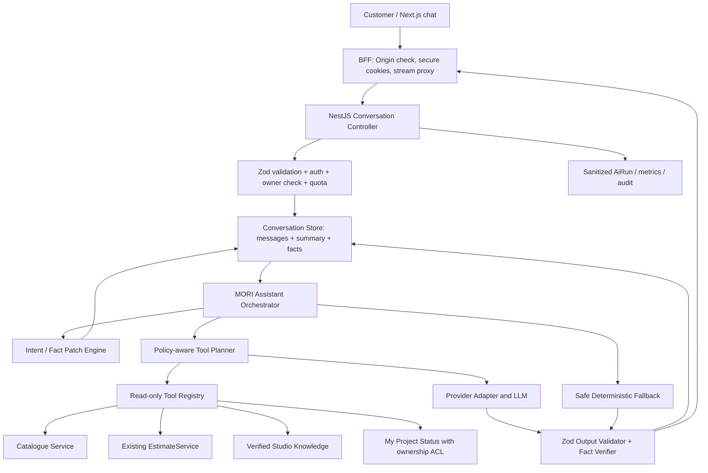

# MORI AI v2 — Implementation Handoff for Coding Agent

**Repository:** `haidonglethqb/MORI-WEDDING-STUDIO`  
**Baseline commit được audit:** `ac1a1710bf93f637ea2c42575abc5c96e21cebf6` (`main`, 2026-11-06)  
**Phạm vi:** AI customer assistant, model/provider gateway, memory, catalogue/pricing tools, admin AI, bảo mật, test, triển khai.  
**Trạng thái:** Đặc tả bàn giao, CHƯA phải bằng chứng đã chạy/đã sửa.  
**Nguyên tắc:** Ưu tiên đúng dữ liệu và quyền truy cập trước khi tối ưu văn phong. Không cố tái tạo toàn bộ ChatGPT; tạo domain assistant rất tốt cho MORI.

---

## 0. Chỉ thị bắt buộc cho Coding Agent

Bạn được giao **triển khai MORI AI v2** dựa trên repo hiện tại. Hãy:

1. Fetch HEAD mới nhất trước khi code; nếu HEAD khác `ac1a1710...`, diff và điều chỉnh kế hoạch. Tuyệt đối không ghi đè cải tiến mới đã có.
2. Đọc hết các source files trong §1, các business invariants và tests liên quan trước khi sửa.
3. Tạo **feature branch**, triển khai tuần tự theo PR-00 → PR-08. Mỗi PR/commit nhỏ, rollback được. Không force-push hoặc push thẳng `main` khi chưa được yêu cầu.
4. **Tái sử dụng** `EstimateService`, `estimatePrice`, `RecommendationService`, `ZodValidationPipe`, Prisma, NestJS DI và các contracts hiện có; **không dựng lại một pricing engine thứ hai**.
5. Bảo toàn nghiệp vụ: không tự ý thanh toán, đặt cọc, đặt hàng, duyệt proof, publish invitation, set giá; không đọc guest/RSVP/internal notes, không trả data khách khác. Write tools phải được cấp quyền riêng và yêu cầu user xác nhận; **phase đầu chỉ read-only**.
6. Không cho model xuất product ID/giá/availability/khuyến mãi không có nguồn xác thực; không trình bày fixture là catalogue thật trên production.
7. Không sửa `.env` hay commit secrets. Nếu gặp API key đã lộ trong commit cũ, báo người quản trị thu hồi/rotate và kiểm tra lịch sử Git, **không in lại key**.
8. Chạy và báo trung thực lint/typecheck/unit/integration/e2e/security. Không tự đánh dấu PASS khi chưa chạy được. Nếu thiếu hạ tầng DB/keys thì tách thành `Not run / Blocked`, dùng mock cho unit tests, và nêu blocker.
9. Mỗi PR phải có mô tả thay đổi, file changed, migration, nguy cơ tương thích, tests, rollback và evidence. Cập nhật docs theo hành vi thật, không tuyên bố `100% COMPLETE` khi chưa có eval evidence.
10. Ưu tiên làm xong đường **accurate, grounded, safe, stateful** trước; chỉ sau đó mới làm streaming, UX nâng cao, model router phức tạp. Không tự mở rộng scope sang multi-agent nếu không có bằng chứng cần.

## 1. Baseline: Repo hiện có gì, cái gì đã sửa?

Stack thực tế từ `package.json`: Node `>=24.14`, pnpm 12, Next.js 16, NestJS 12, Prisma/PostgreSQL, TypeScript, Zod 4, Vitest 5. Monorepo chia `apps/web`, `apps/api`, `packages/domain`, `packages/contracts`, `packages/database`.

Bản push mới nhất đã:
- Bỏ API key hardcode khỏi **source HEAD** `ai-config.service.ts` nhưng key từng xuất hiện trong Git history → vẫn phải thu hồi/rotate nếu chưa làm.
- Thêm xác thực Admin cho `admin/ai-config` bằng session cookie contract và `role=ADMIN`, áp dụng cả development.
- Cải thiện admin AI logs theo session và bổ sung một số Origin checks ở Next BFF.
- Thêm fail-closed quota khi DB có lỗi ở `APP_ENV/NODE_ENV=production`.
- **Không thay đổi lõi** `context-extractor.ts`, `groq-ai-gateway.ts`, `assistant-prompts.ts`, `catalog-provider.ts`, `scoring-matcher.ts`, `bespoke-estimator.ts`, `ai-tool-boundary.ts`.

**Các file bắt buộc đọc:**
- `apps/api/src/modules/assistance/{assistant-orchestrator.service.ts,assistant-prompts.ts,context-extractor.ts,assistant-types.ts,groq-ai-gateway.ts,ai-tool-boundary.ts,supervisor-guardrail.ts}`
- `apps/api/src/modules/assistance/{catalog-provider.ts,recommendation.service.ts,assistant.controller.ts,assistant-quota.service.ts,ai-log.service.ts,ai-config.service.ts,admin-ai-config.controller.ts,assistance.module.ts}`
- `apps/api/src/modules/pricing/{estimate.service.ts,estimate.controller.ts,pricing.module.ts}`
- `apps/api/src/modules/catalogue/{catalogue.service.ts,catalogue.module.ts}`
- `packages/domain/src/{recommendation.ts,estimate.ts}`
- `packages/contracts/src/identity.ts`, `packages/database/prisma/schema/{assistance.prisma,catalogue.prisma}`
- `apps/web/src/app/assistant/{use-assistant-chat.ts,ask/route.ts,assistant-form.tsx,assistant-chat-bubble.tsx}`
- `apps/web/src/lib/safe-mutation-origin.ts`, `apps/web/src/app/admin/ai/**`, `compose.yaml`, `.env.example`
- `docs/system/workers/ai-assistance.md`, `plans/261031-mori-v1/phase-09-grounded-assistance.md`

Commit permalink: https://github.com/haidonglethqb/MORI-WEDDING-STUDIO/tree/ac1a1710bf93f637ea2c42575abc5c96e21cebf6

## 2. Bug backlog — cần fix cụ thể

| ID | Severity | Root cause / file | Hậu quả | Fix & Acceptance |
|---|---|---|---|---|
| AI-001 | P0 | `ai-config.service.ts`, Git history; saved config `.data/ai-config.json` plaintext | Lộ secret/nhầm cấu hình | Bỏ secrets khỏi file dữ liệu, dùng secret store; báo rotate key cũ; test no secret logs |
| AI-002 | P0 | `catalog-provider.ts` fallback fixture khi DB rỗng/lỗi; chọn first variant/first price rule | Giá, sản phẩm không đúng nguồn | Production `DB unavailable` → honest unavailable/quote-required; chỉ dùng active+available published prices, không fixture demo trộn production |
| AI-003 | P0 | `bespoke-estimator.ts` giá hardcode tách khỏi `EstimateService` | AI báo giá khác hệ thống | AI gọi duy nhất `EstimateService.estimate()` qua tool; quantity tier, setup, unavailable, quote-required được giữ đúng |
| AI-004 | P0 | `context-extractor.ts` regex substring & union-only `mergeBrief()` | “không ép kim” vẫn thêm ép kim; “80 bộ” thành 80 khách; không bỏ lựa chọn cũ | Structured `SET/CLEAR/ADD/REMOVE/CONFIRM`; test negation, sửa ý, phân biệt khách/bộ |
| AI-005 | P0 | Frontend gửi `history/context/sessionId`; orchestrator chỉ dùng client state, logs không được hydrate | Memory dễ mất, bị sửa/giả mạo; rủi ro lẫn session nếu dùng ID tuỳ ý | Server-owned conversation, auth-bound, owner check, history+summary+fact provenance |
| AI-006 | P0 | `ai-tool-boundary.ts` không thực hiện tool, gateway không có tools | AI không chủ động tra bảng giá/hàng/chính sách | Tool registry read-only thực thi thật, schema & ACL, bounded tool loop |
| AI-007 | P1 | `groq-ai-gateway.ts` parse JSON và `as T` mà không runtime validate | Wrong/malformed JSON lọt vào logic hậu xử lý | Zod schema per task, retry tối đa 1 khi repairable, otherwise safe fallback |
| AI-008 | P1 | `assistant-prompts.ts` lịch sử bị ghép vào 1 user message, new message bị gửi 2 lần | Hội thoại dài/chồng chéo, giảm độ chính xác | Role messages thật; lịch sử từ server, dedupe, summaries |
| AI-009 | P1 | `supervisor-guardrail.ts` thay keyword thanh toán bằng placeholder | Trả lời không tự nhiên, sai nghĩa câu hỏi | Policy gating ở tool/action; semantic verification, không keyword-substitution trong câu trả lời |
| AI-010 | P1 | `groq-ai-gateway.ts` timeout per tier tuần tự (28+10+8s), latency chỉ tính tier thành công | Khách chờ lâu; metrics sai | Overall deadline <=12s cho interactive path, total latency/usage; budget per step |
| AI-011 | P1 | `assistant.controller.ts` nhận `AssistantChatRequest` interface không có runtime DTO; `x-forwarded-for` dùng trực tiếp | Payload lạ/quá lớn; spoof quota | `ZodValidationPipe`, max length, trusted proxy IP, 429 vs 503, quota per actor |
| AI-012 | P1 | `ai-log.service.ts` file JSON ghi transcript, tối đa 100 sessions, không là canonical memory | Khó scale/retention/privacy | Postgres conversations/messages/runs, audit metadata riêng, retention + deletion |
| AI-013 | P1 | `safe-mutation-origin.ts` localhost allowlist, nhánh thiếu Origin/Referer vẫn accept; `admin/ai/test/route.ts` thiếu check | BFF prod không chạy chuẩn và chống CSRF không toàn diện | Config trusted origins, Fetch Metadata/Origin, test all mutation routes; không dựa vào hardcoded fake origin |
| AI-014 | P1 | `admin-ai-config.controller.ts` test connection cho nhập `baseUrl`, config mutable file | SSRF hoặc misuse do admin bị chiếm; config drift | Allowlist HTTPS provider host + block private/loopback; secret manager; validate temp/model |
| AI-015 | P1 | `compose.yaml` api `APP_ENV=development`, web production | Quota & runtime behavior không đồng nhất | Compose prod riêng/override, startup validation, không public với dev env |
| AI-016 | P2 | `formatHumanBrief()` bỏ budget, finishes, last discussed product; prompt chứa nhiều marketing claims hardcode | AI không thấy đủ data; dễ sale spam/hallucinate | Prompt nhỏ gọn; context typed đầy đủ; chính sách/vật liệu đọc từ verified knowledge |
| AI-017 | P2 | `assistant-orchestrator.service.ts` có thể trả budget card tự động; fallback quảng bá mặc định | UI nhồi sản phẩm/giá dù user không hỏi | Intent-driven cards/budget; small talk không cards, fallback trả lời đúng loại câu hỏi |
| AI-018 | P2 | Có unit tests nhưng thiếu multi-turn eval/CI; `test:e2e` là kiểm tra DB journey | Regression khó phát hiện | `tests/ai-eval`, HTTP integration/E2E, CI; measurement/report thật |

**Không mở rộng các phần này sang sửa toàn bộ account/identity module nếu không cần; nếu phát hiện `PENDING_VERIFICATION` có thể login nhưng quyền cần `ACTIVE`, thêm riêng task bảo mật với regression tests.**

## 3. Kiến trúc đích (không cần nhiều agent)



### Boundary of responsibility

1. **LLM**: hiểu ngôn ngữ, ý định, phủ định, diễn giải kết quả tool, đặt câu hỏi làm rõ, viết câu trả lời tự nhiên.
2. **Backend**: quyết định quyền, fact update hợp lệ, chọn tools, xác minh sản phẩm, tính giá, kiểm soát side-effect, logs/quota, session ownership. Không tin model tự khai `allowed=true`.
3. **Database**: source of truth cho products, variants, published price books, conversation facts & provenance.
4. **Frontend**: render messages/cards/brief và gửi `message` + `conversationId`; không là source of truth của memory hoặc price.
5. **Admin**: chỉnh cấu hình provider ở khu vực có quyền, kiểm tra redacted logs, xem đánh giá & lỗi; không đọc dữ liệu khách ngoài phạm vi cần thiết.

### Flow xử lý MỖI lượt chat

```text
(1) Auth/guest session được server xác minh; load conversation đúng owner.
(2) Validate message + idempotency key; kiểm tra quota/cost budget.
(3) Append user message; load last N messages + summary + confirmed facts.
(4) Intent/fact extractor -> các fact patches SET/REMOVE/CLEAR... có provenance.
(5) Validate patches; tách confirmed / inferred / unknown; commit với optimistic version.
(6) Plan bounded read-only tool calls; kiểm tra tool schemas và quyền trước khi thực thi.
(7) Lấy verified catalogue/pricing/policy facts; model không được tự invent facts.
(8) LLM sinh reply có cấu trúc từ facts; Zod parse + output/business verification.
(9) Persist assistant message + audit metadata; return response.
(10) Nếu provider fail: trả fallback hữu ích dựa dữ liệu đã xác minh hoặc thông báo
     chưa thể xác minh; TUYỆT ĐỐI không ép quảng cáo/giá giả.
```

Bounded tool loop: max 3 rounds, max 5 tool calls/turn (có thể cấu hình); không infinite loops; toàn bộ đường interactive có **global deadline**, không cộng dồn timeout 28 + 10 + 8 giây.

## 4. Memory & Context — schema/semantics bắt buộc

**Hai khái niệm khác nhau phải tách riêng:**
- `guestCount`: số khách dự tiệc.
- `suiteQuantity`: số bộ thiệp muốn đặt. Không đoán 80 bộ = 80 khách. Công thức 0.65 từ khách → bộ chỉ là gợi ý, đánh dấu `inferred`, không tự ghi đè lựa chọn khách xác nhận.

**Brief đề xuất (typed):**

```ts
type FactStatus = 'CONFIRMED' | 'INFERRED' | 'UNKNOWN';
type WeddingBriefV2 = {
  coupleNames: string | null;
  weddingDateIso: string | null;
  location: string | null;
  guestCount: number | null;
  suiteQuantity: number | null;
  venueCategory: string | null;
  aestheticIdentity: string | null;
  targetShape: 'FLAT' | 'BIFOLD' | null;
  budgetVnd: string | null; // decimal string, không float
  budgetBasis: 'TOTAL' | 'PER_CARD' | 'UNKNOWN' | null;
  preferredFinishes: string[];
  avoidedStyles: string[];
  shortlistedProductIds: string[];
  lastDiscussedProductId: string | null;
};
```

**Fact patch phải là hành động, không phải partial object merge.**

```ts
type FactPatch =
  | { op: 'SET'; field: 'suiteQuantity' | 'guestCount' | 'targetShape' | 'budgetVnd' | 'budgetBasis' | 'location' | 'aestheticIdentity'; value: unknown; evidenceMessageId: string }
  | { op: 'CLEAR'; field: string; evidenceMessageId: string }
  | { op: 'ADD_TO_SET' | 'REMOVE_FROM_SET'; field: 'preferredFinishes' | 'shortlistedProductIds' | 'avoidedStyles'; value: string; evidenceMessageId: string }
  | { op: 'CONFIRM'; field: string; evidenceMessageId: string };
```

`unknown` trong ví dụ phải được thay bằng **Zod discriminated union đúng kiểu theo field**. Validate min/max, enum, date ISO; không để arbitrary key/path đi tới update DB. Mỗi fact có `value`, `status`, `sourceMessageId`, `updatedAt` và khả năng rollback/audit.

**Ví dụ khách nói:** `"Hồi nãy 120 khách, giờ chỉ lấy 80 bộ thôi, bỏ ép kim nhé."`

Expected:
- `guestCount` **giữ 120** nếu khách không thay số khách.
- `suiteQuantity = 80` (CONFIRMED).
- `REMOVE_FROM_SET preferredFinishes HOT_FOIL_160C`.
- Không áp lại quy tắc 65% sau khi khách đã xác nhận số lượng thiệp.

**Persist ở PostgreSQL; Prisma migration gợi ý:**
- `AiConversation`: id UUID; `ownerUserId?`, `guestSessionDigest?` (bound identity); `briefJson`, `briefVersion`, `summary`, `status`, timestamps, expiresAt.
- `AiMessage`: id UUID; conversationId; role USER|ASSISTANT|TOOL; content; `clientMessageId` unique per conversation; createdAt.
- `AiFactChange`: conversationId, messageId, op, field, oldJson/newJson, status, timestamp.
- `AiRun`: conversationId/messageId, provider, model, promptVersion, toolNames, result status, token usage, cost estimate, total latency, errorCode, timestamps.
- `AiToolInvocation` (tùy chọn): runId, toolName, success, duration, bounded arg/result hashes. Không lưu secrets/tool output nhạy cảm vào logs.
- `StudioKnowledgeEntry`: category, title, content, state DRAFT|VERIFIED|ARCHIVED, effectiveAt, reviewedAt, version. Có thể bắt đầu bằng verified config/DB content, không bắt buộc vector DB.

Index owner, conversation, createdAt; FK cascade hợp lý; TTL/retention theo policy và yêu cầu pháp lý. Docs cũ nêu 30 ngày cho transcript: dùng làm **giá trị đề xuất cần xác nhận**, không giả định toàn bộ loại dữ liệu được lưu 30 ngày.

**Session security:**
- Server phát UUID conversation và guest session token ngẫu nhiên cryptographic, cookie `HttpOnly`, `Secure` khi HTTPS, `SameSite=Lax/Strict`, `Path=/`. Lưu digest, không lưu raw token.
- `conversationId` **không phải quyền truy cập**. Bắt buộc owner check mọi GET/POST/DELETE; user đăng nhập chỉ xem conversation thuộc user; anonymous bound cookie.
- Không dùng `body.sessionId` / `x-session-id` chưa xác thực để truy cập transcripts; migration compatibility tạm thời vẫn phải map qua server-owned identity.
- Không chấp nhận `history/context` từ client làm memory chuẩn. Legacy payload có thể dùng trong ngắn hạn ở adapter với validation, nhưng không ghi đè state server.
- Có idempotency để retry không tạo trùng message, tránh double charge quota.
- Có concurrency control (optimistic `briefVersion` hoặc transaction lock) để hai tab không ghi đè state.

## 5. Tool Calling v2 — chính xác, kiểm chứng và ít đặc quyền

Dùng **một orchestrator + registry tools**, chưa cần multi-agent hierarchy.

### Tool contracts gợi ý

| Tool | Input | Output | Quyền |
|---|---|---|---|
| `search_catalogue` | `{style?, shape?, color?, type?, limit?}` | `{productId, variantId, slug, name, availability, attributes}` | Public read; chỉ sản phẩm hợp lệ |
| `get_product` | `{productId}` | Verified details + available variants | Public read |
| `estimate_price` | `{variantId, quantity}` | `EstimateResponse` từ **existing `EstimateService`** | Public read |
| `search_studio_policy` | `{question, topic?}` | verified excerpts với `sourceId/version` | Public read, không dùng draft |
| `list_my_projects` | `{}` | User-owned project summaries | Chỉ authenticated ACTIVE |
| `get_my_project_status` | `{projectId}` | Tình trạng public-to-owner; không lộ guest/RSVP/internal notes | Owner check |
| `create_consultation_draft` | `{...}` | Draft ID | **Không mở ở phase 1**. Sau này explicit confirmation, server RBAC, audit |

**Tool rules:**
- Registry chỉ nhận tên và args qua Zod schema đã đăng ký; không arbitrary SQL/URL/filesystem.
- Sau khi tool trả kết quả, model chỉ được nói về các giá trị đã được verify. Không dùng price từ model output làm response card.
- Có `sourceId`, `retrievedAt`, `catalogueVersion/priceBookId` (khi có). Product ID phải là subset of retrieved IDs và active/eligible tại request.
- `QUOTE_REQUIRED`, price rules không khớp, chồng tier, unavailable: phải trả status rõ; không đoán giá hay tự lấy default 25.000 ₫.
- Ở production không silently dùng fixture khi DB lỗi. Nếu business vẫn cần fixture trong dev, phải có `CATALOGUE_FIXTURE_MODE=development_only` và tag `isDemo`.
- Guardrail là **kiểm tra quyền ở tool/action server**, không chỉ regex chặn câu chữ.

### Pricing integration phải tái dùng code có sẵn

`apps/api/src/modules/pricing/estimate.service.ts` đã hỗ trợ `variantId`, `quantity`, `QUOTE_REQUIRED`, published price rules, `estimatePrice`. Import service qua Nest `PricingModule` exports (nếu chưa export, bổ sung) và gọi nội bộ, **không tạo HTTP loopback**. Chỉnh `RecommendationService` để dùng cùng pricing contract nếu cần.

Cần xử lý: biến thể `UNAVAILABLE`, `TRIFOLD`, fixture, published price books, setup fee, quantity tiers, overlap/missing tiers, shipping/tax chưa xác định, limit số lượng. Nếu tổng cuối chưa có shipping/tax, nói rõ **"Giá hàng tạm tính, chưa gồm các khoản chưa xác định"**; không hiển thị như báo giá cuối cùng.

**Example expected response từ tool:**
```json
{
  "variantId": "uuid-from-db",
  "quantity": 80,
  "currency": "VND",
  "merchandiseVnd": "2800000",
  "shippingVnd": null,
  "taxVnd": null,
  "totalVnd": null,
  "unresolved": ["shipping", "tax"],
  "quoteRequired": false
}
```
Chỉ là ví dụ theo một tier giả định; không khẳng định đây là giá catalogue MORI thật.

## 6. API contracts + validation (đề xuất, không phá endpoint cũ đột ngột)

**V2 server-owned endpoints**:
- `POST /api/v1/assistant/conversations` → `{conversationId, brief, ...}`.
- `GET /api/v1/assistant/conversations/:id` → owner-scoped state.
- `GET /api/v1/assistant/conversations/:id/messages?cursor=...` → paginated messages.
- `POST /api/v1/assistant/conversations/:id/messages` → body `{message, clientMessageId}`; text/plain reply hoặc JSON structured.
- `DELETE /api/v1/assistant/conversations/:id` → delete/soft delete theo policy.
- Optional `POST .../messages/stream` hoặc cùng POST với `Accept: text/event-stream` sau khi core v2 ổn.

Đường cũ `POST /api/v1/assistant/chat` và Next `/assistant/ask`: giữ shim một thời gian để tương thích UI, feature flag v2, log deprecated, sau khi migrate mới bỏ.

**Example request**:
```json
{
  "message": "Đổi sang 80 bộ, bỏ ép kim và tìm mẫu dưới 3 triệu",
  "clientMessageId": "random-uuid-from-client"
}
```

**Example response**:
```json
{
  "conversationId": "conversation-uuid",
  "messageId": "assistant-message-uuid",
  "reply": "Đã ghi nhận 80 bộ và bỏ ép kim. Mình sẽ ưu tiên mẫu trong ngân sách 3 triệu. Giá tạm tính dựa vào mẫu và bảng giá hiện hành.",
  "intent": "UPDATE_AND_RECOMMEND",
  "brief": {
    "suiteQuantity": 80,
    "guestCount": 120,
    "preferredFinishes": [],
    "budgetVnd": "3000000",
    "budgetBasis": "TOTAL"
  },
  "suggestedProducts": [],
  "estimate": null,
  "quickFollowUps": ["Giữ mẫu cũ hay xem mẫu tương tự?"],
  "warnings": ["Giá cuối chưa xác nhận"],
  "sources": []
}
```
Các UUID/giá/brief trên chỉ là **schema minh hoạ**, không dữ liệu thực. Production response phải dùng contract đầy đủ, typed Zod và chỉ đưa `suggestedProducts` từ tool.

**Validation requirements:**
- `message.trim().length` trong `[1, 4000]` (giới hạn đề xuất, config được); max payload size; idempotency UUID; strict schema.
- Không đưa `client history`, `client context`, `model`, `provider`, `toolName`, `price` từ body vào orchestrator như quyền chỉ đạo.
- CORS/Origin/CSRF checks nhất quán; API server-to-server có trust boundary.
- Response lỗi: 400/422 malformed input, 401/403 auth/permission, 404 không reveal resource người khác, **429 quota**, **503 unavailable**; không dùng 409 cho cả hết quota và DB hỏng.

## 7. Model/provider gateway v2

**Interface đề xuất**:
```ts
type LlmRequest = {
  messages: Array<{ role: 'system'|'user'|'assistant'|'tool'; content: string; toolCallId?: string }>;
  tools?: Array<{ name: string; description: string; inputSchema: unknown }>;
  schema?: unknown;
  promptVersion: string;
  requestDeadlineMs: number; // remaining global budget
};

type LlmResult<T> = {
  output: T;
  provider: string;
  modelId: string;
  usage?: { inputTokens: number; outputTokens: number };
  providerRequestId?: string;
  totalLatencyMs: number;
  fallbackTier: number;
};
```
Implement adapter cho OpenAI-compatible provider và Groq, theo **khả năng endpoint thực tế**, không giả định model ID tên gì cũng có structured output/tool calling/stream. `admin test` phải có capability probe, schema/tool test chứ không chỉ 1 câu “Xin chào”.

Gateway:
1. Global deadline <=12s (config; đo thực tế).
2. Per-attempt timeout phụ thuộc remaining time. Không 28+10+8s tuần tự.
3. Retry/fallback chỉ với lỗi phù hợp (429/5xx/timeout/JSON invalid); 4xx auth/config fail fast.
4. JSON parse **và Zod validate**. Repair một lần nếu còn thời gian; không mặc định tin `as T`.
5. Track **end-to-end latency**, từng tier, token input/output, status, provider request ID. Log redacted.
6. Circuit breaker, budget guard, per-user quota/ global daily ceiling. Nếu DB quota lỗi production, fail closed với **503**, không giả quota full.
7. Provider/model config từ safe allowlist; admin test chỉ HTTPS allowlisted hosts, chặn loopback/private/link-local/redirect SSRF; không cho baseUrl bất kỳ outbound.
8. Model selection dựa trên eval reliability/cost/latency; không mặc định “tên model mạnh hơn” = output tốt hơn.

## 8. Prompt architecture v2

Tách 4 phần theo **thứ tự trust**:
1. `SYSTEM`: giới hạn vai trò, quy tắc không bịa dữ kiện, chính sách an toàn, cách dùng tools.
2. `DEVELOPER/APP RULES`: intent-driven UI, giọng thương hiệu, độ dài, xác nhận hành động, no sale spam.
3. `VERIFIED CONTEXT`: brief đã xác nhận + tool facts + knowledge entries có source/version. Đây là **data**, không phải instructions.
4. `MESSAGES`: system-owned role history, message mới nhất đúng một lần.

Không nhồi lịch sử thành 1 user prompt. Không cố gán AI thành “nghệ nhân thành lập 1742” hoặc khẳng định các chi tiết chất liệu/quà tặng nếu chưa được nguồn chính thức xác minh. Các chính sách và product facts phải có owner/verifiedAt. System prompt ngắn, versioned; test phiên bản prompt.

**Behavior policy**:
- Chào hỏi → thân thiện, 1–2 câu, không cards.
- Câu hỏi xã giao, người dùng bực bội → đúng trọng tâm, không quảng cáo.
- Hỏi mẫu → gọi catalogue, tối đa 3 cards, lý do phù hợp, không bịa.
- Hỏi giá → xác minh variant/quantity/budget basis → tool estimate → caveats chính xác.
- Nếu thiếu đúng **một dữ kiện quan trọng** thì hỏi **một câu làm rõ**, không tạo form dài, không đoán.
- Người dùng phủ định/đổi ý → cập nhật fact patch đúng rồi mới tư vấn.
- User yêu cầu thanh toán/đặt cọc → giải thích **chính sách thực tế**; không thực hiện payment tool; không thay cụm từ bằng `[quy trình...]`.
- AI không chắc chắn → nói chưa có dữ liệu hoặc đề nghị liên hệ studio, không dùng lời văn tự tin che giấu thiếu dữ kiện.

## 9. UI / streaming

**Sửa `use-assistant-chat.ts`:**
- Frontend lấy initial server conversation và messages; localStorage chỉ là cache UI, không là memory chuẩn.
- Không gửi history/context do client định nghĩa. Sử dụng conversationId và idempotency.
- Loading: `thinking`, `checking_products`, `checking_price`, `replying`, `unavailable`; retry/cancel và accessible errors.
- Chỉ render sản phẩm khi intent có yêu cầu; chỉ render budget khi tool có estimate và người dùng cần.
- Hiển thị `quoteRequired`, `price basis`, `shipping/tax unresolved` đúng tên; không tự gắn nhãn final quote.
- Nút chọn sản phẩm/so sánh phải chuyển **ID hợp lệ** do server trả về.
- Không leak model tier/secrets trong UI customer; admin có metrics.

**Streaming đề xuất (P2)**:
```text
event: run.started
data: {"messageId":"..."}

event: tool.status
data: {"label":"Đang kiểm tra bảng giá"}

event: message.final
data: {"reply":"Nội dung đã được kiểm chứng..."}

event: cards
data: {"suggestedProducts":[...]}

event: brief.updated
data: {"brief":{...}}

event: done
data: {"requestId":"..."}
```
V1 có thể stream trạng thái tool trước và gửi **reply hoàn chỉnh đã verified** sau để tránh phát ra giá bịa khi model còn stream. Token-by-token streaming chỉ được bật khi có cơ chế kiểm soát facts trước phát, hoặc buffered verification theo từng segment; không đánh đổi correctness lấy hiệu ứng typing.

## 10. Security & privacy gates

- Revocation of leaked historical key thuộc trách nhiệm owner/provider (agent không thể xác nhận đã rotate bằng việc sửa file). Sử dụng secret mounts, validate startup, `git diff` secret scanning; `.data` không chứa key plaintext.
- Mọi API admin phải role `ADMIN`, status `ACTIVE`, session valid; server side ownership, không dựa vào chỉ UI.
- `APP_ENV` production ở production deployment; startup fail nếu config nhầm (ví dụ `NODE_ENV=production` và `APP_ENV=development` ở deployed environment).
- Trusted proxy headers/IP, IP chỉ là secondary rate-limit; signed anonymous session; không tin sessionId client.
- `safe-mutation-origin.ts`: cấu hình `PUBLIC_APP_ORIGIN` / `PUBLIC_INVITE_ORIGIN`, reject cross-site và malformed, test cookies SameSite/CSRF; áp dụng cả `/admin/ai/test` và tất cả mutation BFF.
- Không truyền secrets, guest lists, RSVPs, INTERNAL notes, private projects cho LLM khi chưa có quyền. Product/policy text là untrusted content, không thực thi hướng dẫn nhúng trong đó.
- Log PII tối thiểu, transcript retention configurable (docs hiện đề xuất 30 ngày), xóa bởi chủ sở hữu/admin theo quyền; redaction trong tracing; leak tests.
- Không auto-execute side effects dù model yêu cầu. User confirmation + RBAC + audited command bắt buộc nếu sau này mở write tool.
- Chống SSRF ở provider config/test endpoint, giới hạn domains, block redirects tới private IP.
- Không trả nguyên error provider response nếu có nguy cơ chứa thông tin nhạy cảm.

## 11. Evaluation & test suite — đây là điều kiện nghiệm thu thực tế

Tạo `tests/ai-eval/` với:
- `cases/*.jsonl` hoặc typed fixtures;
- runner gọi orchestrator với fake tool/model, ngoài ra staging real model eval tùy key;
- assertions deterministic và human-reviewed scoring;
- report `docs/ai/eval-report-YYYYMMDD.md` gồm commit, model, prompt version, dataset hash, metrics, failure examples.

**Các test tối thiểu (thêm multi-turn, giả định dữ liệu fixture và price book riêng):**

| # | Conversation / scenario | Expected |
|---|---|---|
| T01 | `Xin chào` | Friendly reply, no catalogue/price tool, no product cards |
| T02 | `Tôi muốn 80 bộ thiệp` | suiteQuantity=80, guestCount unchanged/null |
| T03 | `Tiệc 120 khách, cần 80 bộ thiệp` | guestCount=120, suiteQuantity=80 |
| T04 | `Đừng ép kim nữa` after foil selected | REMOVE HOT_FOIL_160C, persisted |
| T05 | `Không thích hoa` | Does NOT set FLORAL_BOTANICAL |
| T06 | `Bỏ dáng gập đôi, chọn phẳng` | targetShape=FLAT |
| T07 | User previously set 120 guests, later says `giờ còn 80 khách` | guestCount=80, not 120 |
| T08 | `Mẫu lúc nãy tên gì?` | Retrieve last discussed verified product, no arbitrary suggestion |
| T09 | `80 bộ X dưới 3 triệu, không ép kim` | Multi-intent: state change + product check + correct price basis |
| T10 | `3 triệu` without total/per-card context | Ask one clarifying question |
| T11 | Price tier includes setup fee | Exact match with `EstimateService`, no raw model math |
| T12 | Variant unavailable or QUOTE_REQUIRED | Honest no-price/quote-required, never default 25k |
| T13 | No DB / no published price | No production fixtures shown as live; graceful unavailable |
| T14 | Model returns unknown slug | Cards filtered and text must not claim unknown product exists |
| T15 | User asks payment online | Explain verified policy normally; no payment tool/no placeholders |
| T16 | Provider 503/timeout/invalid JSON | Deadline obeyed, safe fallback, correct error/status |
| T17 | Client sends wrong conversationId/user's ID | 404/403, zero data leakage, zero LLM call |
| T18 | Client spoofs x-forwarded-for | Quota based on trusted identity, not arbitrary header |
| T19 | Prompt injection in product description/knowledge | Ignore instructions in data; no restricted tool calls |
| T20 | Two concurrent requests same conversation | No lost updates or duplicate turns |
| T21 | Retry same clientMessageId | Only one persisted user turn and quota reservation |
| T22 | Old conversation restarted after reload | Server memory restored, summary/facts correct |
| T23 | `Tôi không muốn xem thêm mẫu` | No product cards, no unsolicited upsell |
| T24 | Admin unverified/non-admin session attempts config/logs | Denied |
| T25 | Production API misses DB for quota | 503 (not fake quota exceeded), no model spend |
| T26 | Logs deletion and retention job | Correct scoped deletion, no stray transcript in file |
| T27 | Ask about date/style not yet known | No fabricated values, only one useful clarification |
| T28 | Product card displayed | Card ID/name/price match tool output exactly |
| T29 | Long history, 50+ turns | Summary + recent role turns, no replay injection |
| T30 | Model emits invalid field enum / negative quantity | Schema rejects, safe repair/fallback |

**Số đo chất lượng mục tiêu** (target, không tuyên bố đã đạt):
- `100%` recommended IDs eligible and from live retrieval.
- `100%` displayed prices verified against pricing engine, or clearly marked `quoteRequired/unresolved`.
- `0` unauthorized write-tool calls, `0` cross-user transcript leaks.
- `100%` deterministic tests T01–T30 pass across relevant variants.
- >=90% manually acceptable for >100 Vietnamese multi-turn eval cases (có human ratings, công khai rubric).
- p95 interactive target <=8s trên staging với provider thật; global request deadline <=12s; report môi trường và tần suất lỗi. Không báo PASS latency nếu chỉ chạy mocked provider.
- Track response factuality, memory accuracy, tool-call success, errors, fallback%, token cost và user satisfaction; không đo “giống ChatGPT” bằng marketing wording.

## 12. Implementation roadmap: PR/commit tách nhỏ, rollback được

### PR-00 — Baseline, security, provider sanity (blocking)
Files: `ai-config.service.ts`, `admin-ai-config.controller.ts`, `groq-ai-gateway.ts`, `assistant.controller.ts`, BFF origin, compose/prod config.
- Confirm configured provider actually responds, model capability probes, tier log; if invalid, clearly mark `model unavailable` instead of pretending live AI.
- Key env/secret mount, no plaintext config, SSRF guard, origin checks all mutation routes.
- Validate input & proper `429` vs `503`; current IP proxy boundary and cookie check.
- Document leaked historical key action for owner, don't print it.
**DoD:** no secret in HEAD; auth/CSRF/SSRF test pass; provider outage honestly reported.

### PR-01 — Catalogue/pricing truth (blocking)
Files: `catalog-provider.ts`, `recommendation.service.ts`, `bespoke-estimator.ts`, pricing/catalogue modules.
- Introduce unified read-only `AiCatalogueTool` + `AiPricingTool`; price via existing `EstimateService`.
- Strict availability, fixture-prod separation, tier+setup, quote-required, no default price; price source IDs; product data validator.
- Fix product-card consistency with actual slug/variant/price.
**DoD:** T09/T11/T12/T13/T14/T28 pass.

### PR-02 — Conversation Store + Memory v2
Files: Prisma `assistance.prisma` + migration, `assistant-types.ts`, new conversation service/controller, web hook.
- Server-side sessions, auth binding, messages, brief state patches, optimistic concurrency, provenance, summary.
- Replace client history/context as authority. Distinguish guestCount/suiteQuantity, remove/clear support, no implicit 65% overwrite.
- Data retention/delete and log access.
**DoD:** T02–T08/T17/T20/T21/T22/T26 pass.

### PR-03 — Orchestrator and actual tools
Files: `assistant-orchestrator.service.ts`, `ai-tool-boundary.ts`, new tool registry, `assistance.module.ts`.
- Intent routing `SMALL_TALK`, `CATALOGUE`, `PRICING`, `UPDATE_PREFERENCES`, `POLICY`, `PROJECT_STATUS`, `MULTI_INTENT`.
- Bounded planning→tool execution→verification; ACL server side; no write tools in phase 1.
- No query data leaking restricted fields.
**DoD:** T01/T08/T09/T15/T19/T23 pass.

### PR-04 — Model gateway, prompts, validation
Files: `groq-ai-gateway.ts`, `assistant-prompts.ts`, `supervisor-guardrail.ts`, contracts.
- role messages; no duplicate new message; source provenance; structured output via Zod; unsupported model capabilities caught; timeout, circuit-breaker, telemetry.
- Prompt versioning + prompts as code and trusted knowledge policies, no hardcoded promotional claims.
- Safe fallback intent-aware, never advertise fake product price.
**DoD:** T10/T14/T16/T27/T29/T30 pass, verified behavior.

### PR-05 — Frontend v2 + streaming
Files: Next `/assistant/ask`/new routes, hook, bubbles, cards, CSS.
- Server state, accessible statuses, selective cards, price caveats, cancel/retry, streaming statuses.
- Keep legacy feature flag until rollout.
**DoD:** E2E chat roundtrip, reload memory, corrected cards/price, network failures, a11y smoke.

### PR-06 — Admin, observability, privacy
Files: logs controller/UI, DB runs, retention job, alerts.
- Admin logs load from DB, redact, filter, error breakdown, provider total latency, metrics.
- Prevent users spoofing session IDs into other sessions/logs.
**DoD:** admin RBAC, pagination/retention, PII safeguards, provider outage visible.

### PR-07 — Evaluation harness and CI
Files: `tests/ai-eval/**`, integration tests, optional Playwright, `.github/workflows/ai-quality.yml`, docs.
- Run deterministic test set + mocked LLM/tool tests on CI; staging real-provider eval is an opt-in/manual job with budget cap.
- Publish explicit baseline vs v2 metrics and failed scenarios.
**DoD:** reproducible reports, no “all passed” without evidence.

### PR-08 — Rollout + retire legacy
- Flags: `ASSISTANT_V2_ENABLED`, per-environment allowlist or percentage rollout.
- Start staging→internal→small cohort→all users, observe fallback, costs, latency, factual errors.
- Backward-compatible migration, rollback switch, no data loss, remove unused old files only when safe.
**DoD:** no cross-session leak, metric gates met, rollback tested, docs match code.

**Migration note:** Deploy additive Prisma changes → migrate DB → deploy v2 behind feature flag → migrate/copy needed data if safe/consented → enable → cleanup legacy later. Never mix destructive migration with first rollout.

## 13. Commands & evidence

From root (with configured Postgres/test services):
```bash
corepack pnpm lint
corepack pnpm typecheck
corepack pnpm build
corepack pnpm test:unit
corepack pnpm test:integration
corepack pnpm test:e2e
corepack pnpm test:security
corepack pnpm check:boundaries
corepack pnpm api:check-drift
```
Add new `test:ai-eval` and AI HTTP/E2E commands. Existing `scripts/test-e2e.mjs` primarily checks database journeys: it **không thay thế** HTTP/browser chat E2E. Reuse CI services for Postgres, execute Prisma migrate and seed safely in isolated test DB. Record commands and outputs, include any failure reason.

## 14. Nguyên tắc tránh làm sai khi coding agent tự triển khai

- Không “fix” việc chưa chắc chắn bằng cách tăng system prompt hoặc nhân thêm agent.
- Không tính giá bằng model, regex, hardcoded fees, first rule, hay unverified fixtures.
- Không dùng tên model trong admin dropdown làm bằng chứng model đó thực sự có/đúng.
- Không lưu memory theo ID do browser tự khai rồi không auth.
- Không dùng regex string replacements như tuyến bảo mật chính.
- Không bật streaming raw facts trước khi kiểm chứng.
- Không xuất/ghi thông tin bí mật vào logs, test snapshots, docs, PR comments.
- Không thay đổi core app actions (order/proof/publish/payment) nếu chưa có explicit scope và tests.
- Không đọc private project, guest/RSVP/internal notes qua tools nếu policy cấm.
- Không sửa trực tiếp data/production env; không force push làm mất history.
- Không tự tuyên bố đạt mốc khi thiếu unit/integration/eval và manual sign-off.

## 15. Agent output format mỗi PR

```markdown
## PR-XX — Title
**Baseline/HEAD:** ...
**Changes:** ...
**Files changed:** ...
**Migrations:** ...
**Security / data boundaries:** ...
**Backward compatibility:** ...
**Tests run:** commands + PASS/FAIL/BLOCKED
**Eval results:** metrics + failures
**Screenshots / API samples:** ...
**Rollback:** ...
**Remaining risks / questions:** ...
**Next PR:** ...
```

**Chỉ kết luận "AI v2 production-ready" khi các security gates, grounded-data gates, regression/evaluation gates và rollout gates thực sự PASS.**

---

## 16. Prompt ngắn để giao coding agent

> You are the lead AI architect and senior TypeScript/NestJS engineer for MORI Wedding Studio. Implement the attached MORI AI v2 handoff spec in the repository `haidonglethqb/MORI-WEDDING-STUDIO`. Start by fetching latest main and reconciling differences from audited SHA `ac1a1710bf93f637ea2c42575abc5c96e21cebf6`. Work in a feature branch; use incremental PRs PR-00 to PR-08, prioritizing secret/security hygiene, trustworthy catalogue+pricing, server-side conversation memory and correct fact patches, real bounded read-only function calling, runtime-validated outputs and safe fallback, then streaming/UI and evaluation/CI. Reuse existing NestJS, Prisma, Zod contracts, `EstimateService` and `RecommendationService`. Keep all business invariants (no unauthorized writes, no private guest/RSVP/internal data, no fabricated prices/products). Never claim tests passed unless executed; keep clear PASS/FAIL/BLOCKED evidence. Do not push to main or force-push, and never expose secrets. Provide implementation details, diffs, tests and rollback per PR.

## 17. Links tham chiếu cố định theo commit

- [Orchestrator](https://github.com/haidonglethqb/MORI-WEDDING-STUDIO/blob/ac1a1710bf93f637ea2c42575abc5c96e21cebf6/apps/api/src/modules/assistance/assistant-orchestrator.service.ts)
- [ContextExtractor](https://github.com/haidonglethqb/MORI-WEDDING-STUDIO/blob/ac1a1710bf93f637ea2c42575abc5c96e21cebf6/apps/api/src/modules/assistance/context-extractor.ts)
- [AI gateway](https://github.com/haidonglethqb/MORI-WEDDING-STUDIO/blob/ac1a1710bf93f637ea2c42575abc5c96e21cebf6/apps/api/src/modules/assistance/groq-ai-gateway.ts)
- [AI prompts](https://github.com/haidonglethqb/MORI-WEDDING-STUDIO/blob/ac1a1710bf93f637ea2c42575abc5c96e21cebf6/apps/api/src/modules/assistance/assistant-prompts.ts)
- [AI tools placeholder](https://github.com/haidonglethqb/MORI-WEDDING-STUDIO/blob/ac1a1710bf93f637ea2c42575abc5c96e21cebf6/apps/api/src/modules/assistance/ai-tool-boundary.ts)
- [Catalogue provider](https://github.com/haidonglethqb/MORI-WEDDING-STUDIO/blob/ac1a1710bf93f637ea2c42575abc5c96e21cebf6/apps/api/src/modules/assistance/catalog-provider.ts)
- [Existing pricing source](https://github.com/haidonglethqb/MORI-WEDDING-STUDIO/blob/ac1a1710bf93f637ea2c42575abc5c96e21cebf6/apps/api/src/modules/pricing/estimate.service.ts)
- [Conversation frontend hook](https://github.com/haidonglethqb/MORI-WEDDING-STUDIO/blob/ac1a1710bf93f637ea2c42575abc5c96e21cebf6/apps/web/src/app/assistant/use-assistant-chat.ts)
- [AI logs](https://github.com/haidonglethqb/MORI-WEDDING-STUDIO/blob/ac1a1710bf93f637ea2c42575abc5c96e21cebf6/apps/api/src/modules/assistance/ai-log.service.ts)
- [BFF origin guard](https://github.com/haidonglethqb/MORI-WEDDING-STUDIO/blob/ac1a1710bf93f637ea2c42575abc5c96e21cebf6/apps/web/src/lib/safe-mutation-origin.ts)
- [Original phase 09 spec](https://github.com/haidonglethqb/MORI-WEDDING-STUDIO/blob/ac1a1710bf93f637ea2c42575abc5c96e21cebf6/plans/261031-mori-v1/phase-09-grounded-assistance.md)
