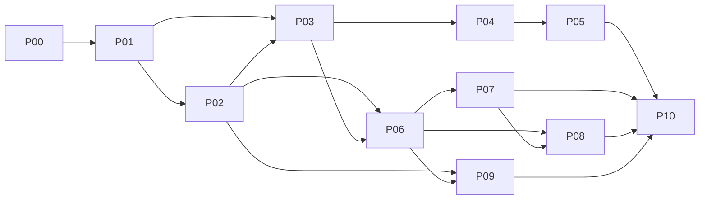

# MORI v1 implementation

## Overview

Build MORI (bagasse wedding stationery + digital invitations) as a Next.js/NestJS/Prisma/PostgreSQL modular monolith on Docker Compose, in vertical slices. Spec: `docs/MORI_PROJECT_PLAN.md` (wins over this plan). Execution rules: [handoff-brief.md](./handoff-brief.md). Hard rules HR-1..12 = brief §3; every phase file cites them by number. Ticket IDs, deps, evidence = spec 19.3; TCs = spec 18.

Path conventions: API `apps/api/src/modules/<m>/**`; web `apps/web/src/features/<m>/**` + routes `apps/web/src/app/**`; schema `packages/database/prisma/schema/<m>.prisma`; contracts `packages/contracts/src/<m>/**`; tests `tests/{integration,e2e,security,performance}/<m>/**`. Migrations (`packages/database/prisma/migrations/**`) are serialized: one agent at a time.

## Phases

| # | Phase | Tickets | Status | Exit gate (spec 19.2) | Link |
|---|-------|---------|--------|-----------------------|------|
| P00 | Decisions and spike | 001-006 | Completed | ADRs approved; minimal pinned build | [phase-00](./phase-00-decisions-and-spike.md) |
| P01 | Foundation | 007-012 | Completed | Clean-clone startup; cross-account denial | [phase-01](./phase-01-foundation.md) |
| P02 | Catalogue and UI system | 013-018 | Completed | 30-record content path; tier/budget correct | [phase-02](./phase-02-catalogue-and-ui-system.md) |
| P03 | Workspaces, media, editor | 019-024 | Completed | Save draft, process image, recover failed task | [phase-03](./phase-03-workspaces-media-editor.md) |
| P04 | Publication and sharing | 025-030 | Completed | Publish; guest views; revocation blocks reads | [phase-04](./phase-04-publication-and-sharing.md) |
| P05 | RSVP and digital pilot | 031-036 | Completed | Digital pilot incl. capacity races + privacy | [phase-05](./phase-05-rsvp-and-digital-pilot.md) |
| P06 | Studio design workflow | 037-042 | Completed | Design/approval loop with stale-proof protection | [phase-06](./phase-06-studio-design-workflow.md) |
| P07 | Quotes and fulfillment | 043-048 | Completed | PAPER/DIGITAL/BUNDLE completed honestly | [phase-07](./phase-07-quotes-and-fulfillment.md) |
| P08 | 3D and manufacturing | 049-054 | Completed | Geometry/artifact mapping + production sign-off | [phase-08](./phase-08-3d-and-manufacturing.md) |
| P09 | Grounded assistance | 055-060 | Completed | Eval, quota, injection, outage gates pass | [phase-09](./phase-09-grounded-assistance.md) |
| P10 | Release gate | 061-066 | Completed | All full-v1 requirements + blockers pass | [phase-10](./phase-10-release-gate.md) |

## Dependency graph (spec 19.2)

## Parallel lanes (brief §4)

- After P01: P02 (catalogue/UI) || media/worker lane (MORI-020..022; see phase-03 note: 020 needs 019 backend slice first).
- MORI-023/024 wait for MORI-013 tokens.
- After P03: Digital lane (P04 -> P05) || Studio lane (P06 -> P07).
- After P06: P08 || P09. P10 starts when P05 + P07 + P08 + P09 are done.
- Each lane owns its module paths; `packages/ui`, `packages/contracts/src/common` change only in dedicated tickets. `docs/api/openapi.json` is generated only.

## Human gates

MORI-003 (design direction), 006 (input register), 018 (real content), 036 (pilot sign-off), 049/054 (printer profiles, physical sample), 058 (AI eval acceptance), 062 (security review), 065 (real inputs + training), 066 (launch sign-off). Agents prepare artifacts; humans sign. Each phase file states what an agent can prepare.

## Key dependencies / open issues

- Inconsistencies found in spec 19.3 are listed in each affected phase's Risk Assessment; summary in the planner report.
- Real prices, print specs, assets, domains, AI provider, legal copy: fixtures flagged `isFixture` until MORI-006/018/049/065 (HR-12).
- `docs/development-rules.md` does not exist; HR-1..12 + spec 23 serve as development rules.
